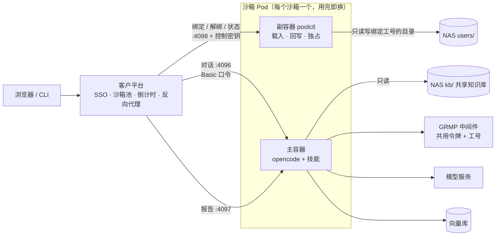
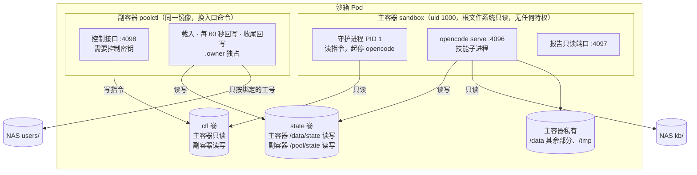
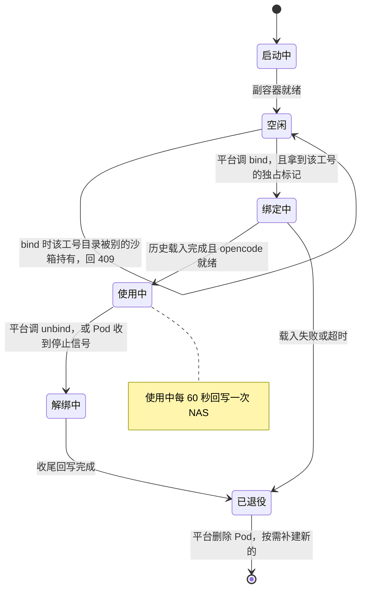
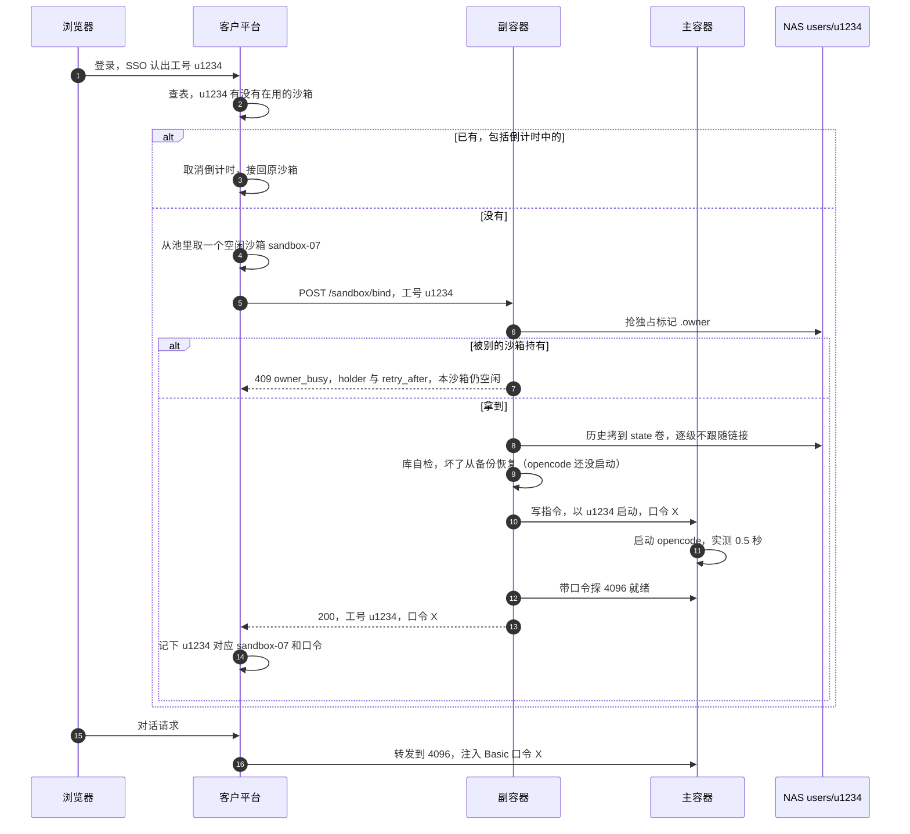
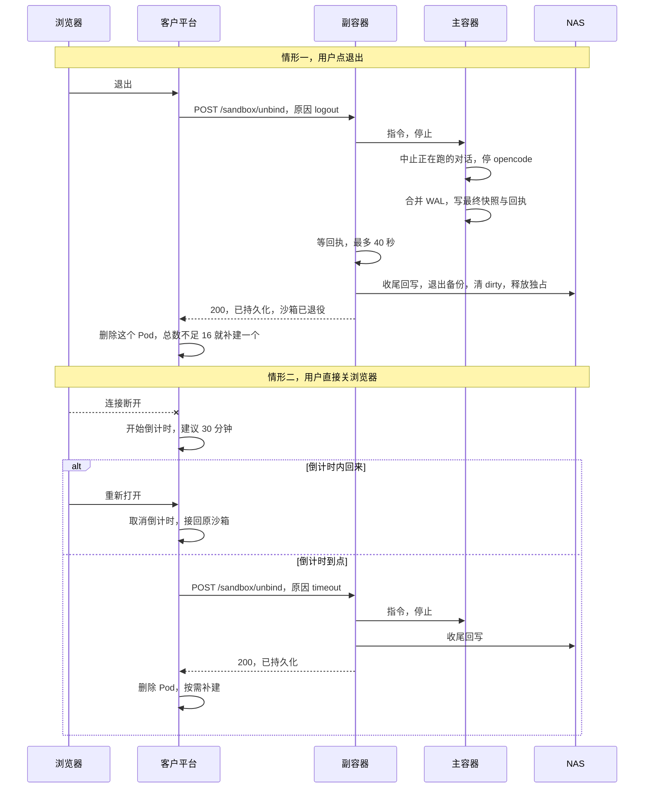

# 池化沙箱方案：预热的 runtime 池，登录时绑定、退出时持久化

设计日期：2026-10-13　基线：`agent-v1.1.5`（main `7e84c57`）　状态：**已确认，实施中**（计划版本 v1.2.0；2026-10-14 定：Q7 按「客户平台能用我方双容器模板」做，Q8 继续池化）

| 修订 | 内容 |
|---|---|
| 2026-10-13 初稿 | 预热池、绑定 / 解绑、用完即换、主副容器 |
| 2026-10-13 晚 | 按当天本地实测补充：§3.2 清空复用也能做（重启主容器）；§3.3 不预热的对比方案；§8.1 长期使用的数据增长与同步开销；§9.1 隔离实测记录；§12–§15 相应条目 |
| 2026-10-13 晚（二） | §3.4 业界对照（JupyterHub、agent-sandbox、sidecar 模式）；§4 镜像与容器的区别、副容器为何用同一镜像；§13 内核共享风险；§15 Q10、Q11 |
| 2026-10-14 实施前评审 | ① §9 防符号链接改为**按文件描述符**逐级不跟随（原「先 lstat 再复制」挡不住复制途中被换成链接），并补三个漏口：中间级目录、SQLite 按路径打开库、指向 `/proc/self/environ`；② §4、§8 绑定之后副容器不再用 SQLite 打开 state 卷，库的一致性快照改由主容器生成；③ §6.2、§6.3 补停止握手（直接删 Pod 时两个容器同时收到信号，没有先后）；④ §5、§7.1 独占冲突在进入「绑定中」之前判定，回 409 带 `retry_after`，沙箱保持空闲；⑤ §8.1 M1 合并没做完时不跳过；⑥ §11 模板补容器级安全设置，`users/` 属主是前提；⑦ §8 补 `gdaa/credentials`、`gdaa/key`。§15 Q7、Q8 已定 |

---

## 0. 一页看懂

**客户平台的用法**：集群启动时先建好 16 个沙箱；用户登录就占一个，第 17 个人来了再现建一个；
有人退出就回收，回收到总数 16 为止，留给后面的人用。

**现有 runtime 为什么不能直接放进这个池子**：现有设计是「一个 Pod 从建到删只属于一个人」，
工号、NAS 个人目录、对话库都在建 Pod 那一刻定死。池子里的沙箱是**先启动、后知道是谁**，
而且运行中的 Pod 不能再改挂载。

**本方案**：

1. 沙箱启动后处于「空闲」，只开一个控制端口，**不跑 opencode**。
2. 平台分配沙箱时调 **绑定**（只传工号）：沙箱把这个人的历史从 NAS 载入本地，再以这个工号启动 opencode。
3. 用户点退出、或关了浏览器且倒计时到点，平台调 **解绑**：沙箱把全部状态写回 NAS，然后**退役**。
4. 平台删掉退役的沙箱，总数不足 16 就补建一个新的空闲沙箱。**一个沙箱一生只服务一个人**（§3.2 讲为什么推荐这样，以及清空复用怎么做）。
5. 读写 NAS 的是沙箱里一个只跑我方代码的**副容器**；跑模型和技能的**主容器**看不到任何人的 NAS 目录。



**术语**

| 词 | 含义 |
|---|---|
| 沙箱 | 一个 Pod，内含主容器与副容器 |
| 绑定 | 把一个空闲沙箱交给某个工号：载入他的历史，以他的身份启动 opencode |
| 解绑 | 停止对话，把状态完整写回 NAS，沙箱进入「已退役」 |
| 退役 | 沙箱不再接受任何绑定，等平台删除 |
| 池 | 平台维护的沙箱集合，总数不少于 16 |

---

## 1. 已确认的需求

| # | 需求 | 确认时间 |
|---|---|---|
| R1 | 集群启动时预建 16 个沙箱；登录即占用；超过 16 人时按需新建；退出后回收，回收到总数 16 为止 | 2026-10-13 |
| R2 | GRMP 令牌**全体共用一个**；工号仍要随请求发给 GRMP | 2026-10-13（工号要求 09-20） |
| R3 | 用户点退出 = 立即退出 | 2026-10-13 |
| R4 | 用户关浏览器不立即退出，进入倒计时；倒计时到点时**先在 NAS 上持久化**，再释放或清空沙箱 | 2026-10-13 |
| R5 | 知识库管理员的 kb-import **不进池**，保持按人创建 | 2026-10-13 |
| R6 | 用户下次登录要能看到并接着之前的对话（由 R4「到点要持久化」推出） | 2026-10-13 |

R3 没有写「点退出也要持久化」。本方案按**点退出同样先持久化**处理，否则主动退出的人反而丢历史。

---

## 2. 现有 runtime 哪些东西在建 Pod 时就定死了

| 项 | 现在怎么来（`k8s/templates/runtime.yaml`、`docker/entrypoint.sh`） | 放进池子的问题 |
|---|---|---|
| 工号 `GSDB_USER_ID` | 环境变量；技能进程从 opencode 继承 | 沙箱启动时还没有人。配了「工号发给 GRMP」时，每次查库都会报错 |
| GRMP 令牌 | `grmp-token-<工号>` Secret 注入 | R2 后改成共用，问题消失 |
| NAS 个人目录 | 挂载 `subPath: users/<工号>` | 运行中的 Pod 不能改挂载 |
| 对话库 opencode.db | 启动时从个人目录载入本地，退出时写回 | 依赖上一条 |
| opencode 口令 | `pod-auth-<工号>` Secret，由网关首次登录时生成 | 客户平台不用我方网关，没人生成 |

---

## 3. 方案取舍（决策记录）

### 3.1 跨登录要不要保留历史

| 方案 | 做法 | 结论 |
|---|---|---|
| A. 沙箱一次性 | 不挂个人目录，退出即清空 | **不满足 R4/R6**，排除 |
| B. 保留历史，由副容器搬运 | 主容器不挂个人目录；副容器挂 `users/`，绑定时载入、解绑时写回 | **采用** |
| C. 主容器直接挂整个 `users/` | 绑定时选子目录 | **排除**：模型能执行命令，一句「列一下 /nas 下的目录」就能看到所有人的会话与报告 |

B 的早先版本是「由客户平台搬运状态包」，改成副容器后，客户平台不用碰状态，只调三个接口。

### 3.2 解绑之后：用完即换，还是清空复用

客户原话是「回收到 16 个就不回收了，供后面的人循环调用」，即同一个沙箱先后给不同的人用。
本方案建议换一种做法达到同样的效果：**退役的沙箱一律删除，总数不足 16 就补建一个新的。**
池子的数量规则与客户原话完全一致，用户感受也一样（登录总能拿到预热好的沙箱），区别只在平台内部。

| | **用完即换（推荐）** | 清空复用 |
|---|---|---|
| 用户感受 | 一样：登录拿到的都是预热好的沙箱 | 一样 |
| 一个沙箱服务几个人 | 一个 | 多个，先后 |
| 前一个人的文件残留 | 不可能：Pod 整个删掉 | 要逐块清空：工作盘、`/tmp`、`$HOME`、配置缓存目录 |
| 前一个人留下的后台进程 | 随 Pod 消失 | 重启主容器清掉（已实测，见下），**需平台核对重启次数** |
| 平台额外动作 | 每次退出后补建一个，约 6 秒，在后台，用户无感 | 每次退出后核对主容器重启次数 +1 |
| 我方实现 | 不需要清空与验证 | 重启主容器、清空全部可写盘、逐项验证 |
| 出错面 | 小：删掉就干净 | 大：任何一步失败都要退回「删除重建」 |

**难点在后台进程**：模型能执行命令，用户可以让它用 `nohup` 留一个后台进程，持续读工作盘。
下一个人绑定进来，这个进程就能读到他的数据。要排除它，就得确认主容器里的进程全都结束了，但：

- 副容器看不到主容器的进程。两个容器不共享进程空间，这是**刻意的**：如果共享，主容器
  可以经 `/proc/<副容器进程>/root` 读到副容器挂的 `users/`，也就是所有人的历史（§9.1 实测读到了）。
- 主容器发来的任何「已清理」信号，都可能是那个后台进程伪造的。

**2026-10-13 本地实测给出了解法**（OrbStack k8s v1.35，详见 §9.1）：

| 实验 | 结果 | 含义 |
|---|---|---|
| 从运行中的 Pod 里删掉或加回一个容器 | 被拒：`pod updates may not add or remove containers` | 「只回收副容器、主容器放回池子」做不到；两个容器同生同死。况且用户的痕迹都在主容器一侧，该扔的是主容器，不是副容器 |
| 让主容器的 1 号进程退出 | 只有主容器被重启，副容器启动时间不变 | 可以单独「刷新」主容器 |
| 重启前用户留的 `nohup` 后台进程 | **重启后全部消失** | 1 号进程退出时，内核杀掉同一容器里的所有进程——这一条不依赖主容器配合 |
| 重启前写的文件（`/data/state`、`/tmp`） | **仍在** | emptyDir 属于整个 Pod，不随容器重启清掉，必须另行清空 |

所以清空复用的安全做法是：

1. 解绑：中止对话、完整写回 NAS（与用完即换相同）；
2. 副容器下指令，主容器守护进程退出，kubelet 重启主容器——上一个人的进程全部结束；
3. 副容器清空主容器能写的每一块盘（state、`/data`、`/tmp`，并重置 ctl）——副容器因此要多挂这两块盘；
4. **平台经 k8s API 核对主容器的重启次数比解绑前 +1**。副容器看不到这个数，主容器的话又不可信，只能由平台核对；
5. 核对通过才把整个 Pod 标回「空闲」；任何一步失败或超时，就删除 Pod 重建。

这样「后台进程无法核实已清理」这条风险就关上了，不再需要客户书面接受。
**推荐仍然是用完即换**：步骤少，出错面小，用户感受没有差别。客户坚持复用时，按上面五步做。

### 3.3 对比方案：不预热，登录时按工号现建

**主副容器拆分的根源是「预热」，不是「复用」。** 沙箱在知道用户是谁之前就启动了，个人目录挂不进去，
运行中又不能加挂载，所以只能让一个挂着全部 `users/` 的组件来搬运，而这个组件不能和模型在同一个容器里。
反过来，如果平台在**用户登录时按工号现建** Pod，建的时候就知道该挂哪个目录：

- 不需要副容器，也不需要绑定 / 解绑接口；现有 runtime 镜像与模板几乎原样可用；
- 退出时正常删除 Pod，现有收尾逻辑就会把状态完整写回 NAS（09-21 实测），满足 R3/R4；
- 要改的只有：GRMP 改成一个共享 Secret；`pod-auth-<工号>` 由平台创建；
  修掉「kubelet 建出来的个人目录属主是 root、容器写不进」（v1.1.6 待修第 1 项）。

| | 预热池（本方案） | 登录时按工号现建 |
|---|---|---|
| 登录到能对话 | 约 1～2 秒（**估算**：载入历史 + opencode 启动 0.5 秒） | 新用户约 **6 秒**、有历史的用户约 **7.6 秒**（09-21 本地实测，镜像已在节点上） |
| 差距从哪来 | — | k8s 建 Pod 与起容器、启动脚本准备配置、就绪探针确认。模板里探针每 5 秒查一次，可能占好几秒；改成 1 秒估计降到 3～4 秒（**未实测**） |
| 某台节点第一次运行 | 镜像早已拉好 | 多出拉镜像的时间（约 150 MB，看内网仓库速度）；可在各节点预拉消除 |
| 从 NAS 载入历史 | 要 | 要（两种方式都省不掉，见 §8.1） |
| 我方开发量 | 副容器、三个控制接口、绑定状态机、安全测试 | 小改模板 + 一个已知 bug |
| 客户平台要做的 | 维护池子、分配、调接口、补建 | 登录时建 Pod，退出或倒计时到点时删 Pod |
| 出错面 | 大 | 小：就是现在已跑通的那套 |

**在「用完即换」前提下，预热换来的是登录时少等约 2～5 秒。** 如果客户能接受登录时等几秒
（页面显示「正在准备环境」），我方建议改走这条；只有客户必须预热时，才需要本方案的主副容器。见 §15 Q8。

现有按需模式（我方网关）保持不变，池化是**新增的第二种部署形态**。

### 3.4 业界对照

本方案的每个组成部分都有成熟的业界对应；但「预热池 + 跨登录保留历史 + 模型能执行命令」三条同时成立的整体形态，
没有现成的通用方案，是按客户需求组合出来的。

| 本方案的组成 | 业界对应 | 是否一致 |
|---|---|---|
| 一人一 Pod、每人一块持久盘、闲置回收 | **JupyterHub**（KubeSpawner）：用户登录时现建 Pod，每人一个持久卷（默认名 `claim-{username}`），闲置回收。Coder、Eclipse Che 等开发环境平台同类 | 一致，但它们是**登录时现建**——即我方现有网关模式与 §3.3 的对比方案。这是业界主流 |
| 缩短登录等待 | JupyterHub 不预热 Pod，而是用 DaemonSet **在每台节点预拉镜像**（continuous image puller），再用低优先级的**占位 Pod**（user placeholders）提前把节点扩出来。其文档指出镜像不在节点上时用户可能要等 5～10 分钟，那才是等待的大头 | 启示：按需现建 + 预拉镜像能解决大部分等待（§3.3） |
| 预热池、认领、后台补建（§3.2 用完即换） | **k8s 官方 SIG 的 agent-sandbox**（面向 AI agent 运行时）：`SandboxWarmPool` 维持预热沙箱，`SandboxClaim` 认领其中一个，池子在后台补建。第三方测试认领 53 毫秒，从零建约 25 秒（含拉镜像） | **高度一致** |
| 高权限副容器 + 共享盘 | sidecar 模式：**git-sync**（副容器拉代码写进共享盘）、**Vault Agent**（副容器持有 Vault 令牌，只把渲染好的密钥文件写进共享盘，应用容器拿不到令牌） | 一致：高权限的东西只在副容器，主容器只拿共享盘上的结果 |
| 认领后才知道是谁，再把他的历史搬进来 | agent-sandbox 文档里**没有**「认领时挂上某个人数据」的机制，它主要面向一次性或单例沙箱 | **业界没有直接对应**，由我方副容器实现，靠 §9、§14 的设计与测试保证 |

两点启示：

1. **agent-sandbox 可作为客户平台的参考实现。** 它的预热、认领、补建与 §5、§6.4 的形态几乎一样。
   客户平台已在自己管池子，大概率不用它；若客户集群允许安装它的控制器，也可评估由它管池子、我方副容器只负责数据。
   它目前是 v1.0.x，成熟度需评估。
2. **业界做这类沙箱通常再加一层运行时隔离。** agent-sandbox 推荐 gVisor 或 Kata Containers，原因正是沙箱里执行
   模型生成的命令。本方案目前只靠普通容器隔离（非 root、去掉全部特权、只读根文件系统），而普通容器与宿主机共用内核，
   内核有漏洞就可能逃逸。客户集群若提供 gVisor / Kata，沙箱模板加一行 `runtimeClassName` 即可用上（§13、§15 Q10）。

参考：[kubernetes-sigs/agent-sandbox](https://github.com/kubernetes-sigs/agent-sandbox)、
[Agent Sandbox 文档](https://agent-sandbox.sigs.k8s.io/docs/)、
[Agent Sandbox 实测（SREKubeCraft）](https://srekubecraft.io/posts/agent-sandbox/)、
[Zero to JupyterHub：用户存储](https://z2jh.jupyter.org/en/stable/jupyterhub/customizing/user-storage.html)、
[Zero to JupyterHub：优化（预拉镜像、占位 Pod）](https://z2jh.jupyter.org/en/stable/administrator/optimization.html)

---

## 4. 沙箱内部结构



| | 主容器 `sandbox` | 副容器 `poolctl` |
|---|---|---|
| 镜像 | `gaussdb-agent-runtime`（不变） | 同一个镜像，入口改为 `podctl pool-serve`，**不新增镜像** |
| 跑什么 | 守护进程 → opencode、技能、报告端口 | 控制接口、状态同步 |
| 能看到的 NAS | 只有 `kb/`（只读） | 只有 `users/`（读写） |
| 环境变量里的秘密 | 共用 GRMP 令牌、模型 key、向量库只读口令 | 控制密钥（**只在这里**） |
| 端口 | 4096 对话、4097 报告 | 4098 控制 |

**几个刻意的安排**

- **主容器的工作路径与现有模式完全一致**（`/data/state/xdg-data`、`/data/state/workspace` …）。
  opencode 按工作目录识别项目，会话挂在项目下；路径一变，旧会话就不在当前项目里显示。
  路径一致也意味着同一个用户可以在两种模式之间切换，NAS 上的数据**不需要迁移**。
- **ctl 卷在主容器里只读**：指令只能由副容器下达，模型改不了。
- **空闲时 opencode 不运行**：4096 端口不监听，平台误把用户路由到空闲沙箱只会连接失败，不会进入一个无主的会话。
- **opencode 口令每次绑定随机生成**，随绑定响应交给平台，不再需要 `pod-auth-*` Secret。
  模型能在自己的沙箱里读到这个口令，但这不带来任何新能力——它本来就在这个沙箱里。
- **绑定之后，state 卷对副容器是不可信输入**（2026-10-14 评审）。从 opencode 启动那一刻起，能执行命令的模型就能写 state 卷，
  而副容器挂着全部 `users/`。所以：
  - 副容器读写任何文件都**按文件描述符**、逐级不跟随符号链接（§9），不按路径；
  - 副容器**不用 SQLite 打开 state 卷上的任何文件**。库的一致性快照（合并 WAL + 在线备份）由主容器守护进程生成，
    写在 `/data/state/.pool/snap/` 下；副容器只把快照当普通文件搬运；
  - 绑定时的载入与库自检在 opencode 启动之前做，那时主容器还没执行过任何用户命令，可以照常用 SQLite。

**指令与回执**（两个方向各走一块盘，各自只有一方能写）

| 位置 | 谁写 | 内容 | 对方怎么看待它 |
|---|---|---|---|
| ctl `run.json` | 副容器 | `run` / `stop`、工号、本次 opencode 口令 | 主容器只认它；主容器重启后照它恢复 |
| ctl `snap.json` | 副容器 | 快照请求序号（定期回写前发） | — |
| state `.pool/snap/<相对路径>` | 主容器 | 各个库的一致性快照 | 副容器当普通文件搬运 |
| state `.pool/ack.json` | 主容器 | 已完成的快照序号、opencode 是否在跑、是否已最终停止、停止时是否中止了正在跑的对话 | 副容器只用它决定「等不等、何时搬」 |

回执与快照都可能被模型伪造或删掉。伪造的后果**只落在这个人自己的数据上**——与他本来就能删自己的会话同级，
读不到也改不到别人的目录，因为副容器不按路径跟随任何东西。

**镜像、容器与 Pod**：两个容器用**同一个镜像**启动，但它们是两个独立的运行实例。

| 概念 | 是什么 | 本方案 |
|---|---|---|
| 镜像 | 只读的模板：装了哪些程序与文件 | 一个：`gaussdb-agent-runtime` |
| 容器 | 用镜像启动的运行实例，有自己的文件系统、挂载、进程与环境变量 | 两个：主容器 `sandbox`、副容器 `poolctl` |
| Pod | 装容器的盒子，盒子里的容器一起调度、一起生死 | 一个沙箱 = 一个 Pod |

§9.1 实测的隔离（主容器看不到 `/pool`、读不到密钥）是**容器之间**的隔离，与是否同一个镜像无关。

**为什么副容器也用 runtime 镜像**

- 副容器要用的同步代码（`statesync.py`、`podctl.py`）与 Python 本来就在 runtime 镜像里；
- 不多构建、分发、扫描一个镜像——客户离线安装，每多一个镜像就多一份交付与安全审查；
- 同步代码与 opencode 永远同一版本，不会出现「副容器搬运的库格式与 opencode 对不上」；
- 节点上镜像只存一份，两个容器共用，不多占磁盘、不多拉一次。

**代价与另一种做法**：副容器里也带着 opencode 与 19 个技能，虽然从不运行。另一种做法是像网关那样给副容器
单独做一个小镜像（只装 Python 与同步代码，约 40 MB），更干净，代价是多交付一个镜像。本方案选同一个镜像；
客户安全审查要求「容器内只装用得到的东西」时再拆。

---

## 5. 沙箱的生命周期



- **任何进入过「绑定中」的沙箱都不再回到「空闲」**，绑定失败也一样直接退役：里面可能已经有了半份某人的数据。
- **独占标记在进入「绑定中」之前判定**：抢不到时还没碰任何人的数据，沙箱保持空闲、回 409 带 `retry_after`（§7.1），
  不为此白白退役一个沙箱。
- 已退役的沙箱拒绝一切绑定（409）。即使平台的映射表出错，也不会把 A 用过的沙箱交给 B。
- 收尾回写失败时同样退役，但 NAS 上的 `.state-dirty` 标记保留；这个人下次绑定时先给 NAS 上那份留快照、并在日志告警。

---

## 6. 关键时序

### 6.1 登录与绑定



### 6.2 退出：点退出，或关浏览器后倒计时到点



倒计时期间沙箱保持「使用中」，每 60 秒的定期回写照常进行，模型若还在跑也继续跑；到点时正在跑的那一轮被中止，已写出的部分保留。

**停止握手**：副容器要等主容器写完最终快照才能收尾回写，否则最后一段对话还没进库。主容器停完 opencode、
写完快照后在回执里标「已最终停止」；副容器最多等 40 秒（在解绑总时限 50 秒之内）。等不到就回写最近一次定期快照，
`.state-dirty` 保留，解绑回 500——这个人下次绑定按「上次非正常退出」处理（留快照、`unclean_last_time: true`）。
「中止正在跑的对话」用 opencode 1.18.27 的 `GET /session/status` 找出忙着的会话、逐个 `POST /session/{id}/abort`（10-14 实机核对过这两个接口）。

### 6.3 平台直接删 Pod / 沙箱被强杀

| 情况 | 结果 |
|---|---|
| 平台不调 unbind，直接正常删除 Pod | 两个容器**同时**收到停止信号，没有先后。主容器停 opencode、写最终快照与回执后退出；副容器按上面的停止握手等回执再收尾回写，与 unbind 等价。宽限期设 90 秒 |
| 内存超限、节点故障 | 来不及回写，**最多丢最近 60 秒**（09-21 已接受的代价）。`.state-dirty` 留在 NAS，下次绑定先快照并告警 |
| `--force --grace-period=0` | 10-14 实测：容器**仍会收到停止信号**，历史不大时副容器在那一两秒里就收尾干净了；历史大时可能来不及，退化成上一行。平台不要这么删 |
| 主容器崩溃重启（Pod 还在） | 守护进程重启后读到 ctl 里的「以 u1234 运行」指令，重新拉起 opencode；状态在 state 卷里，不丢 |
| 副容器崩溃重启 | 从自己的私有目录恢复「当前绑定的是谁」，继续定期回写；恢复不了就退役 |

### 6.4 池子数量的变化（与客户规则一致）

| 时刻 | 事件 | 使用中 | 空闲 | 总数 | 平台动作 |
|---|---|---|---|---|---|
| t0 | 集群启动 | 0 | 16 | 16 | 预建 16 个 |
| t1 | 16 人陆续登录 | 16 | 0 | 16 | 逐个绑定 |
| t2 | 第 17 人登录 | 17 | 0 | 17 | 现建 1 个再绑定，用户多等约 6 秒 |
| t3 | 2 人退出 | 15 | 1 | 16 | 删 2 个退役沙箱；总数 15 不足 16，补建 1 个空闲 |
| t4 | 又 10 人退出 | 5 | 11 | 16 | 删 10 个，补建 10 个 |

可选：平台可以始终多留 N 个空闲余量，让第 17 个人也不用等。这是平台侧参数，与我方无关。

---

## 7. 控制接口（副容器，端口 4098）

除 `/healthz` 外，所有请求都要带请求头 `X-Sandbox-Key: <控制密钥>`；不对回 401，不说明原因。
控制密钥是一个共享 Secret `sandbox-control`，**只注入副容器**，由平台持有。

### 7.1 绑定

```http
POST /sandbox/bind
X-Sandbox-Key: <控制密钥>
Content-Type: application/json

{"user_id": "u1234"}
```

成功（200）：

```json
{
  "sandbox": "sandbox-07",
  "state": "bound",
  "user_id": "u1234",
  "opencode": {"port": 4096, "username": "opencode", "password": "<本次随机生成>"},
  "reports_port": 4097,
  "loaded": {"files": 45, "dbs": 1, "mb": 3.2, "seconds": 1.4, "unclean_last_time": false}
}
```

| 返回码 | 含义 | 平台该怎么做 |
|---|---|---|
| 200 | 已绑定。对**同一工号**重复调用是幂等的，返回同样内容 | 记下口令，开始转发 |
| 400 | 工号格式不对（沿用网关规则 `^[a-z0-9]([a-z0-9-]{0,52}[a-z0-9])?$`，先转小写） | 检查 SSO 给的工号 |
| 401 | 控制密钥不对 | — |
| 409 `state` | 状态不对：已绑定别人 / 正在绑定 / 已退役 | 换一个空闲沙箱 |
| 409 `owner_busy` | 该工号的目录正被另一个沙箱持有（`.owner` 未过期）。响应带 `holder`（持有者 Pod 名）与 `retry_after`（秒）。**本沙箱保持空闲**，可以分给别人 | 该工号还有活着的沙箱 → 接回它（平台映射表漏了）；没有 → 上一个沙箱多半是被强杀的，标记最长 90 秒过期，等 `retry_after` 秒再绑定 |
| 500 / 504 | 载入失败，或 opencode 未在时限内就绪。**沙箱已退役**；响应带 `reason` 说明哪一步失败（例如 `users/` 不可写） | 删掉它，换一个空闲沙箱重试 |

409 的响应体都带 `reason`（`state` / `owner_busy`），平台据此分支，不靠解析文字。
`unclean_last_time: true` 表示这个人上次是非正常退出，最后 60 秒内的对话可能已丢失；平台可以选择提示用户。

### 7.2 解绑

```http
POST /sandbox/unbind
X-Sandbox-Key: <控制密钥>
Content-Type: application/json

{"user_id": "u1234", "reason": "logout"}
```

`reason` 取 `logout`（点退出）/ `timeout`（倒计时到点）/ `admin`（运维操作），只用于日志。
`user_id` 必须与当前绑定的工号一致，否则 409——防止平台映射出错时解绑了别人。

成功（200）：

```json
{
  "sandbox": "sandbox-07",
  "state": "retired",
  "user_id": "u1234",
  "aborted_running": true,
  "synced": {"files": 3, "dbs": 1, "mb": 0.4, "seconds": 0.8},
  "backup": "opencode.db.20261013T120000Z"
}
```

| 返回码 | 含义 | 平台该怎么做 |
|---|---|---|
| 200 | 已持久化，已退役 | 删除 Pod，按需补建 |
| 409 | 工号不一致，或沙箱不在「使用中」 | 核对映射表 |
| 500 | 收尾回写失败，或主容器 40 秒内没确认停止（已回写最近一次定期快照）。`.state-dirty` 保留，**沙箱同样已退役** | 照样删除 Pod；告警给运维 |

`aborted_running`：停止前 opencode 是否有正在跑的对话被中止（§6.2）。

解绑总时限 50 秒，小于 Pod 宽限期 90 秒。

### 7.3 状态与探针

- `GET /sandbox/status` → `{"sandbox", "state", "user_id", "bound_at", "last_sync_at", "last_sync"}`，**不返回口令**。
  `state` 取 `idle` / `binding` / `bound` / `unbinding` / `retired`。
- `GET /healthz` 不鉴权，只回 `{"ok": true}`，不带任何用户信息，给 k8s 探针用。

### 7.4 绑定之后怎么对话

与现有 runtime 完全相同：opencode 1.18.27 的 HTTP API，Basic 认证，用户名 `opencode`，口令取绑定响应里的 `password`。

```bash
B=http://<沙箱 Pod IP>:4096
A="-u opencode:<口令> -H Content-Type:application/json"
curl $A -d '{"title":"慢SQL排查"}' $B/session                     # 建会话，返回 {"id":"ses_..."}
curl $A -d '{"parts":[{"type":"text","text":"登录 10.0.0.9 的 postgres 库，看下最近的慢 SQL"}]}' \
     $B/session/ses_xxx/message                                    # 同步，模型跑完才返回
curl $A -d '{"parts":[{"type":"text","text":"..."}]}' $B/session/ses_xxx/prompt_async   # 异步，立即 204
curl $A $B/session/ses_xxx/message                                 # 取完整记录
```

模型提问要回答（`GET /question` → `POST /question/{requestID}/reply`），权限请求同理（`/permission`）；
否则会话一直等。库的信息写在消息正文里，第一条消息给出实例 IP 与库名。
平台若做流式转发，必须关闭缓冲、不设读超时（接入手册 §8.1）。

---

## 8. 数据：存什么、存在哪

NAS 上每个人的目录结构与现有模式**完全相同**，两种模式之间切换不需要迁移。

| NAS `users/<工号>/` | 内容 | 现有模式 | 池化模式 |
|---|---|---|---|
| `xdg-data/` | opencode.db（会话、消息、上下文压缩摘要、待办）、撤销用的 git 快照 | 载入本地，定期回写 | 同左，由副容器做 |
| `xdg-state/` | opencode 运行状态 | 同上 | 同上 |
| `workspace/` | 工作目录：上传、生成的文件 | 同上 | 同上 |
| `gdaa/sessions/` | 数据库登录句柄 | 直接放在 NAS 上 | 载入本地，定期回写 |
| `gdaa/config.yaml` | 中间件连接配置（不含令牌） | 每次启动重新生成 | 每次绑定重新生成，**不回写** |
| `gdaa/credentials/`、`gdaa/key` | 直连数据库的加密口令与钥匙。容器版连库只走中间件，用不到 | 留在 NAS | **不载入、不回写**，NAS 上原样保留 |
| `reports/` | 技能报告存档（大盘的数据） | 直接放在 NAS 上 | 载入本地，定期回写 |
| `backup/` | 退出时的库备份，保留 3 份 | 退出时写 | 解绑时写 |
| `.owner` | 独占标记：同一时刻只许一个沙箱使用这个目录 | 主容器持有 | **副容器**持有 |
| `.state-dirty`、`.unclean-*` | 非正常退出的标记与快照 | 同右 | 沿用 |

**能持久化与不能持久化的**

| 内容 | 结论 |
|---|---|
| 对话记录、模型上下文（opencode 每次提问都把历史重发给模型，上下文就是库里的历史与压缩摘要） | 能。opencode 没有独立的「记忆」组件，全部在 opencode.db 里（09-15 评估） |
| 工作目录文件、撤销快照、报告、登录句柄 | 能 |
| 解绑时模型正在跑的那一轮 | 只保留已写出的部分；这一轮被中止，不会在新沙箱里自动续跑 |
| 被强杀时最后 60 秒 | 丢失，可见（dirty 标记 + 快照 + 告警） |
| `/tmp`、`$HOME` 下的临时文件 | 不保留，与现有模式一致 |

「NAS 载入 → 本地读写 → 写回 → 重建后会话原样回来」这条链路在现有模式下已于 09-21 实测通过。
池化沿用它的规则（dirty 标记、非正常退出留快照、没载入成功不传播删除、库自检与从备份恢复），
差别在两处：搬运由副容器按绑定的工号做，且一律按文件描述符（`docker/fdtree.py`，两种模式共用）；
库不再由搬运方用 SQLite 读，而是搬主容器生成的快照（§4）。state 卷上的 `.pool/` 是两个容器之间的工作区，不回写 NAS。

### 8.1 长期使用：数据增长与同步开销

**结论**：一个人用得越久，要搬运的数据越多。影响有两处：登录时载入变慢；**每 60 秒回写的量变大**，后者更要紧。
两处都来自共用的同步代码，**现有按需模式（v1.1.5）同样存在**，不是池化特有的。

**实测样本**：Mac 上 opencode 1.18 自 2026-05-02 到 09-17 的真实数据（开发测试与诊断混用），共 149 个会话。

| 内容 | 大小 | 说明 |
|---|---|---|
| opencode.db | **40 MB** | 事件日志表 `event` 22.3 MB、消息内容表 `part` 11.2 MB（其中工具输出 6.1 MB）、`message` 0.7 MB |
| 日志 `log/` | 14 MB | 容器里启动时只保留 7 天（`podctl log-prune`），不会一直涨 |
| 撤销快照 `snapshot/` | 2.7 MB | 随工作目录文件变化而涨 |
| 合计 | 59 MB | |

增长集中在用得多的月份（8 月 36 个会话、9 月前半月 79 个）。按这两个月推算，高频用户的库**每月约 10～15 MB，
一年约 150 MB，三年约 400～500 MB**。这是单人样本的推算，只代表量级；DBA 天天跑健康检查，工具输出可能更多。

**两处影响**

| | 现在（约 40 MB） | 三年后（约 500 MB，推算） |
|---|---|---|
| 登录时载入 | 本机 SSD 实测 39.2 MB 用 0.05 秒（SQLite backup API，与同步代码相同）；NAS 按千兆网约 100 MB/s 估，不到 1 秒 | 约 5 秒以上，取决于 NAS |
| **每 60 秒回写** | 每人每分钟向 NAS 写 40 MB；16 人在线约 10 MB/s，持续 | 每人每分钟 500 MB；16 人约 130 MB/s，**超过千兆网 NAS 的上限** |

回写量大的原因：`statesync._copy_tree` 对数据库**每个周期都整库复制，不管有没有变化**。当初这样写是为了
不漏掉与同步发生在同一秒内的写入（代码注释里有说明）。代价是闲着的用户（比如倒计时中）也照样每分钟复制一遍。

**缓解措施**

| # | 措施 | 做法 | 状态 |
|---|---|---|---|
| M1 | **库没变就不回写** | 记下上次回写时本地库文件的纳秒级修改时间与大小，每轮 checkpoint 之后比一次，没变就跳过。用纳秒、并且跟「上次记录」比而不是跟目标文件比，就不会漏掉同一秒内的写入。**`-wal` 非空时一律不跳过**：checkpoint 遇到读者会返回 busy，WAL 里的提交还没进主库文件，只看主库文件会漏同步（10-14 评审补）。池化下这个判断由主容器在生成快照时做，副容器按快照文件的身份（inode、纳秒修改时间、大小）决定搬不搬 | 改我方同步代码；两种模式都受益，随 v1.2.0 |
| M2 | **老会话归档** | 超过 N 天的会话导出成文件，存到 `users/<工号>/archive/`（只在 NAS，不载入）；再用 opencode 接口 `DELETE /session/{id}` 删除，最后 `VACUUM` 压缩库。活跃的库因此有上限 | 10-13 实测：接口删会话时，它的事件日志一并删掉，不留残渣。删除后不 VACUUM 文件不会变小。N 取多少待定（§15 Q9） |
| M3 | 修剪旧工具输出 | 打开 opencode 配置 `compaction.prune`（默认关） | 配置项存在；对数据量与对话质量的效果**未测** |
| M4 | 关闭文件撤销快照 | opencode 配置 `snapshot: false`，代价是不能撤销文件改动 | DBA 场景很少改文件，可考虑；**未测** |
| M5 | 可见 | 绑定响应带「载入多少 MB、用了几秒」（§7.1 已有），超过阈值告警 | 设计已有 |

建议做 M1 与 M2：M1 解决持续写 NAS，M2 给库的大小封顶。M2 有一个产品问题要定：
**超过多久的历史可以不在对话列表里直接显示**，需要时怎么查归档。

---

## 9. 安全设计

| 风险 | 怎么挡 | 怎么验 |
|---|---|---|
| 模型读别人的历史 | 主容器**不挂** `users/`，只以 `subPath` 只读挂 `kb/`；`users/` 只挂给副容器 | §9.1 已实测；e2e：会话里让模型 `ls /nas`、`find / -name opencode.db` |
| 模型绕过挂载，自己挂 NAS 或直连 NFS 服务器 | 主容器非 root、去掉全部特权，没有挂载权限；出网规则不放行 NFS 端口 2049（挂载由节点上的 kubelet 完成，不走 Pod 网络，不受影响） | 挂载被拒已实测（§9.1）；出网规则依赖客户集群的网络插件执行（Calico / Cilium），在客户集群上验 |
| 打开「共享进程空间」后主容器读到副容器的一切 | 模板保持 `shareProcessNamespace` 为默认 false；清单守卫测试钉住 | §9.1 对照实验：打开后读到了密钥与别人的历史 |
| 模型调副容器接口，给自己换工号或解绑 | 接口要控制密钥，密钥只在副容器；两容器不共享进程空间，主容器读不到副容器的环境变量与文件 | e2e：主容器内 `curl 127.0.0.1:4098/sandbox/status` 不带密钥 → 401 |
| 模型改指令目录，伪造身份 | ctl 卷在主容器只读；副容器只认接口传入的工号，**从不从共享卷读身份** | e2e：主容器写 ctl 报只读文件系统 |
| **模型在工作目录放符号链接，或在复制途中把普通文件换成链接，诱使副容器把别人的文件拷进来** | 副容器读写一律**按文件描述符**：从根目录起逐级不跟随链接打开（`os.fwalk` + `O_NOFOLLOW`），打开之后再 `fstat` 确认是普通文件、且与根目录在同一设备上。判断与读取针对的是同一个已打开的对象，复制途中换成链接也换不走。写 NAS 同样逐级不跟随，临时文件独占创建、原子改名 | 单测：埋 `workspace/x → /pool/users/u9999/…`、中间级目录是链接、FIFO、「检查之后、打开之前」被换成链接，回写后 NAS 里没有 u9999 的任何内容 |
| 库文件经 SQLite **按路径**打开（合并 WAL 还是读写打开），链接指向别人的库就会读到、甚至写坏别人的库 | 绑定之后副容器不用 SQLite 打开 state 卷上的任何文件；库的一致性快照由主容器生成，副容器当普通文件搬（§4） | 单测：state 卷上的库换成指向 u9999 库的链接，回写后 u9999 的库字节不变、本人 NAS 里没有它的内容 |
| 链接指向 `/proc/self/environ`，把副容器自己的控制密钥搬进本人目录，下次登录就到了主容器手里 | 同上：只认与 state 卷同一设备的普通文件 | 单测 |
| NAS 本人目录里预先埋的链接（按需模式下主容器对本人目录可写，能留下 `.state-dirty`、`.owner`、`backup/` 下的链接，字符串在副容器里会被解析成 `/pool/users/…`） | 副容器对 NAS 的一切读写——载入、回写、`.owner`、dirty 标记、非正常退出快照、从备份恢复——都走同一套按文件描述符的代码 | 单测：埋 `.state-dirty → u9999 的库`、`backup/opencode.db.<时间> → u9999 的库`，绑定后 u9999 的库字节不变，恢复不会用它 |
| 工号里带 `../` | 工号格式校验（§7.1） | 单测 |
| 同一工号同时进两个沙箱，互相覆盖 | NAS 上 `.owner` 独占，沿用现有规则：30 秒刷新、90 秒过期。bind 不等待：标记被别的沙箱持有时立即回 409 `owner_busy` 带 `retry_after`（§7.1） | e2e：第二个 bind 回 409 |
| 平台映射出错，把 A 用过的沙箱交给 B | 退役沙箱拒绝绑定；unbind 必须带一致的工号 | 单测 |
| 前一个人的残留（文件、后台进程） | 用完即换，沙箱不复用（§3.2） | e2e：退役后再 bind 回 409 |
| 外部直连沙箱端口 | NetworkPolicy：4096 / 4097 / 4098 入站只放行客户平台 | 清单校验 |
| 共用 GRMP 令牌 | **我方挡不住**：所有人的数据库权限相同。工号随请求发给中间件，供其审计 | 残余风险，见 §13 |

**关于符号链接这一条**：现有 `statesync._copy_tree` 用 `shutil.copy2`，会跟随符号链接。
在现有模式下复制是主容器做的，主容器只挂了本人目录，所以没有跨用户的后果；
到了池化，复制由挂着**全部用户目录**的副容器来做，同样的代码就成了一个真实的泄露口子。
初稿的「先 `lstat`、是链接就跳过」挡不住**检查与使用之间被抢先**：模型在后台循环把同一个名字在普通文件与链接之间来回换，
检查时是普通文件、打开时已是链接，60 秒一次的回写里多试几次就能撞上。所以改为按文件描述符（2026-10-14 评审）。
普通文件的复制改走 `docker/fdtree.py` 这一处也会进入现有模式：只是更严，链接与非普通文件不再被跟随复制。

### 9.1 2026-10-13 本地实测记录

环境：Mac 上 OrbStack 自带 k8s（v1.35.6），用 `nginx:1.29-alpine` 代替真实镜像，挂载与权限设置按 §11 模板：
两个容器都以 uid 1000 运行、根文件系统只读、去掉全部特权；模拟 NAS 的盘上有 `kb/` 与 `users/u9999/opencode.db`。
以下命令都在**主容器**里执行。实验用的临时命名空间做完即删。

**主容器能看到什么（不共享进程空间，即本方案）**

| 尝试 | 结果 |
|---|---|
| 读共享知识库 `/nas/kb/rule.md` | 读到，正常使用不受影响 |
| `ls /nas` | 只有 `kb` |
| `ls /nas/users`、`ls /nas/kb/../users` | No such file or directory——`..` 走到的是镜像自带的空目录，不是 NAS 根目录 |
| 全盘搜 `opencode.db` | 搜不到 |
| 自建符号链接指向 `/nas/kb/../users` 再读 | 链接是断的，读不到 |
| `mount` 自己挂一个目录 | permission denied |
| 往知识库写 | Read-only file system |
| `ls /pool`（副容器的挂载点） | No such file or directory |
| 访问副容器的 `127.0.0.1:4098` | **通**——两个容器共享网络，所以控制接口必须带密钥 |
| 读两边共用的盘 | 读到副容器写入的文件 |
| 写只读的指令目录 | Read-only file system |
| 看进程 | 只有自己的 |
| 在 `/proc/*/environ` 里搜副容器的密钥 | 找不到 |
| 经 `/proc/<pid>/root` 读副容器挂的 `users/` | 读不到 |

**对照组：打开共享进程空间（`shareProcessNamespace: true`）**

| 尝试 | 结果 |
|---|---|
| 看进程 | **看到副容器的进程** |
| 搜副容器的密钥 | **从 `/proc/11/environ` 读到** |
| 经 `/proc/<pid>/root` 读副容器挂的 `users/` | **读到「A的历史」** |

所以「两个容器不共享进程空间」是这套隔离的必要条件，模板与清单守卫都要钉住。

**容器生命周期（§3.2 的依据）**

| 尝试 | 结果 |
|---|---|
| 从运行中的 Pod 里删掉副容器 | 被拒：`pod updates may not add or remove containers` |
| 主容器 1 号进程退出 | 只有主容器重启（重启次数 1），副容器启动时间不变 |
| 重启前留下的 `nohup` 后台进程 | 重启后没有了 |
| 重启前写的 `/data/state`、`/tmp` 文件 | 仍在 |
| 在主容器里 `kill -9 1` | 无效，1 号进程不受同容器内的 SIGKILL 影响 |

**未在本地验证**：出网规则挡住 NFS 端口 2049。这依赖客户集群的网络插件真正执行 NetworkPolicy，要在客户集群上验。

---

## 10. 客户平台要做的事（对接契约）

1. **维护池子**：启动时建 16 个沙箱（模板 `k8s/templates/sandbox.yaml`）；总数不少于 16；用户超出时现建。
2. **分配**：同一工号若已有沙箱（包括倒计时中的）必须接回原沙箱，**同一个人同一时刻只能有一个沙箱**；没有才取空闲的并调 `bind`。
3. **转发**：浏览器 → 沙箱 4096，注入 Basic `opencode:<口令>`；口令只留在平台，不下发到浏览器。流式转发必须关缓冲、不设读超时。
   大盘的 `/reports/*` 转到该用户沙箱的 4097（去掉前缀）。
4. **倒计时**：建议以「该用户到平台的最后一条连接断开」起算——opencode Web 页面开着时始终挂着一条事件流（SSE），页面关了它就断；重新连上即取消。
5. **点退出**：立即调 `unbind`。
6. **回收**：`unbind` 返回后删除 Pod（正常删除，宽限期 90 秒，**不要** `--force`）；总数不足 16 就补建一个新的空闲沙箱。退役的沙箱不要再分配。
7. **失败处理**：`bind` 返回 500/504 → 删掉该沙箱、换一个重试；`unbind` 返回 500 → 照样删除并告警。
8. **kb-import**：不进池，仍按人用 `k8s/templates/kb-import.yaml` 创建（需要 `pod-auth-<工号>`，不需要 GRMP 令牌），或只为管理员保留我方网关。

---

## 11. k8s 对象的变化

| 对象 | 现有按需模式 | 池化模式 |
|---|---|---|
| 用户容器 | Deployment `runtime-<工号>`，网关按人建 | **Pod `sandbox-<编号>`**，平台按池建，模板 `k8s/templates/sandbox.yaml`（新增） |
| Service | `runtime-<工号>` | 不需要，平台按 Pod IP 访问（也可按需为每个沙箱建一个） |
| opencode 口令 | Secret `pod-auth-<工号>` | **不需要**，每次绑定随机生成，随响应返回 |
| GRMP 令牌 | Secret `grmp-token-<工号>` | **共享 Secret `grmp-token`**（一个） |
| 控制密钥 | — | **新增**共享 Secret `sandbox-control`，只注入副容器 |
| NetworkPolicy | 入站只放行我方网关 | 新增 `sandbox-policy`：4096/4097/4098 入站只放行客户平台 |
| 不变 | `model-api`、`agent-config`、`grmp-sm2`（可选）、`vectordb-auth`（可选）、PVC `nas`、kb-import、向量库、大盘前端 | 同左 |

**为什么用裸 Pod，不用 Deployment / StatefulSet**：沙箱一生只服务一个人，用完即删，生死由平台决定。
Deployment 会在 Pod 消失时自动补一个新的空闲 Pod，这件事平台已经在做，两边一起做会多出沙箱；
StatefulSet 缩容只能删编号最大的那个，删不了指定的退役沙箱。

**模板草案**（实施时以代码为准）：

```yaml
apiVersion: v1
kind: Pod
metadata:
  name: sandbox-${SANDBOX_ID}
  namespace: gaussdb-agent
  labels: {app: gaussdb-agent, role: sandbox, sandbox: "${SANDBOX_ID}"}
spec:
  terminationGracePeriodSeconds: 90
  # runtimeClassName: gvisor                     # 客户集群提供 gVisor / Kata 时启用(§3.4、§15 Q10)
  enableServiceLinks: false                      # 不注入别的 Service 地址(现有模板同样关闭)
  securityContext: {runAsUser: 1000, runAsGroup: 1000, fsGroup: 1000, runAsNonRoot: true}
  # shareProcessNamespace 保持默认 false —— 见 §3.2、§9.1:共享会让主容器经 /proc 读到副容器的 users/ 与密钥
  containers:
    - name: sandbox                                # 主容器:opencode + 技能
      image: gaussdb-agent-runtime:${TAG}
      securityContext: {readOnlyRootFilesystem: true, allowPrivilegeEscalation: false, capabilities: {drop: [ALL]}}
      env:
        - {name: POOL_MODE, value: "1"}
        - {name: GRMP_AUTH_TOKEN, valueFrom: {secretKeyRef: {name: grmp-token, key: GRMP_AUTH_TOKEN}}}
        - {name: MODEL_API_KEY, valueFrom: {secretKeyRef: {name: model-api, key: MODEL_API_KEY}}}
        # GRMP_SM2_PRIVATE_KEY / KB_PG_* 同现有 runtime 模板
      envFrom: [{configMapRef: {name: agent-config}}]
      ports: [{containerPort: 4096}, {containerPort: 4097}]
      volumeMounts:
        - {name: nas, mountPath: /nas/kb, subPath: kb, readOnly: true}   # 只有共享知识库
        - {name: data, mountPath: /data}                                  # 配置缓存、$HOME,不持久化
        - {name: state, mountPath: /data/state}                           # 本人状态,副容器载入与回写
        - {name: ctl, mountPath: /run/sandbox, readOnly: true}           # 指令目录,只读
        - {name: tmp, mountPath: /tmp}
    - name: poolctl                                # 副容器:载入 / 回写 / 控制接口
      image: gaussdb-agent-runtime:${TAG}
      command: ["python3", "/opt/agent/podctl.py", "pool-serve"]
      securityContext: {readOnlyRootFilesystem: true, allowPrivilegeEscalation: false, capabilities: {drop: [ALL]}}
      env:
        - {name: SANDBOX_ID, value: "${SANDBOX_ID}"}
        - {name: POD_NAME, valueFrom: {fieldRef: {fieldPath: metadata.name}}}   # .owner 里记的持有者
        - {name: SANDBOX_CONTROL_KEY, valueFrom: {secretKeyRef: {name: sandbox-control, key: KEY}}}
      ports: [{containerPort: 4098}]
      readinessProbe: {httpGet: {path: /healthz, port: 4098}}
      volumeMounts:
        - {name: nas, mountPath: /pool/users, subPath: users}             # 全部用户目录,只有这里有
        - {name: state, mountPath: /pool/state}
        - {name: ctl, mountPath: /pool/ctl}
        - {name: poolpriv, mountPath: /pool/priv}                         # 记「当前绑定的是谁」
  volumes:
    - {name: nas, persistentVolumeClaim: {claimName: nas}}
    - {name: state, emptyDir: {sizeLimit: 10Gi}}
    - {name: ctl, emptyDir: {sizeLimit: 1Mi}}
    - {name: poolpriv, emptyDir: {sizeLimit: 1Mi}}
    - {name: data, emptyDir: {sizeLimit: 1Gi}}
    - {name: tmp, emptyDir: {sizeLimit: 1Gi}}
```

两个容器都要容器级的 `securityContext`（只读根文件系统、禁止提权、去掉全部特权）——§9.1 的实测就是这样设的，
清单守卫要一起钉住，不只钉 `shareProcessNamespace`。

副容器自己创建 `users/<工号>/`，属主是 1000。**前提是 NAS 上的 `users/` 本身已按部署手册改成 1000 所有**
（`chown -R 1000:1000`）。没改的话副容器连本人目录都建不出来，bind 回 500 并在 `reason` 里写明
「`users/` 不可写，属主 uid=…」。满足前提时，现有模式下「kubelet 建出来的目录属主是 root、容器写不进」那个问题
（v1.1.6 待修第 1 项）在池化路径上不会出现；按需模式仍需单独修。

---

## 12. 我方改动清单

| # | 文件 | 改动 | 归属 |
|---|---|---|---|
| 1 | `docker/poolctl.py`（新）、`docker/podctl.py` | 副容器：子命令 `pool-serve`——控制接口、绑定 / 解绑状态机、停止握手、定期回写、`.owner` 刷新、退役、从私有目录恢复 | 仅本仓库 |
| 2 | `docker/fdtree.py`（新） | 按文件描述符的遍历、复制、删除、小文件读写（§9）；两种模式共用 | 仅本仓库 |
| 2b | `docker/poolsync.py`（新） | 池化布局（含 `gdaa/sessions`、`reports`）的载入、回写、退出备份、非正常退出快照、库自检与从备份恢复、dirty 与 `.owner`，全部经 `fdtree` | 仅本仓库 |
| 2c | `docker/statesync.py` | 普通文件的复制改走 `fdtree`（现有模式更严、行为不变） | 仅本仓库 |
| 3 | `docker/poolrun.py`（新）、`docker/podctl.py`、`docker/entrypoint.sh` | 主容器：`POOL_MODE=1` 时 entrypoint 做完公共准备后交给守护进程 `pool-run`——读 ctl 起停 opencode 与报告端口、中止正在跑的对话、生成库快照、写回执；不碰 NAS | 仅本仓库 |
| 4 | `k8s/templates/sandbox.yaml`、`k8s/base/networkpolicy.yaml`、Secret 样例 | 新模板与策略 | 仅本仓库 |
| 5 | `scripts/k8s/pool-sim.py` | 平台模拟器：预建 16、分配、倒计时、解绑、补建。既是 e2e 工具，也是给客户平台的参考实现 | 仅本仓库 |
| 6 | 接入手册、参数手册、部署手册、功能清单 | 新增「池化接入」一章与参数 | 仅本仓库 |
| 7 | 测试 | 见 §14 | 仅本仓库 |
| 8 | `docker/statesync.py`、`docker/poolrun.py` | M1：库没变就不回写，`-wal` 非空不跳过（§8.1） | 仅本仓库；两种模式都用，随 v1.2.0 |
| 9 | `docker/podctl.py` | M2：新子命令 `session-archive`——超过 N 天的会话导出到 `archive/`、经 API 删除、VACUUM；默认关闭，确认 N 后开启 | 仅本仓库；两种模式都用 |
| 10 | 清单守卫测试 | 沙箱模板不得打开 `shareProcessNamespace`；主容器不得挂 `users/`；两个容器都有只读根文件系统、去掉全部特权、禁止提权 | 仅本仓库 |

**不改**：技能代码 `agent/`（工号发给 GRMP、报告落款已经读 `GSDB_USER_ID`）、网关、kb-import、向量库、大盘前端。现有按需模式行为不变。

---

## 13. 残余风险与限制

| 项 | 说明 |
|---|---|
| 共用 GRMP 令牌 | 所有人的数据库权限相同，按人授权在 GRMP 侧，不在我方 |
| 强杀丢最多 60 秒 | 本地读写 + 定期回写的架构代价，09-21 已接受；可见、不静默 |
| 解绑时正在跑的一轮被中止 | 倒计时建议不短于一次长任务（健康检查要几分钟） |
| 绑定耗时与回写量随历史增长 | 见 §8.1：载入随历史线性变慢；回写现为每 60 秒整库复制。靠 M1（不变不写）与 M2（老会话归档）封顶。实施时实测给出载入曲线 |
| 大盘只在用户有沙箱时有数据 | 报告端口在沙箱里；用户退出后大盘看不到（现有按需模式会自动拉起 Pod，池化不会） |
| 副容器挂着全部用户目录 | 它只跑我方代码、不执行模型命令；主要防线是 §9 的密钥、只读 ctl、不跟随符号链接，均有测试钉住 |
| 普通容器与宿主机共用内核 | 模型能执行命令，内核漏洞可能导致逃逸。业界做法是 gVisor / Kata 运行时（§3.4）；本方案不依赖它，客户集群提供时模板加 `runtimeClassName` 即可启用（§15 Q10） |

---

## 14. 测试方案

**单测**

- 副容器状态机：空闲 → 绑定 → 使用中 → 解绑 → 退役；退役后 bind 回 409；对同一工号重复 bind 幂等；unbind 工号不一致回 409。
- 工号校验、控制密钥校验（常量时间比较）。
- 符号链接：载入与回写两个方向都不跟随；埋在 `workspace/`、`xdg-data/` 下各一条指向别人目录的链接，NAS 结果里没有别人的内容。
- 按文件描述符（§9）：中间级目录是链接；FIFO 不卡住；「检查之后、打开之前」被换成链接（测试里在两步之间插入替换，确定性复现）；
  state 卷上的库换成指向别人库的链接；指向 `/proc/self/environ`；NAS 本人目录预先埋的 `.state-dirty`、`.owner`、`backup/` 链接——
  别人的文件字节不变、本人 NAS 里没有别人的内容。
- 停止握手：主容器写最终回执后副容器才收尾；等不到回执时回写最近一次快照、dirty 保留、回 500。
- 独占冲突：bind 立即回 409 `owner_busy` 带 `holder` 与 `retry_after`，沙箱仍是空闲、之后还能绑定别人。
- `gdaa/config.yaml` 不回写；`reports/`、`gdaa/sessions/` 回写。
- M1：库没变时不回写；与上次同步发生在同一秒内的写入仍会被回写；`-wal` 非空时一律回写。
- M2：超过 N 天的会话导出到 `archive/` 后从库里删除，事件日志一并删除，VACUUM 后文件变小；未超期的会话不受影响。
- 清单守卫：沙箱模板没有打开 `shareProcessNamespace`；主容器的挂载里没有 `users/`；两个容器都有只读根文件系统、去掉全部特权、禁止提权。

**本地集群 e2e**（OrbStack，`pool-sim.py` 扮演客户平台）

1. 预建 16 个；16 人登录全部秒级绑定；第 17 人触发现建。
2. A 对话后点退出 → NAS 有 A 的库；A 再登录分到**另一个**沙箱，旧会话可见、能接着聊。
3. 关浏览器模拟：倒计时内回来接回原沙箱；到点后持久化并补建，总数回到 16。
4. 同一工号同时 bind 两个沙箱 → 第二个 409。
5. 节点侧对主容器 `kill -9` → 下次绑定 `unclean_last_time: true`，NAS 有快照。
5b. 平台不调 unbind、直接正常删除 Pod → 最后一段对话在 NAS 上（验证停止握手在两个容器同时收到信号时成立）。
6. 模型级越权尝试：让模型 `ls /nas`、读 `/pool`、`curl 127.0.0.1:4098`、写 `/run/sandbox`、埋符号链接——全部失败。
7. 工号随 GRMP 请求发出（签名 mock 8782 校验请求头），报告落款是绑定的工号。
8. 现有按需模式全套回归（网关、kb-import、大盘、矩阵）不受影响。
9. 载入曲线：造 50 / 200 / 500 MB 的历史，分别测绑定耗时，以及 16 个沙箱同时在线时每分钟写 NAS 的量（M1 前后对比）。
10. 若客户选清空复用：按 §3.2 五步走一遍，复用前埋的后台进程与文件在下一个人绑定后都不存在；平台核对不到重启次数 +1 时不复用。

**模型级**：DeepSeek 经 `pool-sim.py` 走一遍「登录 → 诊断 → 退出 → 再登录接着问」。

---

## 15. 待确认

| # | 事项 | 我方建议 |
|---|---|---|
| Q1 | 解绑后用完即换，还是清空复用（§3.2） | **用完即换**；若坚持清空复用，按 §3.2 五步做，平台须核对主容器重启次数 |
| Q2 | 点退出是否同样先持久化 | 是 |
| Q3 | 倒计时时长，以及平台怎么判断浏览器已关 | 30 分钟，可配；以最后一条连接断开起算 |
| Q4 | 池子的上限（超过 16 后最多建几个） | 平台侧参数，按集群资源定：每个沙箱上限 2 CPU / 2Gi |
| Q5 | 平台调用控制接口用一把共用密钥是否可接受 | 可接受；密钥只在平台与副容器 |
| Q6 | 池化下是否使用四个大盘 | 若使用，平台需按 §10 第 3 条路由 `/reports/*` |
| Q7 | 客户平台建沙箱时能否使用我方的双容器 Pod 模板 | **已定（2026-10-14）：按能用实施。** 若之后发现客户的「沙箱」是平台自定义的单容器 Pod，或根本不是 k8s Pod，副容器放不进去，方案要改 |
| Q8 | 登录时等几秒能否接受；「预启 16 个」是硬要求还是平台现有做法（§3.3） | **已定（2026-10-14）：继续池化**，按 R1 预建 16 个。§3.3 留作对比记录 |
| Q9 | 超过多久的会话可以不在对话列表里直接显示（§8.1 M2），归档内容需要时怎么查 | 180 天；归档以文件形式留在本人 NAS 目录 |
| Q10 | 客户集群是否提供 gVisor 或 Kata Containers 运行时（§3.4、§13） | 有就启用；没有不影响本方案，但记为残余风险 |
| Q11 | 副容器是否要求单独的最小镜像（§4） | 默认与主容器同一镜像；客户安全审查要求时再拆 |
