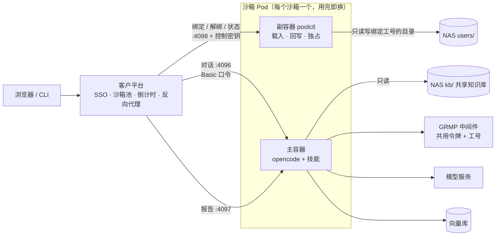
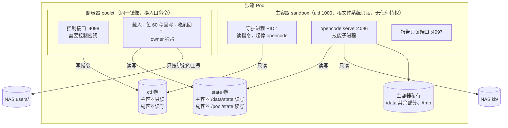
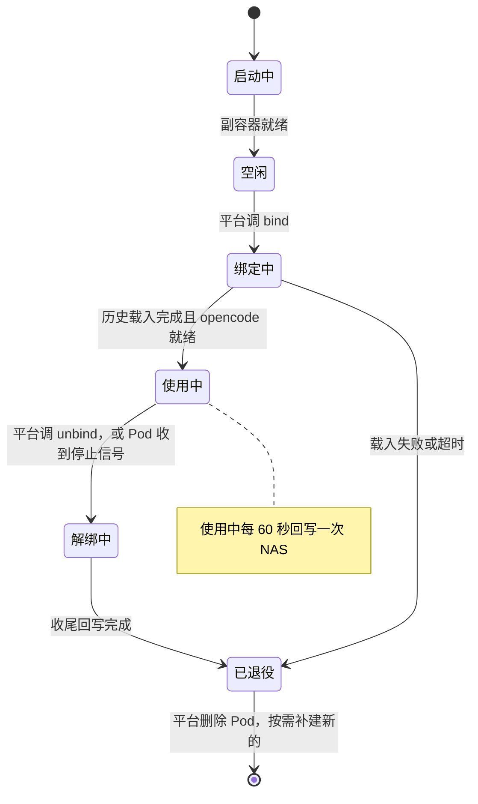
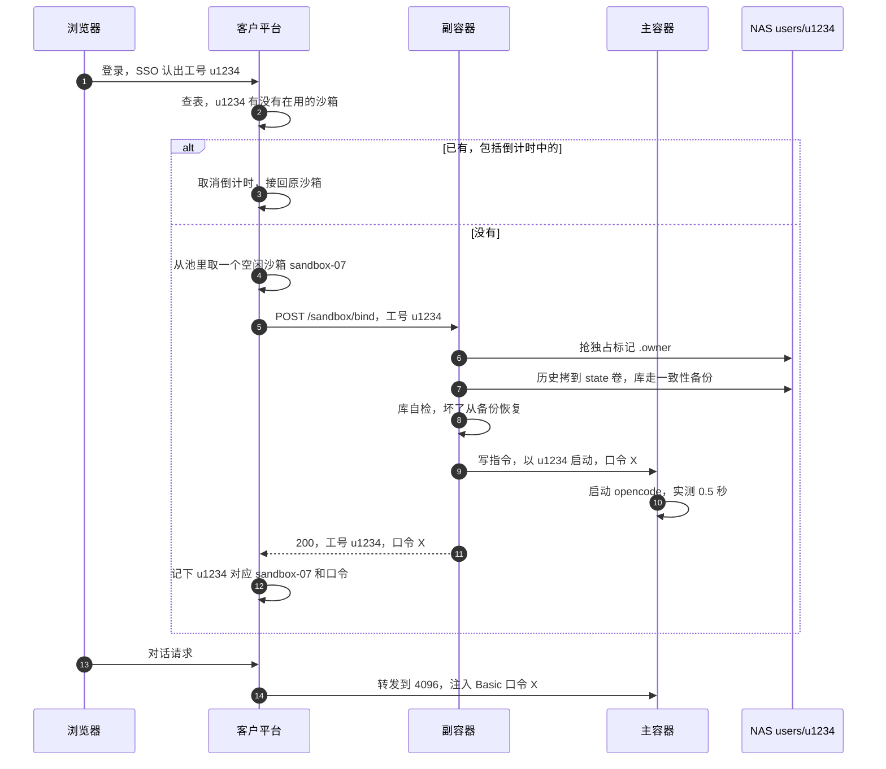
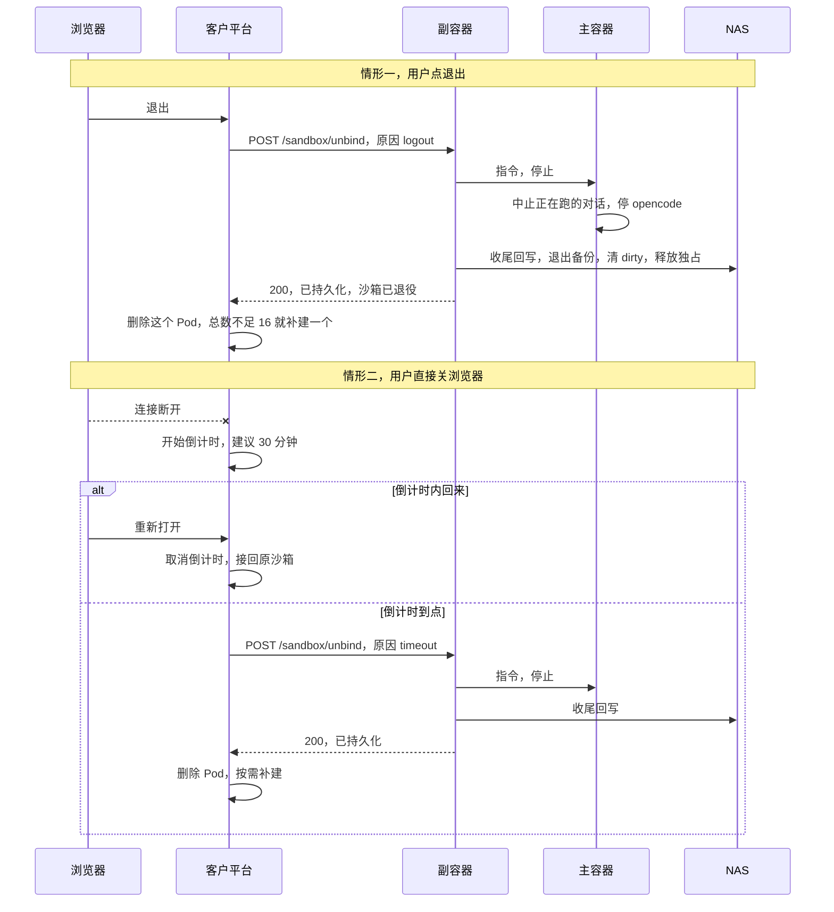

# 池化沙箱方案：预热的 runtime 池，登录时绑定、退出时持久化

设计日期：2026-10-13　基线：`agent-v1.1.5`（main `7e84c57`）　状态：**方案稿，待确认后实施**（计划版本 v1.2.0）

---

## 0. 一页看懂

**客户平台的用法**：集群启动时先建好 16 个沙箱；用户登录就占一个，第 17 个人来了再现建一个；
有人退出就回收，回收到总数 16 为止，留给后面的人用。

**现有 runtime 为什么不能直接放进这个池子**：现有设计是「一个 Pod 从建到删只属于一个人」，
工号、NAS 个人目录、对话库都在建 Pod 那一刻定死。池子里的沙箱是**先启动、后知道是谁**，
而且运行中的 Pod 不能再改挂载。

**本方案**：

1. 沙箱启动后处于「空闲」，只开一个控制端口，**不跑 opencode**。
2. 平台分配沙箱时调 **绑定**（只传工号）：沙箱把这个人的历史从 NAS 载入本地，再以这个工号启动 opencode。
3. 用户点退出、或关了浏览器且倒计时到点，平台调 **解绑**：沙箱把全部状态写回 NAS，然后**退役**。
4. 平台删掉退役的沙箱，总数不足 16 就补建一个新的空闲沙箱。**一个沙箱一生只服务一个人**（§3 讲为什么不清空复用）。
5. 读写 NAS 的是沙箱里一个只跑我方代码的**副容器**；跑模型和技能的**主容器**看不到任何人的 NAS 目录。



**术语**

| 词 | 含义 |
|---|---|
| 沙箱 | 一个 Pod，内含主容器与副容器 |
| 绑定 | 把一个空闲沙箱交给某个工号：载入他的历史，以他的身份启动 opencode |
| 解绑 | 停止对话，把状态完整写回 NAS，沙箱进入「已退役」 |
| 退役 | 沙箱不再接受任何绑定，等平台删除 |
| 池 | 平台维护的沙箱集合，总数不少于 16 |

---

## 1. 已确认的需求

| # | 需求 | 确认时间 |
|---|---|---|
| R1 | 集群启动时预建 16 个沙箱；登录即占用；超过 16 人时按需新建；退出后回收，回收到总数 16 为止 | 2026-10-13 |
| R2 | GRMP 令牌**全体共用一个**；工号仍要随请求发给 GRMP | 2026-10-13（工号要求 09-20） |
| R3 | 用户点退出 = 立即退出 | 2026-10-13 |
| R4 | 用户关浏览器不立即退出，进入倒计时；倒计时到点时**先在 NAS 上持久化**，再释放或清空沙箱 | 2026-10-13 |
| R5 | 知识库管理员的 kb-import **不进池**，保持按人创建 | 2026-10-13 |
| R6 | 用户下次登录要能看到并接着之前的对话（由 R4「到点要持久化」推出） | 2026-10-13 |

R3 没有写「点退出也要持久化」。本方案按**点退出同样先持久化**处理，否则主动退出的人反而丢历史。

---

## 2. 现有 runtime 哪些东西在建 Pod 时就定死了

| 项 | 现在怎么来（`k8s/templates/runtime.yaml`、`docker/entrypoint.sh`） | 放进池子的问题 |
|---|---|---|
| 工号 `GSDB_USER_ID` | 环境变量；技能进程从 opencode 继承 | 沙箱启动时还没有人。配了「工号发给 GRMP」时，每次查库都会报错 |
| GRMP 令牌 | `grmp-token-<工号>` Secret 注入 | R2 后改成共用，问题消失 |
| NAS 个人目录 | 挂载 `subPath: users/<工号>` | 运行中的 Pod 不能改挂载 |
| 对话库 opencode.db | 启动时从个人目录载入本地，退出时写回 | 依赖上一条 |
| opencode 口令 | `pod-auth-<工号>` Secret，由网关首次登录时生成 | 客户平台不用我方网关，没人生成 |

---

## 3. 方案取舍（决策记录）

### 3.1 跨登录要不要保留历史

| 方案 | 做法 | 结论 |
|---|---|---|
| A. 沙箱一次性 | 不挂个人目录，退出即清空 | **不满足 R4/R6**，排除 |
| B. 保留历史，由副容器搬运 | 主容器不挂个人目录；副容器挂 `users/`，绑定时载入、解绑时写回 | **采用** |
| C. 主容器直接挂整个 `users/` | 绑定时选子目录 | **排除**：模型能执行命令，一句「列一下 /nas 下的目录」就能看到所有人的会话与报告 |

B 的早先版本是「由客户平台搬运状态包」，改成副容器后，客户平台不用碰状态，只调三个接口。

### 3.2 解绑之后：用完即换，还是清空复用

客户原话是「回收到 16 个就不回收了，供后面的人循环调用」，即同一个沙箱先后给不同的人用。
本方案建议换一种做法达到同样的效果：**退役的沙箱一律删除，总数不足 16 就补建一个新的。**
池子的数量规则与客户原话完全一致，用户感受也一样（登录总能拿到预热好的沙箱），区别只在平台内部。

| | **用完即换（推荐）** | 清空复用 |
|---|---|---|
| 用户感受 | 一样：登录拿到的都是预热好的沙箱 | 一样 |
| 一个沙箱服务几个人 | 一个 | 多个，先后 |
| 前一个人的文件残留 | 不可能：Pod 整个删掉 | 要逐块清空：工作盘、`/tmp`、`$HOME`、配置缓存目录 |
| 前一个人留下的后台进程 | 随 Pod 消失 | **无法独立验证已清理**（见下） |
| 平台额外动作 | 每次退出后补建一个，约 6 秒，在后台，用户无感 | 无 |
| 我方实现 | 不需要清空与验证 | 清空、验证、进程清理，且有一处关不掉的风险 |

**清空复用关不掉的那一处**：模型能执行命令，用户可以让它用 `nohup` 留一个后台进程，持续读工作盘。
下一个人绑定进来，这个进程就能读到他的数据。要排除它，就得确认主容器里的进程全都结束了，但：

- 副容器看不到主容器的进程。两个容器不共享进程空间，这是**刻意的**：如果共享，主容器（同为 uid 1000）
  可以经 `/proc/<副容器进程>/root` 读到副容器挂的 `users/`，也就是所有人的历史。
- 主容器发来的任何「已清理」信号，都可能是那个后台进程伪造的。

所以在清空复用下，「上一个人的进程已全部结束」这件事**副容器无法独立核实**，只能靠主容器自己的守护进程去杀，
再加时间窗口兜底。用完即换从结构上消除了这类问题，代价只是平台每次多建一个 Pod。

如果客户坚持清空复用，需要我方额外实现清空与验证，并请客户书面确认接受上面这条残余风险。

### 3.3 参考：现有按需模式

不用池子、来一个人建一个 Pod 的现有模式，实测新建约 6 秒、从 0 拉起约 7.6 秒（09-21）。
池子省下的就是这几秒。现有模式与网关保持不变，池化是**新增的第二种部署形态**。

---

## 4. 沙箱内部结构



| | 主容器 `sandbox` | 副容器 `poolctl` |
|---|---|---|
| 镜像 | `gaussdb-agent-runtime`（不变） | 同一个镜像，入口改为 `podctl pool-serve`，**不新增镜像** |
| 跑什么 | 守护进程 → opencode、技能、报告端口 | 控制接口、状态同步 |
| 能看到的 NAS | 只有 `kb/`（只读） | 只有 `users/`（读写） |
| 环境变量里的秘密 | 共用 GRMP 令牌、模型 key、向量库只读口令 | 控制密钥（**只在这里**） |
| 端口 | 4096 对话、4097 报告 | 4098 控制 |

**几个刻意的安排**

- **主容器的工作路径与现有模式完全一致**（`/data/state/xdg-data`、`/data/state/workspace` …）。
  opencode 按工作目录识别项目，会话挂在项目下；路径一变，旧会话就不在当前项目里显示。
  路径一致也意味着同一个用户可以在两种模式之间切换，NAS 上的数据**不需要迁移**。
- **ctl 卷在主容器里只读**：指令只能由副容器下达，模型改不了。
- **空闲时 opencode 不运行**：4096 端口不监听，平台误把用户路由到空闲沙箱只会连接失败，不会进入一个无主的会话。
- **opencode 口令每次绑定随机生成**，随绑定响应交给平台，不再需要 `pod-auth-*` Secret。
  模型能在自己的沙箱里读到这个口令，但这不带来任何新能力——它本来就在这个沙箱里。

---

## 5. 沙箱的生命周期



- **任何进入过「绑定中」的沙箱都不再回到「空闲」**，绑定失败也一样直接退役：里面可能已经有了半份某人的数据。
- 已退役的沙箱拒绝一切绑定（409）。即使平台的映射表出错，也不会把 A 用过的沙箱交给 B。
- 收尾回写失败时同样退役，但 NAS 上的 `.state-dirty` 标记保留；这个人下次绑定时先给 NAS 上那份留快照、并在日志告警。

---

## 6. 关键时序

### 6.1 登录与绑定



### 6.2 退出：点退出，或关浏览器后倒计时到点



倒计时期间沙箱保持「使用中」，每 60 秒的定期回写照常进行，模型若还在跑也继续跑；到点时正在跑的那一轮被中止，已写出的部分保留。

### 6.3 平台直接删 Pod / 沙箱被强杀

| 情况 | 结果 |
|---|---|
| 平台不调 unbind，直接正常删除 Pod | 两个容器都收到停止信号；副容器照样走收尾回写，与 unbind 等价。宽限期设 90 秒 |
| 内存超限、节点故障、`--force --grace-period=0` | 来不及回写，**最多丢最近 60 秒**（09-21 已接受的代价）。`.state-dirty` 留在 NAS，下次绑定先快照并告警 |
| 主容器崩溃重启（Pod 还在） | 守护进程重启后读到 ctl 里的「以 u1234 运行」指令，重新拉起 opencode；状态在 state 卷里，不丢 |
| 副容器崩溃重启 | 从自己的私有目录恢复「当前绑定的是谁」，继续定期回写；恢复不了就退役 |

### 6.4 池子数量的变化（与客户规则一致）

| 时刻 | 事件 | 使用中 | 空闲 | 总数 | 平台动作 |
|---|---|---|---|---|---|
| t0 | 集群启动 | 0 | 16 | 16 | 预建 16 个 |
| t1 | 16 人陆续登录 | 16 | 0 | 16 | 逐个绑定 |
| t2 | 第 17 人登录 | 17 | 0 | 17 | 现建 1 个再绑定，用户多等约 6 秒 |
| t3 | 2 人退出 | 15 | 1 | 16 | 删 2 个退役沙箱；总数 15 不足 16，补建 1 个空闲 |
| t4 | 又 10 人退出 | 5 | 11 | 16 | 删 10 个，补建 10 个 |

可选：平台可以始终多留 N 个空闲余量，让第 17 个人也不用等。这是平台侧参数，与我方无关。

---

## 7. 控制接口（副容器，端口 4098）

除 `/healthz` 外，所有请求都要带请求头 `X-Sandbox-Key: <控制密钥>`；不对回 401，不说明原因。
控制密钥是一个共享 Secret `sandbox-control`，**只注入副容器**，由平台持有。

### 7.1 绑定

```http
POST /sandbox/bind
X-Sandbox-Key: <控制密钥>
Content-Type: application/json

{"user_id": "u1234"}
```

成功（200）：

```json
{
  "sandbox": "sandbox-07",
  "state": "bound",
  "user_id": "u1234",
  "opencode": {"port": 4096, "username": "opencode", "password": "<本次随机生成>"},
  "reports_port": 4097,
  "loaded": {"files": 45, "dbs": 1, "mb": 3.2, "seconds": 1.4, "unclean_last_time": false}
}
```

| 返回码 | 含义 | 平台该怎么做 |
|---|---|---|
| 200 | 已绑定。对**同一工号**重复调用是幂等的，返回同样内容 | 记下口令，开始转发 |
| 400 | 工号格式不对（沿用网关规则 `^[a-z0-9]([a-z0-9-]{0,52}[a-z0-9])?$`，先转小写） | 检查 SSO 给的工号 |
| 401 | 控制密钥不对 | — |
| 409 | 状态不对：已绑定别人 / 已退役 / 该工号正被另一个沙箱使用（`.owner` 未过期） | 前两种换一个空闲沙箱；第三种说明平台映射表漏了，应把用户接回那个沙箱 |
| 500 / 504 | 载入失败，或 opencode 未在时限内就绪。**沙箱已退役** | 删掉它，换一个空闲沙箱重试 |

`unclean_last_time: true` 表示这个人上次是非正常退出，最后 60 秒内的对话可能已丢失；平台可以选择提示用户。

### 7.2 解绑

```http
POST /sandbox/unbind
X-Sandbox-Key: <控制密钥>
Content-Type: application/json

{"user_id": "u1234", "reason": "logout"}
```

`reason` 取 `logout`（点退出）/ `timeout`（倒计时到点）/ `admin`（运维操作），只用于日志。
`user_id` 必须与当前绑定的工号一致，否则 409——防止平台映射出错时解绑了别人。

成功（200）：

```json
{
  "sandbox": "sandbox-07",
  "state": "retired",
  "user_id": "u1234",
  "aborted_running": true,
  "synced": {"files": 3, "dbs": 1, "mb": 0.4, "seconds": 0.8},
  "backup": "opencode.db.20261013T120000Z"
}
```

| 返回码 | 含义 | 平台该怎么做 |
|---|---|---|
| 200 | 已持久化，已退役 | 删除 Pod，按需补建 |
| 409 | 工号不一致，或沙箱不在「使用中」 | 核对映射表 |
| 500 | 收尾回写失败，`.state-dirty` 保留，**沙箱同样已退役** | 照样删除 Pod；告警给运维 |

解绑总时限 50 秒，小于 Pod 宽限期 90 秒。

### 7.3 状态与探针

- `GET /sandbox/status` → `{"sandbox", "state", "user_id", "bound_at", "last_sync_at", "last_sync"}`，**不返回口令**。
  `state` 取 `idle` / `binding` / `bound` / `unbinding` / `retired`。
- `GET /healthz` 不鉴权，只回 `{"ok": true}`，不带任何用户信息，给 k8s 探针用。

### 7.4 绑定之后怎么对话

与现有 runtime 完全相同：opencode 1.18.27 的 HTTP API，Basic 认证，用户名 `opencode`，口令取绑定响应里的 `password`。

```bash
B=http://<沙箱 Pod IP>:4096
A="-u opencode:<口令> -H Content-Type:application/json"
curl $A -d '{"title":"慢SQL排查"}' $B/session                     # 建会话，返回 {"id":"ses_..."}
curl $A -d '{"parts":[{"type":"text","text":"登录 10.0.0.9 的 postgres 库，看下最近的慢 SQL"}]}' \
     $B/session/ses_xxx/message                                    # 同步，模型跑完才返回
curl $A -d '{"parts":[{"type":"text","text":"..."}]}' $B/session/ses_xxx/prompt_async   # 异步，立即 204
curl $A $B/session/ses_xxx/message                                 # 取完整记录
```

模型提问要回答（`GET /question` → `POST /question/{requestID}/reply`），权限请求同理（`/permission`）；
否则会话一直等。库的信息写在消息正文里，第一条消息给出实例 IP 与库名。
平台若做流式转发，必须关闭缓冲、不设读超时（接入手册 §8.1）。

---

## 8. 数据：存什么、存在哪

NAS 上每个人的目录结构与现有模式**完全相同**，两种模式之间切换不需要迁移。

| NAS `users/<工号>/` | 内容 | 现有模式 | 池化模式 |
|---|---|---|---|
| `xdg-data/` | opencode.db（会话、消息、上下文压缩摘要、待办）、撤销用的 git 快照 | 载入本地，定期回写 | 同左，由副容器做 |
| `xdg-state/` | opencode 运行状态 | 同上 | 同上 |
| `workspace/` | 工作目录：上传、生成的文件 | 同上 | 同上 |
| `gdaa/sessions/` | 数据库登录句柄 | 直接放在 NAS 上 | 载入本地，定期回写 |
| `gdaa/config.yaml` | 中间件连接配置（不含令牌） | 每次启动重新生成 | 每次绑定重新生成，**不回写** |
| `reports/` | 技能报告存档（大盘的数据） | 直接放在 NAS 上 | 载入本地，定期回写 |
| `backup/` | 退出时的库备份，保留 3 份 | 退出时写 | 解绑时写 |
| `.owner` | 独占标记：同一时刻只许一个沙箱使用这个目录 | 主容器持有 | **副容器**持有 |
| `.state-dirty`、`.unclean-*` | 非正常退出的标记与快照 | 同右 | 沿用 |

**能持久化与不能持久化的**

| 内容 | 结论 |
|---|---|
| 对话记录、模型上下文（opencode 每次提问都把历史重发给模型，上下文就是库里的历史与压缩摘要） | 能。opencode 没有独立的「记忆」组件，全部在 opencode.db 里（09-15 评估） |
| 工作目录文件、撤销快照、报告、登录句柄 | 能 |
| 解绑时模型正在跑的那一轮 | 只保留已写出的部分；这一轮被中止，不会在新沙箱里自动续跑 |
| 被强杀时最后 60 秒 | 丢失，可见（dirty 标记 + 快照 + 告警） |
| `/tmp`、`$HOME` 下的临时文件 | 不保留，与现有模式一致 |

「NAS 载入 → 本地读写 → 写回 → 重建后会话原样回来」这条链路在现有模式下已于 09-21 实测通过；
池化复用同一套同步代码（`docker/statesync.py`），新增的是「何时载入、写回到谁的目录」由副容器按绑定决定。

---

## 9. 安全设计

| 风险 | 怎么挡 | 怎么验 |
|---|---|---|
| 模型读别人的历史 | 主容器**不挂** `users/`，只有副容器挂 | e2e：会话里让模型 `ls /nas`、`find / -name opencode.db` |
| 模型调副容器接口，给自己换工号或解绑 | 接口要控制密钥，密钥只在副容器；两容器不共享进程空间，主容器读不到副容器的环境变量与文件 | e2e：主容器内 `curl 127.0.0.1:4098/sandbox/status` 不带密钥 → 401 |
| 模型改指令目录，伪造身份 | ctl 卷在主容器只读；副容器只认接口传入的工号，**从不从共享卷读身份** | e2e：主容器写 ctl 报只读文件系统 |
| **模型在工作目录放符号链接，诱使副容器把别人的文件拷进来** | 副容器复制时一律 `lstat`，**跳过符号链接与一切非普通文件**；写入前再断言目标真实路径落在 `users/<绑定工号>/` 之内 | 单测：埋 `workspace/x → /pool/users/u9999/xdg-data/opencode/opencode.db`，回写后 NAS 里没有 u9999 的任何内容 |
| 工号里带 `../` | 工号格式校验（§7.1） | 单测 |
| 同一工号同时进两个沙箱，互相覆盖 | NAS 上 `.owner` 独占，沿用现有规则：30 秒刷新、90 秒过期，后来者最多等 55 秒 | e2e：第二个 bind 回 409 |
| 平台映射出错，把 A 用过的沙箱交给 B | 退役沙箱拒绝绑定；unbind 必须带一致的工号 | 单测 |
| 前一个人的残留（文件、后台进程） | 用完即换，沙箱不复用（§3.2） | e2e：退役后再 bind 回 409 |
| 外部直连沙箱端口 | NetworkPolicy：4096 / 4097 / 4098 入站只放行客户平台 | 清单校验 |
| 共用 GRMP 令牌 | **我方挡不住**：所有人的数据库权限相同。工号随请求发给中间件，供其审计 | 残余风险，见 §13 |

**关于符号链接这一条**：现有 `statesync._copy_tree` 用 `shutil.copy2`，会跟随符号链接。
在现有模式下复制是主容器做的，主容器只挂了本人目录，所以没有跨用户的后果；
到了池化，复制由挂着**全部用户目录**的副容器来做，同样的代码就成了一个真实的泄露口子。
这一处修改会同时进入现有模式（不影响行为，只是更严）。

---

## 10. 客户平台要做的事（对接契约）

1. **维护池子**：启动时建 16 个沙箱（模板 `k8s/templates/sandbox.yaml`）；总数不少于 16；用户超出时现建。
2. **分配**：同一工号若已有沙箱（包括倒计时中的）必须接回原沙箱，**同一个人同一时刻只能有一个沙箱**；没有才取空闲的并调 `bind`。
3. **转发**：浏览器 → 沙箱 4096，注入 Basic `opencode:<口令>`；口令只留在平台，不下发到浏览器。流式转发必须关缓冲、不设读超时。
   大盘的 `/reports/*` 转到该用户沙箱的 4097（去掉前缀）。
4. **倒计时**：建议以「该用户到平台的最后一条连接断开」起算——opencode Web 页面开着时始终挂着一条事件流（SSE），页面关了它就断；重新连上即取消。
5. **点退出**：立即调 `unbind`。
6. **回收**：`unbind` 返回后删除 Pod（正常删除，宽限期 90 秒，**不要** `--force`）；总数不足 16 就补建一个新的空闲沙箱。退役的沙箱不要再分配。
7. **失败处理**：`bind` 返回 500/504 → 删掉该沙箱、换一个重试；`unbind` 返回 500 → 照样删除并告警。
8. **kb-import**：不进池，仍按人用 `k8s/templates/kb-import.yaml` 创建（需要 `pod-auth-<工号>`，不需要 GRMP 令牌），或只为管理员保留我方网关。

---

## 11. k8s 对象的变化

| 对象 | 现有按需模式 | 池化模式 |
|---|---|---|
| 用户容器 | Deployment `runtime-<工号>`，网关按人建 | **Pod `sandbox-<编号>`**，平台按池建，模板 `k8s/templates/sandbox.yaml`（新增） |
| Service | `runtime-<工号>` | 不需要，平台按 Pod IP 访问（也可按需为每个沙箱建一个） |
| opencode 口令 | Secret `pod-auth-<工号>` | **不需要**，每次绑定随机生成，随响应返回 |
| GRMP 令牌 | Secret `grmp-token-<工号>` | **共享 Secret `grmp-token`**（一个） |
| 控制密钥 | — | **新增**共享 Secret `sandbox-control`，只注入副容器 |
| NetworkPolicy | 入站只放行我方网关 | 新增 `sandbox-policy`：4096/4097/4098 入站只放行客户平台 |
| 不变 | `model-api`、`agent-config`、`grmp-sm2`（可选）、`vectordb-auth`（可选）、PVC `nas`、kb-import、向量库、大盘前端 | 同左 |

**为什么用裸 Pod，不用 Deployment / StatefulSet**：沙箱一生只服务一个人，用完即删，生死由平台决定。
Deployment 会在 Pod 消失时自动补一个新的空闲 Pod，这件事平台已经在做，两边一起做会多出沙箱；
StatefulSet 缩容只能删编号最大的那个，删不了指定的退役沙箱。

**模板草案**（实施时以代码为准）：

```yaml
apiVersion: v1
kind: Pod
metadata:
  name: sandbox-${SANDBOX_ID}
  namespace: gaussdb-agent
  labels: {app: gaussdb-agent, role: sandbox, sandbox: "${SANDBOX_ID}"}
spec:
  terminationGracePeriodSeconds: 90
  enableServiceLinks: false                      # 不注入别的 Service 地址(现有模板同样关闭)
  securityContext: {runAsUser: 1000, runAsGroup: 1000, fsGroup: 1000, runAsNonRoot: true}
  # shareProcessNamespace 保持默认 false —— 见 §3.2,共享会让主容器经 /proc 读到副容器的 users/
  containers:
    - name: sandbox                                # 主容器:opencode + 技能
      image: gaussdb-agent-runtime:${TAG}
      env:
        - {name: POOL_MODE, value: "1"}
        - {name: GRMP_AUTH_TOKEN, valueFrom: {secretKeyRef: {name: grmp-token, key: GRMP_AUTH_TOKEN}}}
        - {name: MODEL_API_KEY, valueFrom: {secretKeyRef: {name: model-api, key: MODEL_API_KEY}}}
        # GRMP_SM2_PRIVATE_KEY / KB_PG_* 同现有 runtime 模板
      envFrom: [{configMapRef: {name: agent-config}}]
      ports: [{containerPort: 4096}, {containerPort: 4097}]
      volumeMounts:
        - {name: nas, mountPath: /nas/kb, subPath: kb, readOnly: true}   # 只有共享知识库
        - {name: data, mountPath: /data}                                  # 配置缓存、$HOME,不持久化
        - {name: state, mountPath: /data/state}                           # 本人状态,副容器载入与回写
        - {name: ctl, mountPath: /run/sandbox, readOnly: true}           # 指令目录,只读
        - {name: tmp, mountPath: /tmp}
    - name: poolctl                                # 副容器:载入 / 回写 / 控制接口
      image: gaussdb-agent-runtime:${TAG}
      command: ["python3", "/opt/agent/podctl.py", "pool-serve"]
      env:
        - {name: SANDBOX_ID, value: "${SANDBOX_ID}"}
        - {name: SANDBOX_CONTROL_KEY, valueFrom: {secretKeyRef: {name: sandbox-control, key: KEY}}}
      ports: [{containerPort: 4098}]
      readinessProbe: {httpGet: {path: /healthz, port: 4098}}
      volumeMounts:
        - {name: nas, mountPath: /pool/users, subPath: users}             # 全部用户目录,只有这里有
        - {name: state, mountPath: /pool/state}
        - {name: ctl, mountPath: /pool/ctl}
        - {name: poolpriv, mountPath: /pool/priv}                         # 记「当前绑定的是谁」
  volumes:
    - {name: nas, persistentVolumeClaim: {claimName: nas}}
    - {name: state, emptyDir: {sizeLimit: 10Gi}}
    - {name: ctl, emptyDir: {sizeLimit: 1Mi}}
    - {name: poolpriv, emptyDir: {sizeLimit: 1Mi}}
    - {name: data, emptyDir: {sizeLimit: 1Gi}}
    - {name: tmp, emptyDir: {sizeLimit: 1Gi}}
```

副容器自己创建 `users/<工号>/`，属主天然是 1000——现有模式下「kubelet 建出来的目录属主是 root、容器写不进」
那个问题（v1.1.6 待修第 1 项）在池化路径上不会出现；按需模式仍需单独修。

---

## 12. 我方改动清单

| # | 文件 | 改动 | 归属 |
|---|---|---|---|
| 1 | `docker/podctl.py` | 新子命令 `pool-serve`：控制接口、绑定 / 解绑状态机、定期回写、`.owner` 刷新、退役 | 仅本仓库 |
| 2 | `docker/statesync.py` | 复制改为 `lstat` 判定、跳过非普通文件；写入目标归属断言；池化布局多同步 `gdaa/sessions`、`reports` | 仅本仓库 |
| 3 | `docker/entrypoint.sh` | `POOL_MODE=1` 分支：守护进程读 ctl 指令起停 opencode 与报告端口；不碰 NAS | 仅本仓库 |
| 4 | `k8s/templates/sandbox.yaml`、`k8s/base/networkpolicy.yaml`、Secret 样例 | 新模板与策略 | 仅本仓库 |
| 5 | `scripts/k8s/pool-sim.py` | 平台模拟器：预建 16、分配、倒计时、解绑、补建。既是 e2e 工具，也是给客户平台的参考实现 | 仅本仓库 |
| 6 | 接入手册、参数手册、部署手册、功能清单 | 新增「池化接入」一章与参数 | 仅本仓库 |
| 7 | 测试 | 见 §14 | 仅本仓库 |

**不改**：技能代码 `agent/`（工号发给 GRMP、报告落款已经读 `GSDB_USER_ID`）、网关、kb-import、向量库、大盘前端。现有按需模式行为不变。

---

## 13. 残余风险与限制

| 项 | 说明 |
|---|---|
| 共用 GRMP 令牌 | 所有人的数据库权限相同，按人授权在 GRMP 侧，不在我方 |
| 强杀丢最多 60 秒 | 本地读写 + 定期回写的架构代价，09-21 已接受；可见、不静默 |
| 解绑时正在跑的一轮被中止 | 倒计时建议不短于一次长任务（健康检查要几分钟） |
| 绑定耗时随历史增长 | 主要耗时是从 NAS 拷历史；opencode 本身启动 0.5 秒。实施时实测给出曲线 |
| 大盘只在用户有沙箱时有数据 | 报告端口在沙箱里；用户退出后大盘看不到（现有按需模式会自动拉起 Pod，池化不会） |
| 副容器挂着全部用户目录 | 它只跑我方代码、不执行模型命令；主要防线是 §9 的密钥、只读 ctl、不跟随符号链接，均有测试钉住 |

---

## 14. 测试方案

**单测**

- 副容器状态机：空闲 → 绑定 → 使用中 → 解绑 → 退役；退役后 bind 回 409；对同一工号重复 bind 幂等；unbind 工号不一致回 409。
- 工号校验、控制密钥校验（常量时间比较）。
- 符号链接：载入与回写两个方向都不跟随；埋在 `workspace/`、`xdg-data/` 下各一条指向别人目录的链接，NAS 结果里没有别人的内容。
- `gdaa/config.yaml` 不回写；`reports/`、`gdaa/sessions/` 回写。

**本地集群 e2e**（OrbStack，`pool-sim.py` 扮演客户平台）

1. 预建 16 个；16 人登录全部秒级绑定；第 17 人触发现建。
2. A 对话后点退出 → NAS 有 A 的库；A 再登录分到**另一个**沙箱，旧会话可见、能接着聊。
3. 关浏览器模拟：倒计时内回来接回原沙箱；到点后持久化并补建，总数回到 16。
4. 同一工号同时 bind 两个沙箱 → 第二个 409。
5. 节点侧对主容器 `kill -9` → 下次绑定 `unclean_last_time: true`，NAS 有快照。
6. 模型级越权尝试：让模型 `ls /nas`、读 `/pool`、`curl 127.0.0.1:4098`、写 `/run/sandbox`、埋符号链接——全部失败。
7. 工号随 GRMP 请求发出（签名 mock 8782 校验请求头），报告落款是绑定的工号。
8. 现有按需模式全套回归（网关、kb-import、大盘、矩阵）不受影响。

**模型级**：DeepSeek 经 `pool-sim.py` 走一遍「登录 → 诊断 → 退出 → 再登录接着问」。

---

## 15. 待确认

| # | 事项 | 我方建议 |
|---|---|---|
| Q1 | 解绑后用完即换，还是清空复用（§3.2） | **用完即换**；若坚持清空复用，需书面接受「上一个人的后台进程无法独立核实已清理」 |
| Q2 | 点退出是否同样先持久化 | 是 |
| Q3 | 倒计时时长，以及平台怎么判断浏览器已关 | 30 分钟，可配；以最后一条连接断开起算 |
| Q4 | 池子的上限（超过 16 后最多建几个） | 平台侧参数，按集群资源定：每个沙箱上限 2 CPU / 2Gi |
| Q5 | 平台调用控制接口用一把共用密钥是否可接受 | 可接受；密钥只在平台与副容器 |
| Q6 | 池化下是否使用四个大盘 | 若使用，平台需按 §10 第 3 条路由 `/reports/*` |
