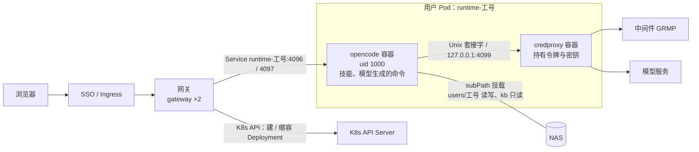
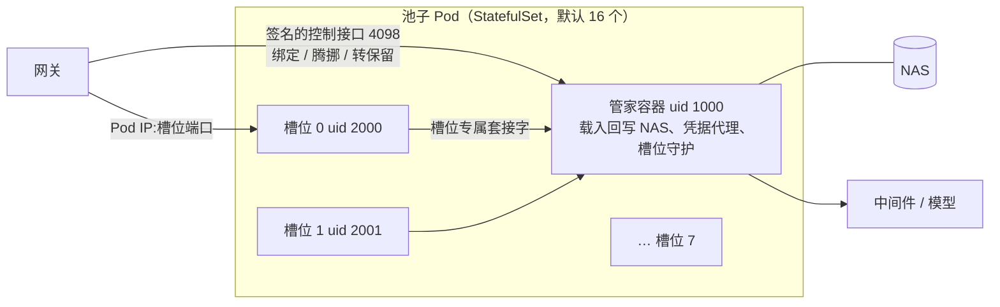
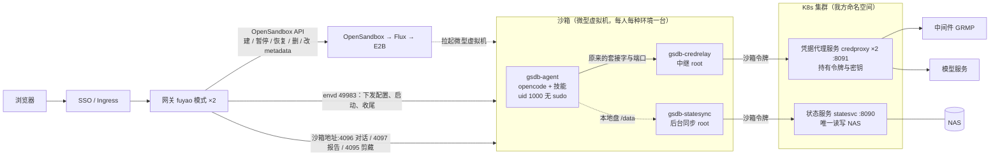
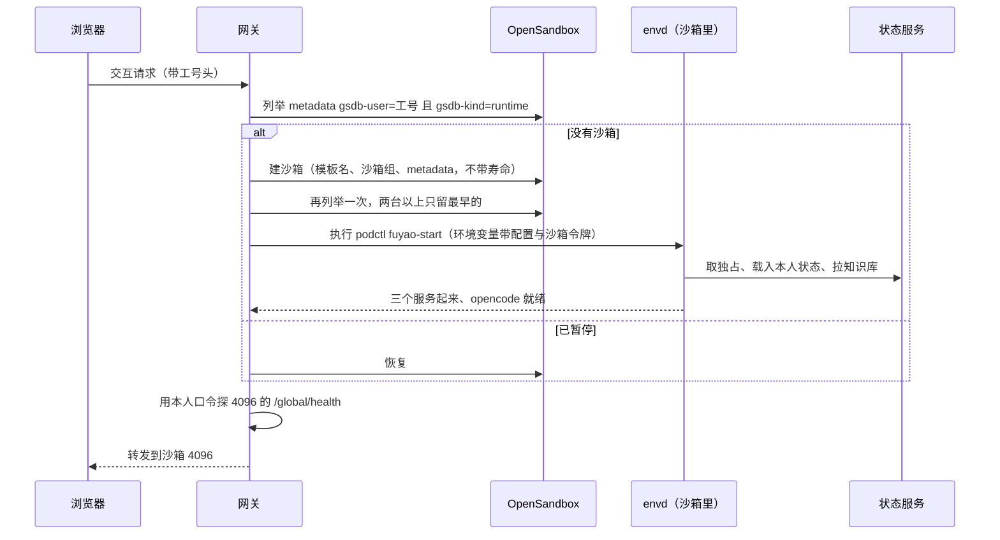
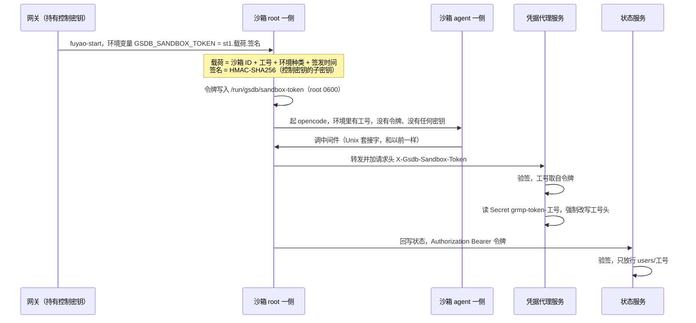
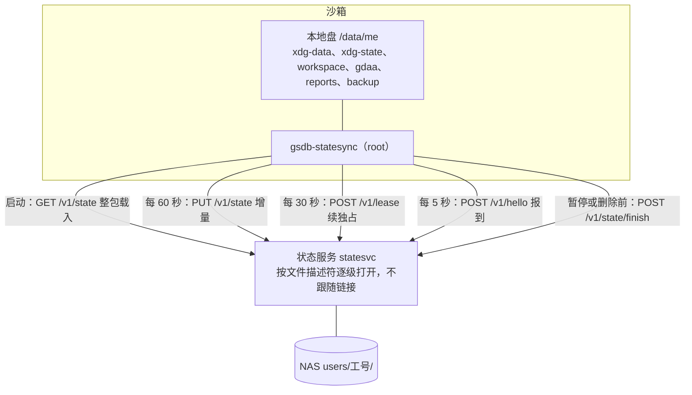
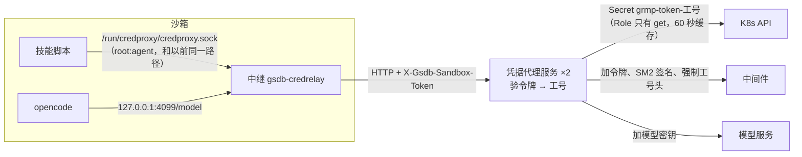
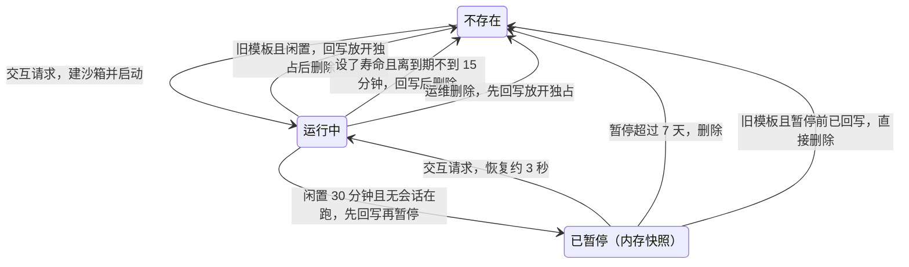
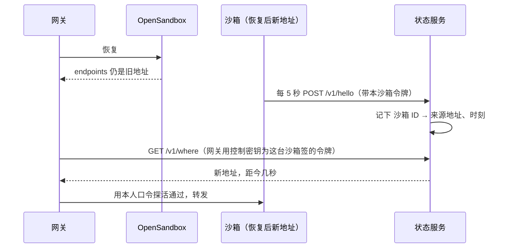
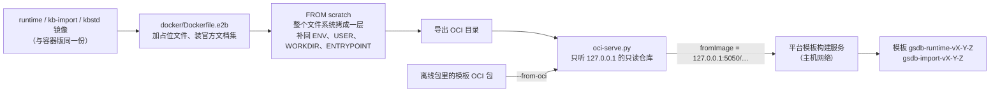

# 原生 K8s 与 Fuyao 沙箱：运行架构对比分析

> 分支 `feat/fuyao`（相对 `main`：60 个文件，+7565 / −87 行）· 2026-11-17 · 内部设计文档（不随离线包交付）
> 配套文档：设计 [`2026-11-17-fuyao-sandbox-design.md`](2026-11-17-fuyao-sandbox-design.md)、实施运维 [`../Fuyao沙箱手册.md`](../Fuyao沙箱手册.md)

## 目录

- [0. 结论先行](#0-结论先行)
- [1. 三种运行模式与对比范围](#1-三种运行模式与对比范围)
- [2. 总体架构：之前与现在](#2-总体架构之前与现在)
- [3. 概念对照表](#3-概念对照表)
- [4. 逐项对比](#4-逐项对比)
  - [4.1 用户运行环境的创建与查找](#41-用户运行环境的创建与查找)
  - [4.2 身份：工号怎么进入运行环境](#42-身份工号怎么进入运行环境)
  - [4.3 配置下发](#43-配置下发)
  - [4.4 进程模型与权限](#44-进程模型与权限)
  - [4.5 用户数据的持久化](#45-用户数据的持久化)
  - [4.6 知识库](#46-知识库)
  - [4.7 凭据：中间件令牌、SM2 私钥、模型密钥](#47-凭据中间件令牌sm2-私钥模型密钥)
  - [4.8 网关到用户环境的转发](#48-网关到用户环境的转发)
  - [4.9 生命周期：闲置、保留、回收](#49-生命周期闲置保留回收)
  - [4.10 恢复后的地址发现（新问题）](#410-恢复后的地址发现新问题)
  - [4.11 版本升级（换版）](#411-版本升级换版)
  - [4.12 镜像与模板](#412-镜像与模板)
  - [4.13 网络隔离与安全模型](#413-网络隔离与安全模型)
  - [4.14 故障处理](#414-故障处理)
  - [4.15 集群清单](#415-集群清单)
  - [4.16 发版台、离线包、根规范](#416-发版台离线包根规范)
- [5. 逐文件改动清单](#5-逐文件改动清单)
- [6. 没有改的部分](#6-没有改的部分)
- [7. 平台行为与我方处理](#7-平台行为与我方处理)
- [8. 端到端验证结果](#8-端到端验证结果)
- [9. 残余风险与待办](#9-残余风险与待办)

---

## 0. 结论先行

**核心差异只有一条：用户的运行环境从 K8s 的「容器（Pod）」换成了平台的「微型虚拟机（沙箱）」。** 其余改动都由它引出：

| 由此带来的约束（实测） | 我方的应对 |
|---|---|
| 沙箱挂不了卷（平台不往下传 volumes） | 集群里新增**状态服务**，唯一读写 NAS 的一方；沙箱用本地盘，60 秒增量回写 |
| 建沙箱时传的环境变量、启动命令不进虚拟机 | 网关经 **envd** 在沙箱里执行**启动器**，配置随命令下发 |
| 沙箱不是 Pod，K8s 的 Secret、网络策略、Service 都管不到它 | 密钥留在集群里的**凭据代理服务**；身份改用网关签名的**沙箱令牌**；网关直连沙箱地址 |
| 镜像要先做成平台的**模板** | 新增模板构建流水线（压层、占位文件、本机临时仓库） |
| 平台恢复沙箱后不回新地址 | 状态服务记录沙箱的来源地址，网关据此找到它 |

**没变的**：四个业务镜像的内容、20 个技能与提示词、opencode、大盘前端、标准知识库 Job、网关的接入与认人方式、NAS 上的目录布局。
按需、固定池化两种模式的行为一个字节没变，三种模式改一个配置（`RUNTIME_MODE`）切换。

**换来的**：虚拟机级隔离（独立内核）、暂停后内存完整恢复、建沙箱 0.1–0.6 秒。
**付出的**：多两个集群服务；NAS 上的数据比沙箱里最多晚 60 秒；隔离要等平台落实三项安全前提（§4.13）才真正生效。

---

## 1. 三种运行模式与对比范围

| 模式 | `RUNTIME_MODE` | 用户的运行环境 | 本文简称 |
|---|---|---|---|
| 按需 | `ondemand` | 每人一个 Pod，网关调 K8s 现建 | 之前（按需） |
| 固定池化 | `pool` | 部署时建好一批 Pod，每个 Pod 若干「槽位」容器 + 一个「管家」容器，网关按槽位分配 | 之前（池化） |
| Fuyao 沙箱 | `fuyao` | 每人每种环境一台 openFuyao 沙箱（OpenSandbox → Flux → E2B 微型虚拟机） | 现在 |

「之前」两种都跑在原生 K8s 上，下文需要区分时分别写明。

---

## 2. 总体架构：之前与现在

### 2.1 之前（按需）：一人一个 Pod

### 2.2 之前（池化）：固定池子、按槽位分配

### 2.3 现在（Fuyao）：一人一台沙箱，NAS 与密钥都在集群里

---

## 3. 概念对照表

| K8s（之前） | Fuyao（现在） | 说明 |
|---|---|---|
| Pod / 槽位容器 | 沙箱（微型虚拟机） | 独立内核；暂停后内存快照完整保留 |
| 每人一个 Deployment + Service，名字 `runtime-<工号>` | 沙箱 metadata `gsdb-app / gsdb-user / gsdb-kind` | 沙箱 ID 由平台生成，按 metadata 找人 |
| kubelet + 调度器 | OpenSandbox → Flux 控制器 / 调度器 → E2B 编排 | 网关只调 OpenSandbox 的 REST 接口 |
| 镜像（推内网仓库） | 模板（E2B template，每版本两份） | 由镜像构建，§4.12 |
| PVC subPath 挂载 NAS | 状态服务（HTTP） | 沙箱不挂任何卷 |
| Secret → 容器环境变量 | 网关经 envd 下发；密钥不进沙箱 | §4.3、§4.7 |
| Pod 里的 credproxy 容器 / 池子管家 | 集群里的凭据代理服务 + 沙箱里的中继 | 技能看到的接口不变 |
| `readinessProbe` | 网关用本人口令探 `/global/health` | 平台没有就绪探针的概念 |
| NetworkPolicy | **平台宿主机侧规则（待平台落实）** | 沙箱不是 Pod，策略选不中它 |
| `scale 0` / 删除 Pod；池化的「转保留」 | 暂停（内存快照）/ 删除 | §4.9 |
| 管家的 4098 签名控制接口 | OpenSandbox 接口 + envd | 管家容器不再存在 |
| `.owner` 由 Pod 自己写 NAS | 状态服务代管独占 | 格式相同，三种模式互认 |

---

## 4. 逐项对比

每一项按「之前 → 现在 → 技术原理 / 为什么 → 代价」写。

### 4.1 用户运行环境的创建与查找

**之前（按需）**：网关按工号渲染 `k8s/templates/runtime.yaml`，调 K8s API 建 `Deployment runtime-<工号>` 与同名 Service（`gateway/pods.py`）。
**名字就是工号**，K8s 的「同名对象只能有一个」天然保证了一人一个，两个网关副本并发创建时后到的那个拿到 409，直接沿用。
就绪由容器的 `readinessProbe` 判断，网关等 Pod Ready。

**之前（池化）**：Pod 在部署时就建好，网关只做分配：查各 Pod 管家的槽位表，挑空槽位，经签名的控制接口下令绑定。

**现在**：`gateway/fuyaorouter.py`

**技术原理**：
- 沙箱 ID 是平台生成的随机串，**名字不能承载工号**，只能把工号写进 metadata（平台实测 metadata 就是 Sandbox 对象的标签，可 PATCH、可按它列举）。
- 没有「同名唯一」可依赖：两个网关副本可能同时为一个人各建一台。做法是建完再列一次，**大家都认 `createdAt` 最早的那台**，多出来的删掉（对多个副本是确定性的，不需要锁）。
- 平台没有就绪探针：网关自己探 `GET /global/health`，**带本人的对话口令**。连到的如果不是本人的沙箱，口令对不上会被 401 拒绝，这一步同时完成了「就绪」和「身份核对」。
- 非交互请求（探活、事件流）不建、不恢复：开着的浏览器标签页不会把暂停的沙箱拉起来（沿用池化的规矩）。

**代价**：每次未命中缓存要多一次列举；建沙箱本身 0.1–0.6 秒，首次进入的时间主要花在启动器载入状态上（实测全程约 6 秒）。

### 4.2 身份：工号怎么进入运行环境

**之前（按需）**：工号在 Pod 模板里写死成环境变量 `GSDB_USER_ID`；GRMP 令牌按名字取 `Secret grmp-token-<工号>` 注入 credproxy 容器。
**身份是 K8s 对象本身带的**：这个 Pod 只挂这个人的目录、只拿这个人的 Secret，Pod 里的程序无从冒充别人。

**之前（池化）**：一个 Pod 里有多个人，身份由网关经签名的控制接口告诉管家「槽位 3 现在归工号 X」，GRMP 令牌用控制密钥加密后交给管家。

**现在**：网关签发**沙箱令牌**，集群里的服务只认令牌。

**技术原理**：
- 沙箱里能跑模型生成的任意命令，**沙箱自己声称的工号不可信**。可信的只有网关签过名的东西；控制密钥（`Secret sandbox-control`）只在网关、状态服务、凭据代理服务三处，从不进沙箱，沙箱伪造不了令牌。
- 令牌是**无状态**的：状态服务和凭据代理服务不需要和网关同步「哪台沙箱归谁」的登记表，验签即可，任何副本都能独立处理。
- 令牌里带环境种类（`runtime` / `kb-import`），状态服务据此决定目录（`users/` 或 `admins/`），知识库发布只认 `kb-import`。
- 对话口令 `OPENCODE_SERVER_PASSWORD` 沿用之前的 `Secret pod-auth-<工号>`（网关管理），报告令牌由沙箱 ID 派生。
- 发给中间件的工号头由凭据代理服务**按令牌强制改写**，覆盖请求里自带的，与之前 Pod 里的 credproxy 同一套逻辑（复用 `common.grmp.userid`）。

**代价 / 注意**：令牌目前没有过期时间，只要控制密钥不换就一直有效（§9）。

### 4.3 配置下发

**之前**：K8s 把 ConfigMap `agent-config` 与 Secret 直接注入容器环境变量（`envFrom` / `secretKeyRef`），镜像里 Dockerfile 的 `ENV` 自然生效。

**现在**：建沙箱请求里的 `env`、`entrypoint` 平台不往下传（实测），只能在沙箱起来之后自己下发：

1. 网关读 ConfigMap `agent-config`（60 秒缓存），加上本次的工号、种类、沙箱 ID、沙箱令牌、对话口令、报告令牌，以及两个集群服务的地址；
2. 经 **envd**（E2B 在虚拟机里的守护进程，端口 49983，Connect 协议的 JSON 流）以 root 执行 `python3 /opt/agent/podctl.py fuyao-start`，这些都作为**这条命令的环境变量**（`gateway/sandboxexec.py`）；
3. 启动器（`docker/fuyao.py`）把它们分成两份文件：`/run/gsdb/root.env`（0600，给 root 一侧，含集群服务地址）与 `/run/gsdb/agent.env`（0640 root:agent，给 opencode，只含 `GRMP_* MODEL_* KB_* GSDB_* OPENCODE_*` 前缀且去掉令牌与地址）；
4. 用 `systemd-run` 起三个服务，各自 `EnvironmentFile=` 指向对应文件。

**技术原理与细节**：
- envd 会等待它启动的子进程结束，所以后台服务不能直接 `&`，要交给 systemd。
- systemd 起的服务**拿不到镜像里的 `ENV`**：启动器补上同一份（`TZ`、`LANG`、`PYTHON*`、`GSDB_ROOTSPEC_HOME`），有守卫测试核对与 Dockerfile 一致。
- systemd 的环境文件一行一个变量，**多行值写不进去**。端到端测试发现实例别名 `GRMP_INSTANCE_ALIASES`（多行）因此丢失、智能体认不出 `og7`；
  修复为按「;」合成一行（解析器本来就先按行、再按「;」切，语义不变），其余写不进的变量记日志、不再悄悄丢。
- 沙箱的 DNS 解析不了集群域名（实测），网关把两个服务的 Service 域名**先解析成 ClusterIP 再下发**；解析失败按启动失败处理，不把死地址带进沙箱。

### 4.4 进程模型与权限

| | 之前（按需） | 之前（池化） | 现在 |
|---|---|---|---|
| 隔离单位 | Pod（共享宿主机内核） | 槽位容器（同 Pod 内共享网络命名空间） | 虚拟机（独立内核） |
| opencode 与技能 | `opencode` 容器，uid 1000 | 槽位容器，uid 2000+i | `gsdb-agent` 服务，uid 1000（`agent`），无 sudo |
| 持有密钥的一方 | `credproxy` 容器 | 管家容器 | 集群里的凭据代理服务（不在沙箱里） |
| 读写 NAS 的一方 | opencode 容器自己（subPath） | 管家容器 | 集群里的状态服务 |
| 加固 | 只读根文件系统、丢弃全部 capabilities、非 root | 同左 + 槽位换人前重启清盘 | 沙箱里 root 一侧与 agent 一侧按 Linux 用户分开；令牌文件只有 root 可读 |

**技术原理**：
- 之前的隔离靠「容器 + 只读根文件系统 + capabilities」，内核是共享的；虚拟机有独立内核，模型生成的命令即使利用了内核漏洞也出不了这台虚拟机——这是采用 Fuyao 的主要收益。
- 沙箱里保留了「两侧分开」的结构（对应之前 credproxy 容器与 opencode 容器、管家与槽位的分开）：中继与同步以 root 运行，opencode 以 `agent` 运行，`agent` 读不到令牌文件。
- E2B 构建模板时会自建一个带 sudo 的默认用户 `user`（uid 1001），我方服务一律不用它。
- **槽位换人前清盘**（池化最复杂的一块：重启容器、核对容器 ID、清除上一个人预埋的文件）在 Fuyao 下**不再需要**：一台沙箱只属于一个人，从不换人，删除即销毁。

### 4.5 用户数据的持久化

**之前（按需）**：

- Pod 按 subPath 直接挂 NAS：`/nas/me` = `users/<工号>`（读写），`/nas/kb` = `kb`（只读）。
- 性能敏感的目录（`xdg-data` 里的 opencode 库、`xdg-state`、`workspace`）**本地化**到 Pod 的 emptyDir，`entrypoint.sh` 每 60 秒用 `podctl state-sync` 回写（SQLite 用在线备份接口整库一致性复制），退出时 `state-finish`；
- `gdaa`（登录句柄与加密凭据）、`reports`、`backup` **直接写在 NAS 上**；
- 同一个人只能有一个 Pod 写：Pod 自己在 NAS 上写 `.owner` 并定期续约。

**现在**：沙箱**不挂任何卷**（平台不往下传 volumes，Flux 的 Sandbox 对象没有卷字段，实测），数据全部经状态服务：

| 接口 | 作用 |
|---|---|
| `POST /v1/lease` | 取 / 续 / 放开本人目录的独占（`.owner`，格式与之前相同，90 秒没续算过期） |
| `GET /v1/state` | 本人状态打成 tar.gz 下发；同时打 dirty 标记 |
| `PUT /v1/state` | 增量回写（改动的文件 + `sync.json` 里的保留清单与「是否允许传播删除」） |
| `POST /v1/state/finish` | 收尾：清 dirty；`release` 时放开独占 |
| `GET /v1/kb/manifest`、`POST /v1/kb/files`、`POST /v1/kb/publish` | 知识库（§4.6） |
| `POST /v1/hello`、`GET /v1/where` | 报到与地址查询（§4.10） |

**技术原理**：
- 规则**沿用按需模式的 `statesync`**（都是事故换来的）：载入时发现上次 dirty 没清（非优雅退出），先把本地化目录快照到 `.unclean-<时间>/`；删除只在「这台沙箱载入成功过」时才传播（防止空盘覆盖 NAS）；库文件写入后清掉旧的 `-wal / -shm`。
- **状态服务挂着全体用户的目录**，所以它读写 NAS 一律按文件描述符逐级打开、不跟随符号链接（`docker/fdtree.py`），不会被谁预埋的链接带到别人的目录；目录由令牌里的工号决定，请求里给不了路径。
- 之前直接写 NAS 的 `gdaa`、`reports`、`backup` 现在也在本地，一并纳入同步（沙箱写不了 NAS）。
- 请求体超限或被拒时先把剩余的请求体读完再回应（`LimitedReader.drain()`），避免客户端写一半被断开。

**代价**：NAS 上的数据最多比沙箱里晚 60 秒；沙箱被平台强行删除（不经网关）时丢最后一个同步周期。对此的防线是：暂停和删除前都由网关先触发完整回写，回写失败不删（§4.14）。

### 4.6 知识库

| | 之前 | 现在 |
|---|---|---|
| 诊断环境读知识库 | 只读挂载 `/nas/kb` | 启动时按清单增量拉到本地 `/data/kb`（文件只读），运行中每 60 秒刷新 |
| 导入环境写知识库 | 读写挂载，直接写 NAS | 本地建索引，**发布**到状态服务 |
| 并发写 | 文件锁 | 发布带「我手上这份的版本」（请求头 `X-Gsdb-Kb-Base`），**先核对再写**：别的管理员先发布了就一个文件都不写，提示先刷新 |
| 正在导入时 | — | 本地有锁文件时不发布半截 |
| 官方文档集 | `kbstd-install` Job 装进 NAS，所有 Pod 挂载可见 | Job 照旧装 NAS；**两种模板里都内置一份**，状态服务给沙箱的清单不含 docsets，发布也不动它 |

**为什么文档集要进模板**：导入沙箱首次启动实测要近两分钟拉取官方文档集；文档集本来就随版本发布，放进模板后首次启动只拉增量。

### 4.7 凭据：中间件令牌、SM2 私钥、模型密钥

**之前（按需）**：Pod 里单独一个 `credproxy` 容器持有三样密钥（Secret 注入），opencode 容器一样都没有。
技能经 `/run/credproxy/credproxy.sock`（两个容器共享的 emptyDir）调中间件，opencode 经 `127.0.0.1:4099` 调模型；credproxy 转发时加令牌、签 SM2、写工号头。
**之前（池化）**：管家持有各槽位使用人的令牌（网关加密下发），每个槽位一个专属套接字。

**现在**：

**技术原理**：
- 密钥不能进沙箱（沙箱里跑模型生成的命令），也没有 Secret 能注入虚拟机 —— 所以把 Pod 里的 credproxy **原样搬到集群里做成网络服务**（`docker/credproxy.py` 的网络形态），按沙箱令牌认人。
- 沙箱里的**中继**保持原来的套接字路径与端口，**技能与 opencode 一行不改**（方案原计划改技能公共层加「网络模式」，实施时改为中继，省掉了对技能包的改动）。
- 凭据代理服务读 Secret 的权限只有 `get`、没有 `list`：拿不到全体名单，只能按令牌里的工号取。
- 导入环境的令牌只能调模型，调不了中间件（与之前导入容器没有中间件令牌一致）。

### 4.8 网关到用户环境的转发

| | 之前（按需） | 之前（池化） | 现在 |
|---|---|---|---|
| 地址 | Service DNS `runtime-<工号>:4096` | Pod IP + 槽位端口 | 沙箱在 Pod 网段的地址（虚拟机直连） |
| 鉴权 | Basic（`pod-auth-<工号>` 口令） | 同左 | 同左 |
| 报告 4097 | 只读端口，网关转发 | 槽位报告端口 | 沙箱 4097，带报告令牌 |
| 剪藏 4095 | 导入容器 | 导入容器（池化下也按需建） | 导入沙箱 |
| SSE（实时流） | 支持 | 支持 | 支持（实测） |

**技术原理**：虚拟机在 Pod 网段有独立地址，集群里能直连任意端口（实测），所以转发代码（`gateway/proxy.py`）完全沿用，只是目标地址从「Service 名」换成「路由器给出的沙箱地址」。
地址的来源见 §4.10。

### 4.9 生命周期：闲置、保留、回收

| | 之前（按需） | 之前（池化） | 现在 |
|---|---|---|---|
| 闲置 | 回收器缩到 0 或删 Pod，下次重建要重新载入 | 转保留：完整回写、停 opencode，文件留在槽位 | **暂停**：回写后冻结虚拟机，内存完整保留 |
| 回来 | 新 Pod 冷启动、重新载入 | 回到保留槽位约 1–3 秒 | 恢复约 3 秒 + 等地址（§4.10） |
| 保留多久 | — | `POOL_RETAIN_DAYS` | `FUYAO_RETAIN_DAYS`（暂停的沙箱） |
| 满员 | 不存在（按需建） | 等待页 + 提前转保留闲置者 | 等待页（沙箱组没空位，平台回 503） |

**平台寿命**：建沙箱带 `timeout` 时平台到点直接删除、不发信号，续期接口回 409，上限 24 小时（实测）；**不带就没有到期时间**。
所以默认不带（`FUYAO_SANDBOX_TIMEOUT=0`），生命周期全由网关的清扫器（`gateway/fuyaosweeper.py`，每 30 秒一轮）管理；平台若强制要求寿命，清扫器在到期前 15 分钟主动收尾删除。

### 4.10 恢复后的地址发现（新问题）

之前不存在这个问题：Pod 的地址由 Service 屏蔽，重建后 DNS 自动指向新 Pod。

**问题**：平台恢复暂停的沙箱后，虚拟机换了 Pod 网段地址，而 `GET /v1/sandboxes/{id}/endpoints/{port}` 仍回旧地址，Sandbox 对象的状态里也没有新地址（实测）。

**做法**：沙箱里的后台同步本来就要定期联系状态服务，而**集群内不做源地址转换（实测），请求的来源地址就是虚拟机现在的地址**：

**技术原理**：
- 地址记录只认 30 秒内的；问不到就退回平台给的地址。
- 最终核对仍是本人口令探活：即使拿错了地址（比如旧地址已分给别人），对方的 opencode 只认它自己的口令，不会串数据（有测试覆盖这个场景）。
- 报到只记地址、不碰 NAS，开销很小；网关问地址的那次请求不刷新记录。

**效果**：修复前恢复后一直连不上；修复后实测 17.6 秒恢复（当时报到间隔 30 秒），已改为 5 秒一次。

### 4.11 版本升级（换版）

| | 之前（按需） | 之前（池化） | 现在 |
|---|---|---|---|
| 升级开关 | `USER_IMAGE_TAG` | 发版台「池子在线替换」：逐槽位等不忙 → 转保留 → 换镜像 | gateway-config 的两个模板名 |
| 在用的人 | 下次登录换新 Pod | 腾挪到新槽位 | **不打断**，闲置后换新 |
| 新版本何时生效 | 下次建 Pod | 替换完成 | 下次建沙箱 |

**做法**（`e7ec874`）：建沙箱时把模板名写进 metadata（`gsdb-template`），暂停时记下回写是否成功（`gsdb-synced`）。
- 在跑的旧版沙箱：闲置时回写、**放开独占**后删除（不放开的话新沙箱要等 90 秒独占过期），下次登录按新模板建；回写失败就照旧暂停，不删。
- 暂停的旧版沙箱：暂停前已回写的直接删除（登录时在同一个请求里删旧建新，用户无感）；没回写成的照旧恢复，等下次闲置再换。
- `/admin/fuyao` 的 `outdated` 是剩余旧版台数，发版台的「沙箱换版」一步据此显示进度。

### 4.12 镜像与模板

**之前**：四个镜像推内网仓库，K8s 按标签拉。

**现在**：额外把 runtime、kb-import 镜像做成平台的模板：

| 步骤 | 技术原理 / 为什么 |
|---|---|
| 压成一层 | 平台解镜像层时**不处理 OCI whiteout**：上层删掉的文件会回来（诊断镜像删掉的两个导入技能、源码目录、pip 都回来了），`.wh.*` 标记以 root 000 权限留在根目录，`entrypoint.sh` 复制配置目录时读不了而失败。只有一层就没有 whiteout |
| 补回镜像配置 | 压层会丢 `ENV / USER / WORKDIR / ENTRYPOINT`，照 `docker/Dockerfile` 写回，守卫测试逐项核对 |
| 6GB 全零占位文件 | 平台按「镜像大小 + 约 0.5GB」定模板磁盘，`diskSizeMB` 不生效；占位文件把磁盘撑到 9.3GB，首次启动删除后约 8GB 可用。全零数据压缩后约 6MB |
| 内置官方文档集 | §4.6 |
| 本机临时仓库 | 构建服务的容器没有根证书、拉不了公网仓库，但它在主机网络上、对本机地址走 HTTP 不校验证书（实测）——不需要任何仓库账号 |
| `--from-oci` | 构建主机不能上网时，用别处构建好的 OCI 包（离线包 `--e2b` 带出） |
| 模板名 | `gsdb-runtime-v<主>-<次>-<修订>` 与 `gsdb-import-v<主>-<次>-<修订>`，脚本、网关配置、发版台三处同一规则（有测试） |

### 4.13 网络隔离与安全模型

| 威胁 | 之前的防线 | 现在的防线 | 现状 |
|---|---|---|---|
| 模型生成的命令读别人的数据 | 每人一个 Pod，只挂本人目录 | 每人一台虚拟机；NAS 只经状态服务，按令牌放行本人目录 | ✅ |
| 偷用别人的中间件令牌 | 令牌只在本人 Pod 的 credproxy 容器 | 令牌只在集群里；沙箱令牌伪造不了 | ✅ |
| 内核级逃逸 | 共享内核，靠容器加固 | 独立内核 | ✅ 强于之前 |
| 沙箱之间互相进入 | 网络策略：入站只放行网关 | **envd 无认证，一台沙箱可以 root 进另一台** | ❌ 待平台（S1） |
| 数据外泄 / 横向扫描 | 网络策略：出站只放行 DNS、中间件、模型 | **沙箱出网不受限，出网规则平台不往下传** | ❌ 待平台（S2） |
| 冒用平台接口删改他人沙箱 | K8s RBAC | **OpenSandbox 未开认证** | ❌ 待平台（S3，我方已支持 API Key） |

**技术原理**：K8s 的网络策略按 Pod 标签选择对象，沙箱是虚拟机不是 Pod，选不中它；建沙箱请求里的网络规则平台只传了模式字段（实测）。
所以 S1、S2 只能由平台在宿主机侧实现。我方能做的已经做了：两个集群服务各有网络策略（入站只放行沙箱网段、出站最小化），密钥不进沙箱、令牌无法伪造。
另：之前的网络策略同样依赖网络插件执行，鲲鹏实验环境的 Flannel 并不执行。

### 4.14 故障处理

| 情形 | 之前 | 现在 |
|---|---|---|
| 环境起不来 | Pod CrashLoop，网关一直等就绪 | 启动器在同一台沙箱里接连失败 3 次 → 回「环境准备失败，请联系管理员」并记原因（`d32d85c`）；envd 连不上不算 |
| 收尾回写失败 | Pod 收到退出信号时由 `entrypoint.sh` 收尾回写，尽力而为 | 不删（删了会丢最后一个同步周期），下一轮再试；暂停则照旧暂停并记 `gsdb-synced=0` |
| 网关重启 | 网关无状态，按名字找 Pod | 网关无状态：缓存丢了就现查列举 + 探活；令牌无状态，不需要恢复登记表 |
| 平台接口不可用 | — | 等待页（`platform_unreachable`），不建不删 |
| 状态服务重启 | — | 单副本 Recreate，期间回写失败重试；地址记录 5 秒内由各沙箱补齐 |

### 4.15 集群清单

| 之前 | 现在新增 |
|---|---|
| `k8s/base/`：网关、前端、NAS PVC、网络策略、kbstd Job、ConfigMap | `k8s/fuyao/statesvc.yaml`（1 副本 Recreate，挂 NAS）、`credproxy.yaml`（2 副本，Role 只有 secrets get）、`networkpolicy.yaml`（补充三条）、`sandboxgroups.yaml`（样例，平台管理员 apply） |
| `k8s/templates/`：按工号渲染的 Pod 模板 | Fuyao 下不用 |
| `k8s/overlays/test`、`k8s/overlays/prod` | `k8s/overlays/fuyao` = base + fuyao + 网关切 `RUNTIME_MODE=fuyao` |
| `configmap-gateway.yaml` | 新增 15 个 `FUYAO_*` 键；`gateway.yaml` 新增对应环境变量映射（守卫测试核对映射齐全） |

新服务沿用 base 的加固规矩：不注入 Service 发现变量、只读根文件系统、丢弃全部 capabilities、非 root、emptyDir 有上限（守卫测试）。

### 4.16 发版台、离线包、根规范

| | 之前 | 现在 |
|---|---|---|
| 发版台识别 | 看网关、池子 Pod 的镜像标签 | 读 `RUNTIME_MODE`；fuyao 下看网关与两个集群服务 |
| 发版台步骤 | …→ 网关滚动 → 池子在线替换 → 删除旧导入容器 → 冒烟 | …→ **模板核对**（各建一台探测沙箱、进入运行即删）→ 网关滚动 → **沙箱换版**（报告旧版台数）→ 冒烟 |
| 离线包 | 五个镜像 + 发版台 | 加 `--e2b`：每种架构一个模板 OCI 包 + `e2b/` 目录（构建脚本、临时仓库、Dockerfile.e2b） |
| 换根规范 | 镜像加一层 | 同时按新镜像重建模板 OCI 包，之后在构建主机上重新注册 |

---

## 5. 逐文件改动清单

### 网关（`gateway/`）

| 文件 | 新增 / 修改 | 之前 | 现在 |
|---|---|---|---|
| `opensandbox.py` | 新增 | — | OpenSandbox REST 客户端：建（不带寿命）、列举（本地再按 metadata 过滤）、地址、暂停、恢复、删除、改 metadata；容量不足翻成 `CapacityError` |
| `sandboxexec.py` | 新增 | — | envd 客户端（Connect JSON 流）：按命令带环境变量、指定用户执行；探活 |
| `sbxtoken.py` | 新增 | — | 沙箱令牌签发与验证（与 `docker/sbxtoken.py` 一字不差，有守卫） |
| `fuyaorouter.py` | 新增 | — | 路由器：查 / 建 / 恢复 / 启动 / 探活、重复只留最早、换版、地址发现、接连失败报错；接口与池化的 PoolRouter 相同 |
| `fuyaosweeper.py` | 新增 | — | 清扫器：活动写 metadata、闲置暂停、过保留期删除、旧版退役、到期前收尾；`/admin/fuyao` 的摘要与动作 |
| `config.py` | 修改 | 两种模式 | 加 `fuyao` 与 `GATEWAY_FUYAO_*`，缺项 fail closed；fuyao 必须有控制密钥 |
| `__main__.py` | 修改 | 装配按需 / 池化 | 加 fuyao 装配：agent-config 缓存、地址解析成 ClusterIP、状态服务地址查询 |
| `server.py` | 修改 | 导入容器只按需建 | 路由器声明 `handles_kb_import` 时导入环境也交给它；`/admin/fuyao` |
| `kbclip.py` | 修改 | 剪藏转导入容器 | fuyao 下转导入沙箱的 4095 |
| `tests/*` | 新增 6 个 | — | 假 OpenSandbox（真 HTTP，按平台实测行为写）、envd、路由器、清扫器、服务端、清单守卫、地址查询 |

### 沙箱侧与集群服务（`docker/`）

| 文件 | 新增 / 修改 | 之前 | 现在 |
|---|---|---|---|
| `fuyao.py` | 新增 | — | 启动器：令牌与环境文件、取独占、载入、拉知识库、systemd 三服务、探活；后台同步循环（续独占 / 报到 / 回写 / 知识库）；收尾 |
| `statesvc.py` | 新增 | — | 状态服务（接口见 §4.5） |
| `remotesync.py` | 新增 | — | 状态服务客户端：载入、增量回写、收尾、知识库拉取与发布、报到 |
| `treetar.py` | 新增 | — | 按文件描述符打包 / 解包目录树（限大小、限顶层目录、不跟随链接） |
| `sbxtoken.py` | 新增 | — | 同网关 |
| `credproxy.py` | 修改 | Pod 内形态（Unix 套接字 + 4099） | 加网络形态（8091，按令牌认人，按工号读 Secret）与沙箱中继 |
| `podctl.py` | 修改 | 启停子命令 | 加 `fuyao-start / fuyao-stop / fuyao-syncloop / serve-credrelay / serve-credproxy-net / serve-statesvc` |
| `entrypoint.sh` | 修改 | 自己取独占、载入、回写、收尾 | `FUYAO=1` 时这四件交给 root 一侧，只跑服务与 WAL 合并 |
| `Dockerfile` | 修改 | — | 拷入新文件 |
| `Dockerfile.e2b` | 新增 | — | 模板镜像（§4.12） |
| `tests/*` | 新增 4 个 | — | 状态服务、凭据代理网络形态、启动器、Dockerfile.e2b 守卫 |

### 清单、脚本、发版台、文档

| 文件 | 新增 / 修改 | 说明 |
|---|---|---|
| `k8s/fuyao/*`、`k8s/overlays/fuyao/*` | 新增 | §4.15 |
| `k8s/base/configmap-gateway.yaml`、`gateway.yaml` | 修改 | `FUYAO_*` 配置与映射 |
| `scripts/build-e2b-template.py`、`oci-serve.py` | 新增 | §4.12 |
| `scripts/package-images.sh`、`rootspec-overlay.sh` | 修改 | §4.16 |
| `release/e2b.py` | 新增 | 模板核对、沙箱换版 |
| `release/plan.py`、`steps.py`、`render.py`、`scan.py`、`smoke.py`、`pool.py`、`web/app.js` | 修改 | 识别模式、步骤表、overlay 渲染、扫描两个服务、冒烟放宽超时、共用 exec 进网关的逻辑、界面 |
| `docs/Fuyao沙箱手册.md` | 新增 | 实施运维手册 |
| `docs/参数手册.md`、`功能清单-容器版.md`、`版本说明.md`、`仓库结构说明.md` | 修改 | 补 Fuyao 模式 |
| `docs/specs/2026-11-17-fuyao-sandbox-design.md`、本文 | 新增 | 设计与对比 |

---

## 6. 没有改的部分

- 四个业务镜像的内容（runtime、kb-import、gateway、frontend）与标准知识库镜像：Fuyao 模板由同一份镜像派生。
- `agent/` 下全部技能、公共层、提示词；opencode 版本与配置模板。
- 大盘前端；标准知识库安装 Job；中间件白名单。
- 网关的接入、认人（SSO 头 + 共享密钥 / 来源网段）、转发代码、对话口令管理。
- NAS 目录布局（`users/<工号>/`、`admins/<工号>/`、`kb/`）与 `.owner` 格式：三种模式互认，同一 NAS 可以来回切换。
- 按需与固定池化两种模式的全部代码路径（管家、槽位、回收器）。

---

## 7. 平台行为与我方处理

| # | 平台行为（实测） | 性质 | 我方处理 |
|---|---|---|---|
| 1 | 恢复后地址不更新 | 缺陷 | 状态服务记来源地址（§4.10） |
| 2 | 模板构建不处理 OCI whiteout | 缺陷 | 压成一层（§4.12） |
| 3 | 寿命到点硬删、不能续期、上限 24 小时 | 上限是配置；续期是功能缺失；不发信号是设计 | 不带寿命；带了则到期前收尾删除（§4.9） |
| 4 | 单台查询不带 metadata、都不回到期时间 | 缺陷 | 一律从列举取；到期时刻自己记 |
| 5 | env / entrypoint / volumes 不进虚拟机 | 平台不支持 | envd 下发；状态服务（§4.3、§4.5） |
| 6 | 模板磁盘参数不生效 | 可能是团队配额配置 | 占位文件（§4.12） |
| 7 | 构建服务没有根证书 | 部署配置 | 本机临时仓库 / `--from-oci` |
| 8 | 构建服务重启后集中补建网络槽位，宿主机负载约 300、数分钟 | 稳定性 | 避开高峰构建 |

---

## 8. 端到端验证结果

鲲鹏 920 + openFuyao 实验环境，独立命名空间（与原生 1.4.14 部署互不影响），openGauss 实验库 + 模拟中间件：

| 项目 | 结果 |
|---|---|
| 模板注册 | 每种约 1 分钟 |
| 新用户进入 | 约 6 秒（建沙箱、载入、起服务、探活） |
| 再次进入 | 约 2 秒 |
| 对话回归 14 题 | 12 题通过；另 2 题只因回答带「详情编号」被标出，与原生部署相同 |
| 暂停 / 恢复 | 修复地址发现后 17.6 秒恢复，会话都在 |
| 换版 | 删旧建新验证通过 |
| 单元测试 | 网关、沙箱侧、集群服务、脚本、发版台全部通过（最近一次 1116 + 410 项） |

待现场复测：模板内置文档集后的导入环境首次启动、5 秒报到后的恢复时间、闲置自动暂停与自动换版、知识库发布到诊断环境、报告页与剪藏。

---

## 9. 残余风险与待办

| 风险 / 待办 | 说明 |
|---|---|
| 三项安全前提（§4.13 S1–S3） | 上线前必须由平台落实；落实后需回归（envd 认证要求网关带访问令牌，我方小改；出网限制必须放行两个集群服务） |
| ~~恢复后旧地址可能已分给别人~~（2026-11-18 已修） | 报告写成后在现场核查发现：恢复后平台回旧地址时，网关的补起逻辑与清扫器会在旧地址上探活（送出本人口令）、跑启动器（写入本人令牌）、做收尾，而旧地址可能已是别人的沙箱。已改为恢复过的沙箱只认恢复之后报到的地址；启动器发现虚拟机已属于别的沙箱就拒绝启动。见设计文档 §6.3 |
| ~~回写失败仍删除~~（2026-11-18 已修） | 报告写成后核查发现两条删除路径没看回写结果：暂停过了保留期直接删、运维 `delete` 收尾失败照删并回 200。已改为没回写成就不删（清扫器记日志并计数，`delete` 回 409，带 `force` 才强删），见 Fuyao 沙箱手册 §7.1 |
| 沙箱令牌没有过期时间 | 只要控制密钥不换就一直有效。令牌只在沙箱里 root 可读的文件中，正常情况下拿不到；但在 S1 未落实时，进得了别人沙箱的人可以读走令牌、以对方身份调凭据代理服务。待办：令牌加有效期并由后台同步定期续发，或凭据代理服务按状态服务记录的来源地址核对 |
| 状态服务单副本 | 重启期间回写与新沙箱启动失败重试，约 1 分钟 |
| 沙箱本地盘约 8GB | 工作区很大时会写满 |
| 首次部署不走发版台 | 按手册手工部署 |
