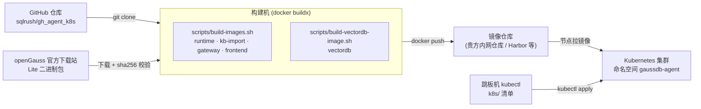
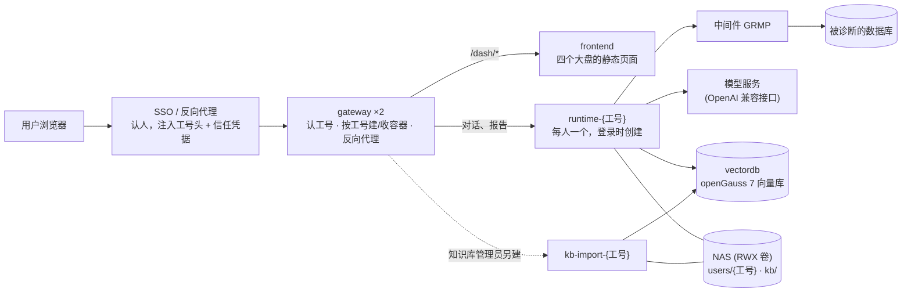
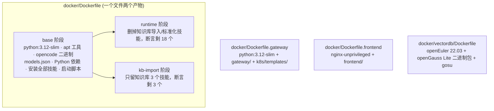
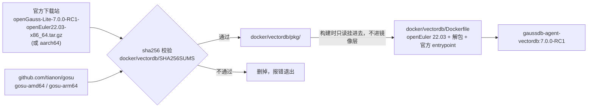
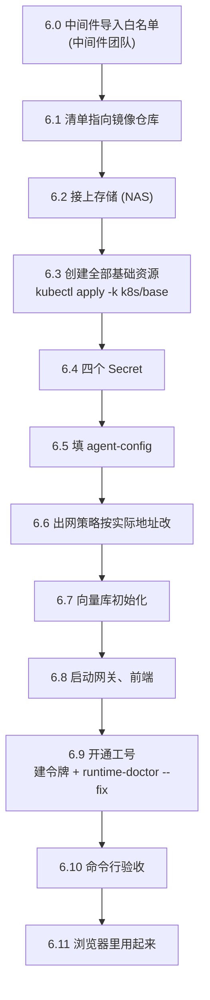
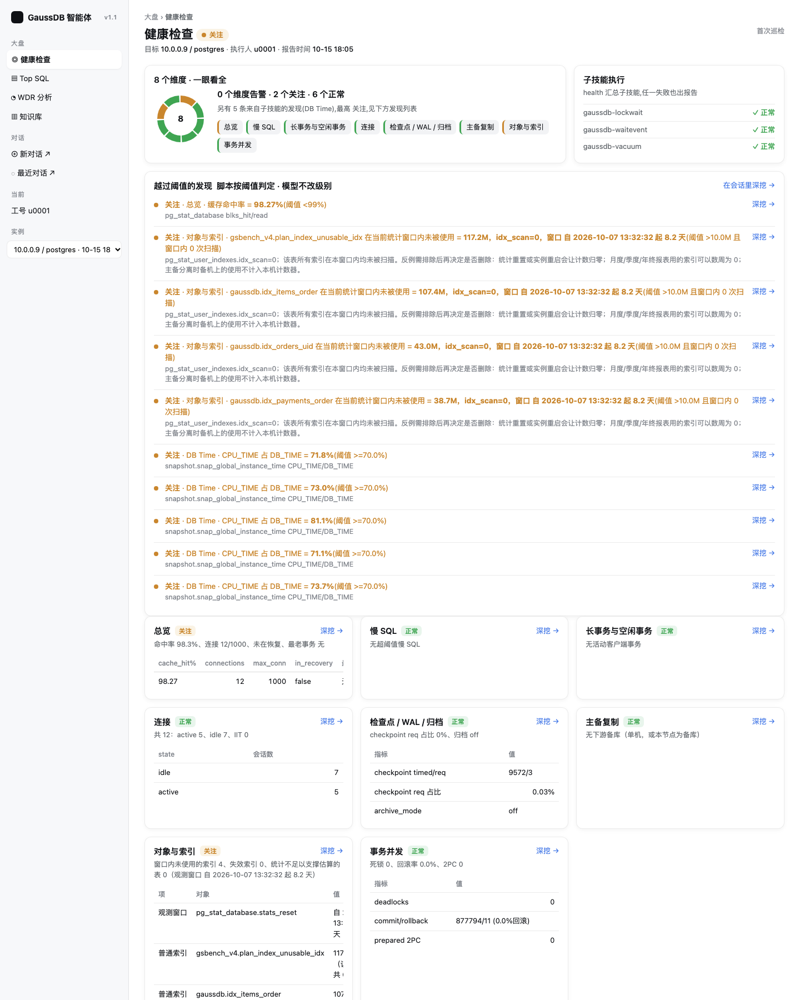

# 从源码构建到 K8s 运行：完整手册

从 GitHub 拉代码开始，自己构建全部 5 个镜像，推进镜像仓库，部署到 Kubernetes，
最后在浏览器里登录、让模型对数据库做一次健康检查、在大盘上看到结果。**每一步都给出命令和执行后应该看到的输出。**

> **本手册的每条命令都实际跑过。** 2026-10-15 在一台全新的机器目录里从 GitHub clone，
> 用不带任何缓存的构建器从零构建，部署到一个全新的 kind 集群（单节点，Kubernetes 1.36，执行 NetworkPolicy），
> 一直走到浏览器里出健康检查大盘。输出都是那次的原样；`<...>` 是需要你换成自己的值的地方。
> x86_64（amd64）与 ARM（arm64）两种架构的镜像都构建并验证过。验证记录见附录 C。
>
> **当前发布版本 `agent-v1.3.1`（2026-10-22）。** 第 2 章 `git checkout agent-v1.3.1` 后按本手册构建，`TAG` 就是 `agent-v1.3.1-oc1.18.27`；
> 第 3 章的镜像验证输出按 v1.3.0 重跑（v1.3.1 只改技能与前端，构建步骤与输出形态相同）。**不想自己构建**的，直接拉已发布的镜像（两种架构）：
> `ghcr.io/sqlrush/gaussdb-agent-{runtime,kb-import,gateway,frontend}:agent-v1.3.1-oc1.18.27`，从第 5 章开始。
> 部署前还要让**中间件团队导入诊断脚本白名单**（本版 123 条，见 1.3 与 6.0）。

| 你要做的 | 章节 | 大约用时 |
|---|---|---|
| 准备构建机、集群、要填的值 | 1 | 看各团队响应速度 |
| 拉代码 | 2 | 1 分钟 |
| 构建 4 个应用镜像 | 3 | 2–10 分钟（看网络） |
| 用 openGauss 官方二进制包构建第 5 个镜像 | 4 | 1–3 分钟 |
| 推进镜像仓库 | 5 | 1–5 分钟 |
| 部署到 K8s、开通工号、浏览器里用起来 | 6 | 15–30 分钟 |

---

## 0. 全景

### 0.1 从代码到运行的全过程



### 0.2 运行起来之后是什么样



### 0.3 五个镜像

| # | 镜像 | 从哪来 | 里面是什么 | 大小（arm64 实测） | 在集群里的形态 |
|---|---|---|---|---|---|
| 1 | `gaussdb-agent-runtime` | `docker/Dockerfile` 的 `runtime` 阶段 | opencode 1.18.27 + 18 个诊断技能 + 知识库只读查询 | 674 MB | 每个工号一个，登录时由网关创建 |
| 2 | `gaussdb-agent-kb-import` | `docker/Dockerfile` 的 `kb-import` 阶段 | opencode + 知识库查询 / 导入 / 入库前标准化 3 个技能 | 674 MB | 只给知识库管理员，每人一个 |
| 3 | `gaussdb-agent-gateway` | `docker/Dockerfile.gateway` | 网关（Python 标准库 + PyYAML），带用户 Pod 模板 | 227 MB | 常驻 2 副本 |
| 4 | `gaussdb-agent-frontend` | `docker/Dockerfile.frontend` | nginx（非 root）+ `frontend/` 静态文件 | 78.4 MB | 常驻 1 副本 |
| 5 | `gaussdb-agent-vectordb` | `docker/vectordb/Dockerfile` | openGauss 7.0.0-RC1 **官方二进制包** + 官方启动脚本 | 550 MB | 常驻 1 个（StatefulSet） |



---

## 1. 准备

### 1.1 构建机

一台 Linux（x86_64 或 ARM 都行）或 macOS 机器：

| 要求 | 怎么确认 |
|---|---|
| Docker 20.10 以上，带 buildx | `docker buildx version` 有输出 |
| git、curl | `git --version`、`curl --version` |
| 磁盘剩余 20 GB 以上 | `df -h` |
| 能访问外网的这些地址（构建时下载） | 见下表 |

| 构建时访问的地址 | 用途 |
|---|---|
| `github.com` | 拉代码；下载 opencode 二进制、gosu |
| Docker Hub（`registry-1.docker.io`） | 基础镜像 `python:3.12-slim-bookworm`、`nginxinc/nginx-unprivileged`、`openeuler/openeuler` |
| `deb.debian.org` | runtime 基础镜像里装 curl、git、ripgrep 等 |
| `pypi.org` / `files.pythonhosted.org` | psycopg2-binary、cryptography、PyYAML |
| `models.dev` | opencode 的模型清单（构建期取好，运行时不再联网取） |
| `opengauss.obs.cn-south-1.myhuaweicloud.com` | openGauss 官方二进制包 |
| `repo.openeuler.org` | 向量库镜像里装几个系统包 |

> **构建机要经代理上网时**：在 `~/.docker/config.json` 里配 `proxies`，Docker 会把它自动传进每一步构建。
> 构建机完全不能上外网时，第 5 个镜像的二进制包可以在别的机器下载好拷过来（见 4.3），
> 另外 4 个镜像需要一台能上网的机器构建后，`docker save` 带过去。

### 1.2 Kubernetes 集群

| 要求 | 说明 |
|---|---|
| Kubernetes 1.24 以上 | 本手册在 1.36 上验证 |
| 网络插件支持 NetworkPolicy | Calico / Cilium / kind 自带的 kindnet 都可以。不支持的话策略不生效（不报错，但等于没有隔离） |
| 一个 RWX 存储 | NFS，或集群已有的 RWX StorageClass。所有用户的会话、报告、知识库都在上面 |
| 节点能从镜像仓库拉镜像 | 节点访问第 5 章推镜像的那个仓库 |
| 一台装了 `kubectl` 的跳板机 | 有 `gaussdb-agent` 命名空间的管理权限；也要能 `git clone`（或把仓库目录拷过去） |

> **手边没有集群？** 附录 A 用 kind 在一台装了 Docker 的机器上起一个单节点集群和一个本地镜像仓库，
> 本手册的验证就是在那上面做的。

### 1.3 需要准备的值

| 值 | 找谁要 | 用在哪一步 |
|---|---|---|
| 镜像仓库地址（下文 `REG`），以及推送权限 | 容器平台管理员 | 5、6.1 |
| NFS 服务器地址、导出路径（或 RWX StorageClass 名） | 存储管理员 | 6.2 |
| 模型服务地址（OpenAI 兼容，一般以 `/v1` 结尾）、key、模型名 | AI 平台管理员 | 6.4、6.5 |
| 中间件（GRMP）的 IP 与端口 | 中间件团队 | 6.5、6.6 |
| 中间件要求签名时：Appkey 与 SM2 私钥 | 中间件团队 | 6.4、6.5 |
| 第一个要开通的工号，及该工号的中间件令牌 | 中间件团队 | 6.9 |
| **诊断脚本白名单已导入**（本版 118 条；已导入过上一版 105 条的只导增量，新增 13、更新 9） | 中间件团队 | 6.0 |

---

## 2. 拉代码

```bash
git clone https://github.com/sqlrush/gh_agent_k8s.git
cd gh_agent_k8s
git log --oneline -1
```

> 进入目录。**之后所有命令都在这个目录里执行。** 最后一行是当前版本，例如：
> ```
> 292a4b0 fix(gateway): 用户 Pod 镜像支持仓库前缀 USER_IMAGE_REGISTRY;修三份手册改镜像地址的两处错误
> ```

要构建某个发布版本，再执行 `git checkout <版本标签>`（`git tag` 列出全部标签）。不切就是最新的 `main`。
交付给客户的版本请切到发布标签：

```bash
git checkout agent-v1.3.1
```

和构建、部署有关的目录：

| 目录 | 内容 |
|---|---|
| `agent/` | 诊断技能的源码（runtime 与 kb-import 镜像把它装进 opencode 的技能目录） |
| `gateway/` | 网关源码 |
| `frontend/` | 大盘前端（纯静态文件，没有编译步骤） |
| `docker/` | 各镜像的 Dockerfile、容器启动脚本；`docker/vectordb/` 是第 5 个镜像 |
| `k8s/base/` | 部署清单（命名空间、配置、网关、前端、向量库、网络策略） |
| `k8s/templates/` | 网关给每个用户建容器用的模板（构建网关镜像时拷进去） |
| `k8s/tools/` | 现场工具：`runtime-doctor.sh`（诊断/修复）、`sso-sim.py`（模拟 SSO） |
| `scripts/` | 构建脚本 `build-images.sh`、`build-vectordb-image.sh`，向量库初始化 `k8s/init-vectordb.sh` |

定一个版本号，后面构建、推送、部署都用它：

```bash
TAG=$(git describe --tags --always)-oc1.18.27
echo $TAG
```

> 切在发布标签上时就是 `agent-v1.3.1-oc1.18.27`；不在标签上时形如 `agent-v1.3.1-2-g1a2b3c4-oc1.18.27`
> （最近的发布标签 + 之后的提交数 + 提交号）。`oc1.18.27` 是镜像里的 opencode 版本。
> 也可以自己定，例如 `TAG=v20261015-oc1.18.27`，只要后面一直用同一个值。

---

## 3. 构建 4 个应用镜像

### 3.1 一条命令

```bash
bash scripts/build-images.sh "$TAG"
```

最后一行：

```
built: gaussdb-agent-{runtime,kb-import,gateway,frontend}:agent-v1.3.1-oc1.18.27
```

验证时从零构建（不带缓存）用了 96 秒；网络慢时 5–10 分钟，主要花在下载上。

```bash
docker images | grep "gaussdb-agent.*$TAG"
```

> 4 行：
> ```
> gaussdb-agent-frontend    agent-v1.3.1-oc1.18.27   78.4MB
> gaussdb-agent-gateway     agent-v1.3.1-oc1.18.27   227MB
> gaussdb-agent-kb-import   agent-v1.3.1-oc1.18.27   674MB
> gaussdb-agent-runtime     agent-v1.3.1-oc1.18.27   674MB
> ```

### 3.2 这条命令做了什么

`build-images.sh` 依次执行 4 次 `docker buildx build`：

| 镜像 | 构建命令（脚本里） | 关键步骤 |
|---|---|---|
| runtime | `-f docker/Dockerfile --target runtime` | ① `python:3.12-slim-bookworm` 上装 curl、git、ripgrep，建 uid 1000 的用户 `agent` ② 下载 opencode 1.18.27 官方 release（按架构选 x64 / arm64）③ 预取模型清单 `models.json` ④ `pip install` psycopg2-binary、cryptography、PyYAML，装完删掉 pip ⑤ 用 `agent/install-opencode.sh` 把技能装进 `/opt/agent/config/opencode/skills` ⑥ 拷启动脚本与 `docker/*.py` ⑦ 删掉知识库导入与标准化两个技能，**断言剩 18 个**，少一个构建就失败 |
| kb-import | `-f docker/Dockerfile --target kb-import` | ①–⑥ 与 runtime 共用（Docker 会复用这些层）⑦ 只留知识库 3 个技能，断言剩 3 个 |
| gateway | `-f docker/Dockerfile.gateway` | `python:3.12-slim` 上装 PyYAML，拷 `gateway/` 与 `k8s/templates/`，非 root（uid 1000）运行 |
| frontend | `-f docker/Dockerfile.frontend` | `nginx-unprivileged` 上拷 `frontend/` 与 nginx 配置，没有编译步骤 |

不带 `--platform` 时构建本机架构，并载入本机 Docker（`--load`）。

### 3.3 验证镜像内容

```bash
docker run --rm --entrypoint sh gaussdb-agent-runtime:$TAG -c 'opencode --version; ls -d /opt/agent/config/opencode/skills/gaussdb-* | wc -l; id'
```

> ```
> 1.18.27
> 18
> uid=1000(agent) gid=1000(agent) groups=1000(agent)
> ```

```bash
docker run --rm --entrypoint sh gaussdb-agent-kb-import:$TAG -c 'ls /opt/agent/config/opencode/skills | grep gaussdb'
```

> `gaussdb-kb`、`gaussdb-kb-import`、`gaussdb-kb-init` 三行。

```bash
docker run --rm gaussdb-agent-gateway:$TAG
```

> `配置错误,网关拒绝启动:缺 GATEWAY_NAMESPACE(网关要在哪个命名空间里建 Pod)` —— 正常：
> 网关缺配置时**拒绝启动**，说明镜像本身是好的。

### 3.4 构建两种架构并直接推进仓库（正式发布用）

集群节点是 x86 而构建机是 ARM（或反过来）时，要构建对方架构。一次构建两种架构并直接推进仓库：

```bash
bash scripts/build-images.sh "$TAG" --registry <REG> --platform linux/amd64,linux/arm64 --push
```

- 在 Linux 构建机上先装一次跨架构模拟：`docker run --privileged --rm tonistiigi/binfmt --install all`（Mac 的 Docker Desktop / OrbStack 已自带）
- `--push` 有两道闸：必须给 `--registry`；必须两种架构，或显式加 `--single-arch` 认下「只推本机架构」。
  单架构推上去，推送这边一切正常，**只有另一种架构的节点会拉不到**（`no matching manifest`）。
- 推完核对：`docker buildx imagetools inspect <REG>/gaussdb-agent-runtime:$TAG`，应看到 `linux/amd64` 与 `linux/arm64` 两行。

用这种方式推了的，跳过第 5 章里这 4 个镜像的 `docker tag` / `docker push`。

---

## 4. 构建第 5 个镜像：openGauss 向量库（官方二进制包）

### 4.1 是什么

知识库检索用 openGauss 7.0 内核自带的 `vector` 类型。这个镜像就是一个**普通的 openGauss 7.0.0-RC1 数据库**，
由 openGauss 官方发布的二进制包打包而成，我们没有改数据库本身：

| 组成 | 来源 | 校验 |
|---|---|---|
| openGauss-Lite 7.0.0-RC1 二进制包（openEuler 22.03 版） | openGauss 官方下载站 | `docker/vectordb/SHA256SUMS`（与官方发布的 sha256 一致） |
| 启动脚本 `entrypoint.sh` | openGauss-server 仓库 v7.0.0-RC1 标签，逐字节原样 | 单测钉住它的 sha256 |
| gosu 1.17（启动脚本用它从 root 切到 omm 用户） | gosu 官方 release | `docker/vectordb/SHA256SUMS` |
| 基础系统 openEuler 22.03 LTS SP4 | Docker Hub `openeuler/openeuler` 官方镜像 | — |

> 与 Docker Hub 上的 `opengauss/opengauss:7.0.0-RC1` 是同一套装法（那个镜像里装的也是 Lite 二进制包，已逐层核对），
> 区别是那个用已停止维护的 openEuler 20.03，并把 40 MB 的安装包本体留在了镜像里（2.01 GB 对 550 MB）。
> 不想自己构建的，也可以直接用官方那个镜像，见 4.6。



### 4.2 一条命令

```bash
bash scripts/build-vectordb-image.sh
```

> ```
> == 1 准备二进制包(架构:amd64 )
>   下载 openGauss-Lite-7.0.0-RC1-openEuler22.03-x86_64.tar.gz
>   校验通过 openGauss-Lite-7.0.0-RC1-openEuler22.03-x86_64.tar.gz
>   下载 gosu-amd64
>   校验通过 gosu-amd64
> == 2 构建镜像
> ...
> built: gaussdb-agent-vectordb:7.0.0-RC1
> ```
> （在 ARM 机器上是 `aarch64` / `arm64`。）再执行一次时显示 `已有 ...(校验通过)`，不重复下载。验证时用了 70 秒。

两种架构并推仓库：`bash scripts/build-vectordb-image.sh 7.0.0-RC1 --registry <REG> --platform linux/amd64,linux/arm64 --push`（两道闸同 3.4）。

### 4.3 手工分步（理解原理，或构建机不能上外网）

一条命令做的就是下面三步。构建机不能上外网时，在能上网的机器上做第 1、2 步，把 `pkg/` 目录拷到构建机同一位置，再做第 3 步。

**第 1 步：下载**（只下集群节点的架构即可）

```bash
mkdir -p docker/vectordb/pkg && cd docker/vectordb/pkg
B=https://opengauss.obs.cn-south-1.myhuaweicloud.com/7.0.0-RC1/openEuler22.03
curl -fLO $B/x86/openGauss-Lite-7.0.0-RC1-openEuler22.03-x86_64.tar.gz     # x86 节点
curl -fLO $B/arm/openGauss-Lite-7.0.0-RC1-openEuler22.03-aarch64.tar.gz    # ARM(鲲鹏等)节点
curl -fLO https://github.com/tianon/gosu/releases/download/1.17/gosu-amd64  # x86 节点
curl -fLO https://github.com/tianon/gosu/releases/download/1.17/gosu-arm64  # ARM 节点
```

**第 2 步：校验**

```bash
sha256sum -c --ignore-missing ../SHA256SUMS
cd ../../..
```

> 每个下载了的文件一行 `OK`：
> ```
> openGauss-Lite-7.0.0-RC1-openEuler22.03-aarch64.tar.gz: OK
> openGauss-Lite-7.0.0-RC1-openEuler22.03-x86_64.tar.gz: OK
> gosu-arm64: OK
> gosu-amd64: OK
> ```
> 有 `FAILED` 就删掉那个文件重新下载，**不要用校验不过的包**。

**第 3 步：构建**（回到仓库根目录执行）

```bash
docker buildx build --load -f docker/vectordb/Dockerfile -t gaussdb-agent-vectordb:7.0.0-RC1 .
```

`docker/vectordb/Dockerfile` 做的事：

| 步骤 | 内容 | 为什么 |
|---|---|---|
| 装系统包 | `findutils libaio util-linux procps-ng shadow tar gzip`，生成 `en_US.utf8` locale | 启动脚本要用 `find`；`gs_initdb` 要 `en_US.utf8`（基础镜像只有 `C.utf8`，缺了初始化报 `invalid locale settings`） |
| 建用户 | `omm`（uid 70） | openGauss 不能以 root 运行，数据目录属主是它 |
| 解包 | 外层 tar.gz 解到 `/usr/local/opengauss`，再解内层 `.bin`，然后删掉 `.bin` | Lite 包是两层；`.bin` 是 40 MB 的安装包本体，解完就没用了 |
| 装 gosu | `/usr/local/bin/gosu` | 官方启动脚本用它从 root 切到 omm |
| omm 的登录环境 | `~/.bashrc` 里设 `GAUSSHOME`、`PATH`、`LD_LIBRARY_PATH` | k8s 探针与初始化脚本都用 `su - omm -c gsql ...` |
| 启动脚本 | 官方 `entrypoint.sh` | 认 `GS_PASSWORD`（超级用户口令）、`GS_PORT`、`GS_DB`（首次启动时建的库），清单里用的就是这三个 |

二进制包经 `--mount=type=bind` 只读挂进构建步骤，不会留在任何镜像层里。

### 4.4 单独验证这个镜像

```bash
docker run -d --name vecdb-test -e GS_PASSWORD='Test@1234Ab' -e GS_PORT=5432 -e GS_DB=kb gaussdb-agent-vectordb:7.0.0-RC1
sleep 30
docker exec vecdb-test bash -c "su - omm -c \"gsql -d postgres -p 5432 -Atc 'select version()'\""
```

> `(openGauss-lite 7.0.0-RC1 build cff7b04d) compiled at 2025-03-28 ...`。实测 18–21 秒就绪；
> 没就绪时报 `failed to connect`，再等几秒重试。

```bash
printf "select count(*) from pg_type where typname='vector';\nselect round((('[1,2,3,4]'::vector) <=> ('[1,2,3,5]'::vector))::numeric, 6);\nselect datname from pg_database where datname='kb';\n" \
  | docker exec -i vecdb-test bash -c "cat > /tmp/q.sql; chmod 644 /tmp/q.sql; su - omm -c 'gsql -d postgres -p 5432 -Atf /tmp/q.sql'"
docker rm -f vecdb-test
```

> ```
> 1
> .006001
> kb
> total time: 1  ms
> ```
> 依次是：`vector` 类型存在；余弦距离算子 `<=>` 可用；`GS_DB` 指定的库已建。

日志里的 `Invalid data in AlarmItem file` 与 `libmemfabric_client.so, lib not exists` 两条是 openGauss 自身的提示，官方镜像里一模一样，不影响使用。

### 4.5 常见问题

| 现象 | 原因 | 处理 |
|---|---|---|
| `校验失败:... 的 sha256 是 ...,应为 ...` | 下载不完整或被替换 | 脚本已删掉坏文件，重新执行；反复失败检查代理是否改写了下载内容 |
| `下载失败` | 访问不了下载站 | 设代理，或按 4.3 在别处下载后拷进 `docker/vectordb/pkg/` |
| 构建卡在 `dnf install` 很久 | openEuler 软件源慢 | 等；Dockerfile 已只用 OS、update 两个源 |
| 自己改了 Dockerfile 后，容器起来报 `find: command not found` 或 `invalid locale settings` | 删掉了 `findutils` 或 locale 那一步 | 恢复那两项 |

### 4.6 不自己构建：用 openGauss 官方镜像

```bash
docker pull opengauss/opengauss:7.0.0-RC1
docker tag opengauss/opengauss:7.0.0-RC1 gaussdb-agent-vectordb:7.0.0-RC1
```

之后的步骤完全相同（`k8s/base/vectordb.yaml` 默认写的就是这个官方镜像）。

---

## 5. 推进镜像仓库

`REG` 是镜像仓库前缀，例如 `registry.example.com/gaussdb-agent`。先登录（有权限要求的仓库）：

```bash
REG=<镜像仓库前缀>
docker login ${REG%%/*}
```

> `Login Succeeded`。

```bash
for img in runtime kb-import gateway frontend; do
  docker tag gaussdb-agent-$img:$TAG $REG/gaussdb-agent-$img:$TAG
  docker push $REG/gaussdb-agent-$img:$TAG
done
docker tag gaussdb-agent-vectordb:7.0.0-RC1 $REG/gaussdb-agent-vectordb:7.0.0-RC1
docker push $REG/gaussdb-agent-vectordb:7.0.0-RC1
```

> 每个 push 最后一行是 `...: digest: sha256:... size: ...`。`denied` 是没有推送权限，找容器平台管理员。

---

## 6. 部署到 Kubernetes

下面的命令在跳板机的仓库目录里执行（跳板机与构建机可以是同一台）。跳板机上也要定义同样的 `REG` 与 `TAG`。



### 6.0 中间件导入诊断脚本白名单（中间件团队做）

用户容器里的技能只能按名字调用中间件里预先登记的脚本（白名单）。**白名单里没有的脚本，对应的功能用不了**
（报「未注册脚本」或「脚本不存在」）。这一步由中间件团队在部署前做，我方提供 DML（全部是只读查询，只访问系统视图与系统表）：

| 情况 | 用哪份 | 条数 |
|---|---|---|
| 第一次部署 | `scripts.sql`（全量） | 123 |
| 已导入过上一版 118 条（v1.3.0） | `scripts-delta-20261022.sql`（增量，带每条用途说明与导入后自检） | 新增 5 |
| 已导入过更早的 105 条 | 先 `scripts-delta-20261018.sql`，再 `scripts-delta-20261022.sql` | 新增 13、更新 9，再新增 5 |

文件在技能仓库 `sqlrush/gh_skill` 的 `docs/delivery/`（`main` 分支或标签 `skills-v12.17`），逐条说明见同目录
`whitelist.md`、`08-初始化白名单.md`、`16-交付手册-20261022.md`。导完用增量文件末尾的自检 SQL 核对：总数应为 123。

### 6.1 清单指向镜像仓库

```bash
sed -i "s#image: gaussdb-agent-gateway:.*#image: $REG/gaussdb-agent-gateway:$TAG#" k8s/base/gateway.yaml
sed -i "s#image: gaussdb-agent-frontend:.*#image: $REG/gaussdb-agent-frontend:$TAG#" k8s/base/frontend.yaml
sed -i "s#image: opengauss/opengauss:7.0.0-RC1#image: $REG/gaussdb-agent-vectordb:7.0.0-RC1#" k8s/base/vectordb.yaml
sed -i "s#  USER_IMAGE_REGISTRY: .*#  USER_IMAGE_REGISTRY: \"$REG\"#; s#  USER_IMAGE_TAG: .*#  USER_IMAGE_TAG: \"$TAG\"#" k8s/base/configmap-gateway.yaml
```

> 在 Mac 上 `sed -i` 要写成 `sed -i ''`，其余不变。

```bash
grep -rn "image:\|USER_IMAGE_REGISTRY:\|USER_IMAGE_TAG:" k8s/base/ | grep -v ":\s*#"
```

> 5 行，地址都以你的 `REG` 开头、版本都是你的 `TAG`：
> ```
> k8s/base/configmap-gateway.yaml:12:  USER_IMAGE_TAG: "agent-v1.3.1-oc1.18.27"
> k8s/base/configmap-gateway.yaml:16:  USER_IMAGE_REGISTRY: "<REG>"
> k8s/base/frontend.yaml:25:          image: <REG>/gaussdb-agent-frontend:agent-v1.3.1-oc1.18.27
> k8s/base/gateway.yaml:91:          image: <REG>/gaussdb-agent-gateway:agent-v1.3.1-oc1.18.27
> k8s/base/vectordb.yaml:43:          image: <REG>/gaussdb-agent-vectordb:7.0.0-RC1
> ```

> **`USER_IMAGE_REGISTRY` 必须填。** 用户容器（runtime、kb-import）不在任何清单文件里：
> 网关在用户登录时按 `<USER_IMAGE_REGISTRY>/gaussdb-agent-runtime:<USER_IMAGE_TAG>` 现建。
> 留空的话镜像名不带仓库前缀，节点会去 Docker Hub 拉，用户一登录就卡在 `ImagePullBackOff`，浏览器等 2 分钟后 504。

### 6.2 接上存储（NAS）

所有用户容器共用一个 RWX 卷，各自挂其中一个子目录。二选一：

- **集群已有 RWX 的 StorageClass**：把 `k8s/base/nas-pvc.yaml` 里的 `storageClassName: nas` 改成那个类名，跳过本节其余部分。
- **用 NFS**：

```bash
cp k8s/base/nas-pv-nfs.example.yaml k8s/base/nas-pv-nfs.yaml
vi k8s/base/nas-pv-nfs.yaml      # 只改最后两行:server 与 path
kubectl apply -f k8s/base/nas-pv-nfs.yaml
```

> `persistentvolume/nas-nfs created`

**存储管理员要先在导出目录下建好 `users/`、`admins/`、`kb/` 三个目录，属主 uid/gid 都是 1000**：

```bash
# 在 NFS 服务器上(或任何挂了这个导出目录、有 root 权限的机器上)
mkdir -p <导出路径>/users <导出路径>/admins <导出路径>/kb
chown -R 1000:1000 <导出路径>
```

> 单节点测试集群没有 NFS 时用节点本机目录，见附录 A.3。

### 6.3 创建全部基础资源

```bash
kubectl apply -k k8s/base
```

> ```
> namespace/gaussdb-agent created
> serviceaccount/gateway created
> role.rbac.authorization.k8s.io/gateway created
> rolebinding.rbac.authorization.k8s.io/gateway created
> configmap/agent-config created
> configmap/agent-roles created
> configmap/gateway-config created
> service/frontend created
> service/gateway created
> service/vectordb created
> persistentvolumeclaim/nas created
> deployment.apps/frontend created
> deployment.apps/gateway created
> statefulset.apps/vectordb created
> networkpolicy.networking.k8s.io/frontend-policy created
> networkpolicy.networking.k8s.io/gateway-policy created
> networkpolicy.networking.k8s.io/kb-import-policy created
> networkpolicy.networking.k8s.io/runtime-policy created
> networkpolicy.networking.k8s.io/sandbox-policy created
> networkpolicy.networking.k8s.io/vectordb-policy created
> ```

```bash
kubectl -n gaussdb-agent get pvc
kubectl -n gaussdb-agent get pods
```

> 两个 PVC 都是 `Bound`（`nas` 与向量库的 `data-vectordb-0`）。Pod 里：
> - `frontend` 是 `Running`：说明节点能从你的镜像仓库拉镜像；
> - `gateway` 是 `CrashLoopBackOff`：**正常**。还没建信任凭据，网关按设计拒绝启动，6.8 之后就好；
> - `vectordb-0` 是 `ContainerCreating` 或 `Running`。
>
> `frontend` 卡在 `ImagePullBackOff`：节点拉不到镜像，检查 `REG` 与仓库权限（私有仓库要配 `imagePullSecrets` 或节点级凭据）。

### 6.4 四个 Secret

**模型服务的 key**（输入时不显示）：

```bash
read -rs -p "模型服务 key: " V && echo
kubectl -n gaussdb-agent create secret generic model-api --from-literal=MODEL_API_KEY="$V"
unset V
```

**网关信任凭据**：上游 SSO 转发请求时带上它，网关才认请求头里的工号（6.11 的模拟 SSO 也要用）：

```bash
TRUST=$(openssl rand -hex 24)
kubectl -n gaussdb-agent create secret generic gateway-auth --from-literal=TRUST_SECRET="$TRUST" --from-literal=ADMIN_TOKEN="$(openssl rand -hex 24)"
printf '%s' "$TRUST" > ~/.agent-trust && chmod 600 ~/.agent-trust
```

**向量库口令**（超级用户、读写用户、只读用户各一个，随机生成）：

```bash
kubectl -n gaussdb-agent create secret generic vectordb-auth \
  --from-literal=GS_PASSWORD="$(openssl rand -base64 12 | tr -d '/+=')Aa1@" \
  --from-literal=KB_RW="$(openssl rand -base64 12 | tr -d '/+=')Rw1@" \
  --from-literal=KB_RO="$(openssl rand -base64 12 | tr -d '/+=')Ro1@"
```

**中间件签名私钥**（中间件要求 SM2 签名时才需要；不要求就跳过）：

```bash
read -rs -p "SM2 私钥: " V && echo
kubectl -n gaussdb-agent create secret generic grmp-sm2 --from-literal=GRMP_SM2_PRIVATE_KEY="$V"
unset V
```

```bash
kubectl -n gaussdb-agent get secret
```

> `gateway-auth`、`model-api`、`vectordb-auth` 三行（建了签名私钥的再多一行 `grmp-sm2`）。

### 6.5 填 agent-config

```bash
kubectl -n gaussdb-agent patch configmap agent-config --type merge -p '{"data":{
  "GRMP_API_HOST":"<中间件IP>","GRMP_API_PORT":"<中间件端口>",
  "MODEL_BASE_URL":"<模型服务地址,如 https://api.deepseek.com/v1>","MODEL_ID":"<模型名>","MODEL_PROVIDER_NAME":"<随便起个名字,如 deepseek>"}}'
```

中间件要求签名时再填 Appkey（签名的其余旋钮见《参数手册》，默认值是国标 / Java 常见形态）：

```bash
kubectl -n gaussdb-agent patch configmap agent-config --type merge -p '{"data":{"GRMP_APPKEY":"<中间件给的 Appkey>"}}'
```

```bash
kubectl -n gaussdb-agent get configmap agent-config -o go-template='{{range $k,$v := .data}}{{$k}}={{$v}}{{"\n"}}{{end}}' | grep -E "^(GRMP_API|GRMP_APPKEY|MODEL_)"
```

> 验证时的值（中间件是测试用的模拟服务）：
> ```
> GRMP_API_HOST=0.250.250.254
> GRMP_API_PORT=8781
> GRMP_APPKEY=gaussdb-agent
> MODEL_BASE_URL=https://api.deepseek.com/v1
> MODEL_ID=deepseek-flash
> MODEL_PROVIDER_NAME=deepseek
> ```

**中间件地址不能写 `localhost` / `127.0.0.1`**：那在容器里指容器自己。

### 6.6 出网策略按实际地址改

清单里的出网地址段是占位值（`10.0.0.0/8`）。不改的话，要么用户容器连不上模型和中间件，要么网关连不上 k8s API。要改 4 处：

| 策略 | 第几条出站规则（从 0 数） | 放行什么 | 填什么 |
|---|---|---|---|
| `gateway-policy` | 3 | 网关 → k8s API | **apiserver 的真实地址**（下面查） |
| `runtime-policy` | 1 | 用户容器 → 中间件 | 中间件 IP/32 与端口 |
| `runtime-policy` | 2 | 用户容器 → 模型服务 | 模型服务的地址段；模型在公网时只能 `0.0.0.0/0`（端口 443/80） |
| `kb-import-policy` | 1 | 知识库导入容器 → 模型服务 | 同上 |

**查 apiserver 的真实地址**（NetworkPolicy 按真实端点判，不按 Service 的 ClusterIP）：

```bash
kubectl -n default get endpoints kubernetes
```

> ```
> NAME         ENDPOINTS            AGE
> kubernetes   192.168.155.3:6443   13m
> ```
> 例子里是 `192.168.155.3`；多 master 的集群会有多个，每个都要放行。

```bash
APISERVER=<上面查到的 IP>
GRMP_IP=<中间件IP>; GRMP_PORT=<中间件端口>
MODEL_CIDR=0.0.0.0/0          # 模型服务在内网且地址固定时,换成它的地址段
kubectl -n gaussdb-agent patch networkpolicy gateway-policy --type json -p "[{\"op\":\"add\",\"path\":\"/spec/egress/3/to/-\",\"value\":{\"ipBlock\":{\"cidr\":\"$APISERVER/32\"}}}]"
kubectl -n gaussdb-agent patch networkpolicy runtime-policy --type json -p "[{\"op\":\"replace\",\"path\":\"/spec/egress/1\",\"value\":{\"to\":[{\"ipBlock\":{\"cidr\":\"$GRMP_IP/32\"}}],\"ports\":[{\"port\":$GRMP_PORT,\"protocol\":\"TCP\"}]}},{\"op\":\"replace\",\"path\":\"/spec/egress/2/to\",\"value\":[{\"ipBlock\":{\"cidr\":\"$MODEL_CIDR\"}}]}]"
kubectl -n gaussdb-agent patch networkpolicy kb-import-policy --type json -p "[{\"op\":\"replace\",\"path\":\"/spec/egress/1/to\",\"value\":[{\"ipBlock\":{\"cidr\":\"$MODEL_CIDR\"}}]}]"
```

> 三行 `... patched`。核对：

```bash
for p in gateway-policy runtime-policy kb-import-policy; do echo "--- $p"; kubectl -n gaussdb-agent get networkpolicy $p -o jsonpath='{range .spec.egress[*]}{.to[*].ipBlock.cidr}{" "}{.to[*].podSelector.matchLabels}{" -> "}{.ports[*].port}{"\n"}{end}'; done
```

> ```
> --- gateway-policy
>  {"k8s-app":"kube-dns"} -> 53 53
>  {"app":"gaussdb-agent"} -> 4096 4097
>  {"app":"gaussdb-frontend"} -> 8080
> 10.96.0.0/12 172.16.0.0/12 192.168.155.3/32  -> 443 6443
> --- runtime-policy
>  {"k8s-app":"kube-dns"} -> 53 53
> 0.250.250.254/32  -> 8781
> 0.0.0.0/0  -> 443 80
>  {"app":"vectordb"} -> 5432
> --- kb-import-policy
>  {"k8s-app":"kube-dns"} -> 53 53
> 0.0.0.0/0  -> 443 80
>  {"app":"vectordb"} -> 5432
> ```

> 公司出网要经 HTTPS 代理时，模型那条不用放开 `0.0.0.0/0`：开通工号后执行
> `bash k8s/tools/runtime-doctor.sh <工号> --fix --proxy <代理IP:端口>`，它给用户容器配上代理，并把模型那条改成只放行代理。

**验证策略确实在生效**（网络插件不支持 NetworkPolicy 时策略不报错、只是不生效）：起两个临时 Pod，一个带用户容器的标签（受 `runtime-policy` 约束），
一个不带，各访问一次中间件（放行了）和集群里的网关（用户容器的出站规则里没有它）：

```bash
for lbl in "app=gaussdb-agent,role=runtime,user=policytest" "app=policytest"; do
  kubectl -n gaussdb-agent run pt-$RANDOM --rm -i --restart=Never --labels="$lbl" --image=$REG/gaussdb-agent-runtime:$TAG --command -- \
    sh -c "sleep 8; echo \"[$lbl] 中间件 -> \$(curl -s -m 5 -o /dev/null -w '%{http_code}' http://$GRMP_IP:$GRMP_PORT/)  网关 -> \$(curl -s -m 5 -o /dev/null -w '%{http_code}' http://gateway/healthz)\"" 2>&1 | grep 中间件
done
```

> ```
> [app=gaussdb-agent,role=runtime,user=policytest] 中间件 -> 404  网关 -> 000
> [app=policytest] 中间件 -> 404  网关 -> 200
> ```
> - 中间件那一列是任何 HTTP 码都算通（`000` 才是不通：回头查 `GRMP_IP` / `GRMP_PORT` 与中间件的防火墙）；
> - **带用户容器标签的那个访问网关必须是 `000`**。两行都是 `200`，说明集群没在执行 NetworkPolicy，找容器平台确认网络插件。
> - `sleep 8` 不能省：新 Pod 的策略要过几秒才生效，抢在之前测会误以为没生效。

### 6.7 向量库初始化

```bash
kubectl -n gaussdb-agent rollout status statefulset/vectordb --timeout=600s
bash scripts/k8s/init-vectordb.sh
```

> 第一行最后出现 `partitioned roll out complete`（首次初始化要 1–5 分钟）。初始化脚本输出：
> ```
> == 1 DataVec 自检(这是选 openGauss 7 的全部理由,先验它)
>    ✓ vector 类型在,<=> 可用(样例距离 .006001)
> == 2 取口令(只经 stdin 进容器,不落盘、不进命令行)
> == 3 建库、建用户、授权(幂等)
>    kb 库已存在,跳过
>    用户 kb_rw 已建
>    用户 kb_ro 已建
> == 4 库内授权(schema 与未来新建的表)
>    已授权(含 default privileges)
> == 5 验一遍两个用户真能按预期连
>    kb_rw 能建表:        1
>    kb_ro 建表应被拒:    DETAIL:  N/A
>    kb_ro 能连能查:      1
> ```
> `kb_ro 建表应被拒` 后面是一行报错的末尾（`DETAIL` / `ERROR` 开头），表示只读用户确实建不了表。
> 脚本默认对 kubectl 的当前上下文执行，要指定集群用 `CONTEXT=<上下文名> bash scripts/k8s/init-vectordb.sh`。

知识库的语料与 embedding 服务另行配置，见脚本最后打印的说明与《部署手册》阶段 5.3；不配不影响诊断功能。

### 6.8 启动网关、前端

```bash
kubectl -n gaussdb-agent rollout restart deploy/gateway
kubectl -n gaussdb-agent rollout status deploy/gateway --timeout=180s
kubectl -n gaussdb-agent logs -l app=agent-gateway --tail=2
```

> 最后出现：
> ```
> 网关就绪:0.0.0.0:8080 · 命名空间 gaussdb-agent · 用户镜像标签 agent-v1.3.1-oc1.18.27 · 回收 scale(闲置 1800 秒)· 信任来源 共享密钥 · 控制 API 已启用
> ```

```bash
kubectl -n gaussdb-agent rollout status deploy/frontend --timeout=180s
kubectl -n gaussdb-agent get pods
```

> ```
> NAME                       READY   STATUS    RESTARTS   AGE
> frontend-8c96c467c-t52m6   1/1     Running   0          85s
> gateway-84bd57466-nprjf    1/1     Running   0          3s
> gateway-84bd57466-qfl5h    1/1     Running   0          1s
> vectordb-0                 1/1     Running   0          85s
> ```

### 6.9 开通工号

开通一个工号 = 两步：建这个工号的中间件令牌，再用诊断脚本把它的个人目录建好并做一遍检查。

```bash
STAFF=<工号>          # 例如 u0001,小写
read -rs -p "$STAFF 的中间件令牌: " V && echo
kubectl -n gaussdb-agent create secret generic grmp-token-$STAFF --from-literal=GRMP_AUTH_TOKEN="$V"
unset V
bash k8s/tools/runtime-doctor.sh $STAFF --fix
```

> ```
> 诊断工号 u0002(命名空间 gaussdb-agent)…… 约 30 秒到 1 分钟
> == ① 配置与开通 ==
>   [正常] 模型地址 https://api.deepseek.com/v1,模型 deepseek-flash
>   [正常] 模型 key 已配置(Secret model-api,不打印内容)
>   [正常] 中间件地址 0.250.250.254:8781
>   [正常] 已开通(有 Secret grmp-token-u0002)
> == ② NAS 个人目录 ==
>   [问题] users/u0002 还没建:首次登录时会被自动建成 root 属主,容器写不进
> == ③ 用户容器 runtime-u0002 ==
>          还没有 runtime-u0002:这个工号还没登录过,首次登录时网关会创建
> == ④ 出网实测(从集群里连) ==
>   [正常] 模型服务 https://api.deepseek.com/v1:用户容器能连上,通(HTTP 401)
>          401 是因为探测没带 key,网络是通的
>   [正常] 中间件 http://0.250.250.254:8781:用户容器能连上,通(HTTP 404)
> ...
> == 修复 ==
>   [已改] 个人目录 users/u0002 已建好,属主 1000
>   runtime-u0002 当前没有运行,下次登录时会按新的配置与目录拉起
> ...
> ================ 诊断意见 ================
> 全部正常。对话页刷新后重试即可。
> ```

> **为什么要先建个人目录：** 首次登录时，如果 `users/<工号>` 还不存在，kubelet 会以 root 身份自动创建它，
> 而用户容器以 uid 1000 运行，写不进，容器一启动就退出（日志 `mkdir: cannot create directory '/nas/me/gdaa': Permission denied`）。
> 先登录了也没关系，执行同一条 `runtime-doctor.sh <工号> --fix` 会修好目录并重启容器。
>
> ④ 是从集群里实际连一次模型与中间件。哪一项不通，「诊断意见」里会写原因和可以执行的修复命令。

### 6.10 命令行验收

把网关接到本机端口（这个窗口保持打开）：

```bash
kubectl -n gaussdb-agent port-forward svc/gateway 18089:80
```

> `Forwarding from 127.0.0.1:18089 -> 8080`。提示 `address already in use` 就换一个端口，下面跟着换。

另开一个终端（回到仓库目录，重新定义 `STAFF`）：

```bash
STAFF=<工号>; TRUST=$(cat ~/.agent-trust)
curl -s http://127.0.0.1:18089/healthz; echo
curl -s -o /dev/null -w "%{http_code}\n" -H "X-Agent-User: $STAFF" http://127.0.0.1:18089/session
curl -s -m 150 -o /dev/null -w "%{http_code}\n" -H "X-Agent-Trust: $TRUST" -H "X-Agent-User: $STAFF" http://127.0.0.1:18089/global/health
kubectl -n gaussdb-agent get deploy runtime-$STAFF -o wide
```

> ```
> {"ok": true, "version": "gaussdb-agent-gateway"}
> 403
> 200
> NAME            READY   UP-TO-DATE   AVAILABLE   AGE   CONTAINERS   IMAGES
> runtime-u0002   1/1     1            1           8s    opencode     <REG>/gaussdb-agent-runtime:agent-v1.3.1-oc1.18.27
> ```
> - `403`：不带信任凭据的请求被拒，**必须是 403**；
> - `200`：首次登录网关为这个工号新建容器，实测 8 秒；
> - `IMAGES` 列带着你的 `REG` 前缀。
>
> 第三条挂着超过 30 秒没返回，说明容器起不来（网关会等满 2 分钟才回 504）。不用干等，另开终端执行
> `bash k8s/tools/runtime-doctor.sh <工号>`，它会说明原因并给出修复命令。

### 6.11 浏览器里用起来

生产环境由贵方 SSO 在认完人之后把工号头和信任凭据注入请求（见《接入手册》）。SSO 还没接时，
用仓库里的「模拟 SSO」在本机站在 SSO 的位置上（需要 Python 3.8+，只用标准库）。保持 6.10 的 port-forward 窗口开着，再开一个终端：

```bash
python3 k8s/tools/sso-sim.py 18090 18089 <工号> ~/.agent-trust
```

> `模拟 SSO:http://127.0.0.1:18090 → 网关 127.0.0.1:18089,工号 u0001(头名 X-Agent-User)`。这个窗口也保持打开。

浏览器（必须在同一台机器上）打开：

| 看什么 | 地址 |
|---|---|
| 对话页 | `http://127.0.0.1:18090/L2RhdGEvc3RhdGUvd29ya3NwYWNl` |
| 四个大盘 | `http://127.0.0.1:18090/dash/health`（另有 `/dash/topsql`、`/dash/wdr`、`/dash/kb`） |

在对话页新建会话，输入：

```
登录 <数据库IP> 的 <库名> 库,然后做一次健康检查。不要向我提问,遇到选择按默认做。完成后用三五句话总结结论。
```

模型会经中间件登录数据库，跑健康检查的各个子项，最后给出报告与结论（实测约 1 分钟）：


报告同时存档，打开健康检查大盘就能看到（左侧「实例」下拉框切换数据库；每条发现右侧的「深挖」会带着上下文回到对话页）：



**到这里，从源码到运行的全过程完成。** 模拟 SSO 的更多用法（多个工号、知识库管理员角色、安全须知）见《现场测试-模拟SSO》。
测完在两个窗口按 Ctrl-C，并删掉 `~/.agent-trust`。

---

## 7. 升级

改了代码（或拉了新版本）之后。**先看《版本说明》「升级前先看」**：要导白名单增量的版本（如 v1.3.0），先让中间件团队导入（6.0），再换镜像。

```bash
git pull
TAG=$(git describe --tags --always)-oc1.18.27
bash scripts/build-images.sh "$TAG"          # 或 3.4 的多架构 --push 方式
for img in runtime kb-import gateway frontend; do
  docker tag gaussdb-agent-$img:$TAG $REG/gaussdb-agent-$img:$TAG && docker push $REG/gaussdb-agent-$img:$TAG
done
kubectl -n gaussdb-agent set image deploy/gateway gateway=$REG/gaussdb-agent-gateway:$TAG
kubectl -n gaussdb-agent set image deploy/frontend nginx=$REG/gaussdb-agent-frontend:$TAG
kubectl -n gaussdb-agent patch configmap gateway-config --type merge -p "{\"data\":{\"USER_IMAGE_TAG\":\"$TAG\"}}"
kubectl -n gaussdb-agent rollout restart deploy/gateway
```

> `USER_IMAGE_TAG` 是用户容器的升级开关：改了之后，**之后登录**的人用新版本，已经在用的人的容器不动。
> 向量库镜像与应用版本无关，openGauss 版本不变就不用重建。NAS 上的数据在小版本间兼容，回滚把上面的 `TAG` 换回旧值即可。

---

## 8. 常见问题

照本手册部署时可能遇到的问题。前两个与第四个是写本手册时发现的，代码与脚本已修复；表里同时写了老版本上的处理办法。

| 现象 | 原因 | 处理 |
|---|---|---|
| 用户容器反复重启，日志 `mkdir: cannot create directory '/nas/me/...': Permission denied` | 个人目录被 kubelet 以 root 建成，容器的 uid 1000 写不进 | `bash k8s/tools/runtime-doctor.sh <工号> --fix`（6.9） |
| 登录后等 2 分钟 504；`kubectl get pod` 看到用户容器 `ImagePullBackOff`，镜像名不带仓库前缀 | `gateway-config` 的 `USER_IMAGE_REGISTRY` 没填 | 填上（6.1），`kubectl -n gaussdb-agent rollout restart deploy/gateway`，删掉那个用户的 deploy 后重新登录 |
| `port-forward` 报 `address already in use` | 本机端口被别的程序占着 | 换一个端口，后面的地址跟着换 |
| `init-vectordb.sh` 报 `context "orbstack" does not exist` | 用的是旧版脚本（写死了上下文） | 更新代码，或 `CONTEXT=$(kubectl config current-context) bash scripts/k8s/init-vectordb.sh` |
| 网关 `CrashLoopBackOff`，日志 `配置错误,网关拒绝启动:...` | 缺配置或 Secret（网关缺信任配置时刻意拒绝启动） | 按日志说的补；6.4 之前出现属正常 |
| 网关日志 `连不上 k8s API` | `gateway-policy` 没放行 apiserver 的真实地址 | 6.6 第一条 |
| 向量库 `InvalidImageName`，镜像名里有两个冒号 | 旧版手册的 sed 写错了（`opengauss:opengauss:...`） | 按 6.1 的写法改 `k8s/base/vectordb.yaml` |
| `frontend` 或网关 `ImagePullBackOff` | 节点拉不到镜像：地址错、没推、没权限、架构不对 | `kubectl -n gaussdb-agent describe pod <名字> \| tail` 看原因；架构不对用 3.4 推两种架构 |
| 对话页报 `Cannot connect to API`，或登录数据库连不上中间件 | 出网不通、地址填错 | `bash k8s/tools/runtime-doctor.sh <工号>`，按「诊断意见」执行 |

更多现象与排查见《部署手册》附录 A。

---

## 附录 A：用 kind 起一个单机测试集群（本手册的验证环境）

需要一台装了 Docker 的机器（Linux 或 macOS），以及 [kind](https://kind.sigs.k8s.io/) 与 `kubectl`。
集群跑在 Docker 容器里，和机器上原有的 Kubernetes 互不影响。

### A.1 本地镜像仓库 + 集群

```bash
docker run -d --restart=always -p 127.0.0.1:5001:5000 --network bridge --name gaussdb-e2e-registry registry:3

cat <<'EOF' | kind create cluster --name gaussdb-e2e --kubeconfig ~/gaussdb-e2e.kubeconfig --config=-
kind: Cluster
apiVersion: kind.x-k8s.io/v1alpha4
containerdConfigPatches:
- |-
  [plugins."io.containerd.grpc.v1.cri".registry]
    config_path = "/etc/containerd/certs.d"
EOF

for node in $(kind get nodes --name gaussdb-e2e); do
  docker exec "$node" mkdir -p /etc/containerd/certs.d/localhost:5001
  printf '[host."http://gaussdb-e2e-registry:5000"]\n' | docker exec -i "$node" cp /dev/stdin /etc/containerd/certs.d/localhost:5001/hosts.toml
done
docker network connect kind gaussdb-e2e-registry

export KUBECONFIG=~/gaussdb-e2e.kubeconfig
kubectl get nodes
```

> ```
> NAME                        STATUS   ROLES           AGE   VERSION
> gaussdb-e2e-control-plane   Ready    control-plane   70s   v1.36.1
> ```

- `--kubeconfig` 让这个集群的凭据写进单独的文件，**不改动你原来的 kubectl 当前上下文**；之后在这个终端里 `export KUBECONFIG=...` 即可。
- 镜像仓库在本机 `localhost:5001`，集群节点经 `hosts.toml` 访问它。第 5 章用 `REG=localhost:5001`，不需要 `docker login`。
- kind 自带的网络插件执行 NetworkPolicy（6.6 的验证方法在上面实测有效）。

### A.2 apiserver 地址

6.6 里查到的就是 kind 节点的 IP（例子里的 `192.168.155.3`），照常放行。

### A.3 存储：节点本机目录

单节点没有 NFS，用节点上的一个目录。先在节点里建好三个子目录、属主改成 1000：

```bash
docker exec gaussdb-e2e-control-plane sh -c 'mkdir -p /srv/gaussdb-agent-nas/users /srv/gaussdb-agent-nas/admins /srv/gaussdb-agent-nas/kb && chown -R 1000:1000 /srv/gaussdb-agent-nas && ls -ln /srv/gaussdb-agent-nas'
```

再建一个指向它的 PV（代替 6.2 的 NFS PV）：

```bash
cat <<'EOF' | kubectl apply -f -
apiVersion: v1
kind: PersistentVolume
metadata:
  name: nas-hostpath
spec:
  capacity:
    storage: 500Gi
  accessModes: [ReadWriteMany]
  persistentVolumeReclaimPolicy: Retain
  storageClassName: nas
  hostPath:
    path: /srv/gaussdb-agent-nas
    type: Directory
EOF
```

> `persistentvolume/nas-hostpath created`。**只适用于单节点测试集群**：多节点时各节点的目录互不相通。

### A.4 不用镜像仓库

kind 也可以把镜像直接载到节点上：`kind load docker-image <镜像> --name gaussdb-e2e`，五个镜像各执行一次。
这时清单里的镜像名不带仓库前缀、`USER_IMAGE_REGISTRY` 留空（6.1 的 sed 里 `REG` 部分都不做）。
**正式环境不要只靠节点本地镜像**：用户全部闲置回收后，kubelet 可能把没人引用的镜像清掉，之后用户登录就拉不到了。

---

## 附录 B：清理

kind 测试集群整个删掉：

```bash
kind delete cluster --name gaussdb-e2e
docker rm -f gaussdb-e2e-registry
rm -f ~/gaussdb-e2e.kubeconfig
```

在正式集群上删掉整套部署（NAS 上的数据保留）：

```bash
kubectl delete namespace gaussdb-agent
# PV 是 Retain,删命名空间后变成 Released、仍记着旧的 PVC,下次部署会绑不上。重新部署前解除旧绑定:
kubectl patch pv nas-nfs --type json -p '[{"op":"remove","path":"/spec/claimRef"}]'
```

---

## 附录 C：验证记录

| 项 | 内容 |
|---|---|
| 日期 | 2026-10-15 |
| 代码 | `main` 292a4b0（构建脚本与第 5 个镜像 95c6b96 起即可用） |
| 构建机 | macOS（Apple Silicon），Docker 29.4，buildx 0.33，新建的 `docker-container` 构建器（无缓存） |
| 4 个应用镜像 | arm64 从零构建 96 秒；amd64 交叉构建 77 秒通过 |
| 第 5 个镜像 | arm64 构建 70 秒，起库 18 秒就绪；amd64 构建 79 秒，起库 21 秒就绪；两种架构都验了 `vector` 类型、`<=>` 算子、`GS_DB` 建库 |
| 集群 | kind v0.32.0，单节点，Kubernetes v1.36.1，containerd 2.3.1，kindnet（执行 NetworkPolicy） |
| 镜像仓库 | `registry:3`，本机 `localhost:5001` |
| 模型 / 中间件 | DeepSeek（`deepseek-flash`）/ 中间件模拟服务（开 SM2 签名） |
| 结果 | 6.3–6.11 全部按本手册的输出通过：网关 2 副本就绪，首次登录 8 秒，`runtime-doctor` 全部正常，对话页完成一次健康检查，大盘显示报告 |
| 2026-10-19 agent-v1.3.0 | 在发布标签上重跑第 3 章：4 个应用镜像本机构建 + amd64 交叉构建，3.3 的输出即本次结果；两种架构推 GHCR 并合成多架构清单；离线包载回后两种架构镜像冒烟各 16/16；在本机 OrbStack 集群上按第 7 章换镜像升级，浏览器里完成对话与四个大盘。**第 6 章（从空集群部署）未重跑**：v1.2.0 以来 K8s 清单除镜像标签外没有改动 |
| 过程中发现并已修复 | 网关给用户建容器时不带镜像仓库前缀（新增 `USER_IMAGE_REGISTRY`）；三份旧手册里向量库镜像的 sed 写错；`init-vectordb.sh` 写死了 kubectl 上下文；向量库镜像缺 `find` 与 `en_US.utf8` |
