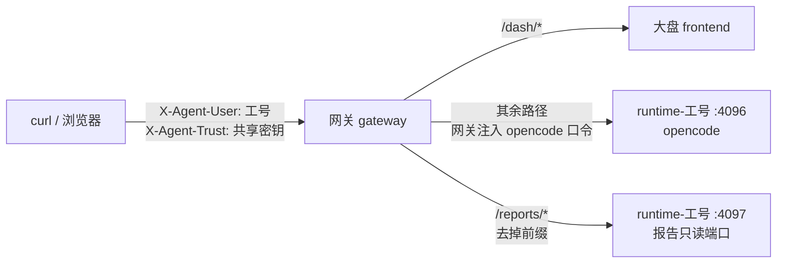

# 测试手册：经网关用「工号 + 密钥」调用接口

适用：**网关模式**（网关按工号建用户容器）。池化模式的调用方式见《池化接入手册》。

本手册的每条命令都在本地测试集群上真跑过，「实际输出」是那一次的原样结果：

| 项 | 值 |
|---|---|
| 验证日期 | 2026-10-14 |
| 集群 | Mac + OrbStack 自带 k8s，单节点 |
| 镜像 | 网关、前端、用户容器均为 `main-954b1cb-oc1.18.27` |
| 模型 | `deepseek-flash` |
| 执行方式 | 本手册的 14 个代码块在 zsh（macOS 默认 shell）里按顺序原样执行，全部通过，退出码 0；唯一改动是 §1.3 用本地已有的令牌。那一遍发现 §6 清理后端口转发仍在后台，已改 §1.2 的写法并单独复验 |

---

## 0. 调用关系



调用方只带两个请求头：

| 请求头 | 值 | 来源 |
|---|---|---|
| `X-Agent-User` | 工号，小写字母、数字与 `-` | 生产由 SSO / 反向代理认完人后填入 |
| `X-Agent-Trust` | 共享密钥 | Secret `gateway-auth` 里的 `TRUST_SECRET` |

**不需要 opencode 的口令。** 网关从 Secret `pod-auth-<工号>` 读出口令，转发时自己注入；调用方看不到它。

---

## 1. 准备

### 1.1 变量

以下命令在 bash 或 zsh 里都能直接粘贴执行。

```bash
CTX=orbstack                 # kubectl 上下文。客户测试环境换成自己的
NS=gaussdb-agent
k(){ kubectl --context "$CTX" -n "$NS" "$@"; }   # 用函数而不是 K="kubectl ..."：zsh 不拆分变量，那种写法会报 command not found

PORT=18180                   # 本机转发到网关的端口，挑一个没被占用的
GW=http://127.0.0.1:$PORT
STAFF=u9510                  # 测试工号。用一个从没用过的：用过的工号 NAS 上有历史，④ 的会话数会更多
OTHER=u9511                  # 隔离测试用的第二个工号
DIR=/data/state/workspace    # 用户容器里的工作目录，建会话时带上

TRUST=$(k get secret gateway-auth -o jsonpath='{.data.TRUST_SECRET}' | base64 -d)
ADMIN=$(k get secret gateway-auth -o jsonpath='{.data.ADMIN_TOKEN}' | base64 -d)
H=(-H "X-Agent-Trust: $TRUST" -H "X-Agent-User: $STAFF")
```

### 1.2 把网关转发到本机

```bash
# 这一行直接写 kubectl、不用函数 k：放到后台的函数是一个子 shell，$! 记下的是它，
# §6 kill 掉的也是它，kubectl 本身会留在后台一直占着端口（实跑时踩到过）
kubectl --context "$CTX" -n "$NS" port-forward svc/gateway $PORT:80 > /tmp/gw-pf.log 2>&1 &
PF=$!                        # 记下进程号，§6 清理时用
sleep 3; curl -s $GW/healthz; echo
```

实际输出：

```
{"ok": true, "version": "gaussdb-agent-gateway"}
```

`/healthz` 不鉴权，只说明网关在跑。

### 1.3 开通两个测试工号

网关建用户容器前，要求这个工号的 GRMP 令牌 Secret 已经存在；**网关不创建它**。

```bash
TOKEN='<中间件为该用户签发的令牌>'
# 本地测试集群没有真中间件，可复用已开通工号的令牌：
# TOKEN=$(k get secret grmp-token-u9400 -o jsonpath='{.data.GRMP_AUTH_TOKEN}' | base64 -d)
for U in $STAFF $OTHER; do
  k create secret generic grmp-token-$U --from-literal=GRMP_AUTH_TOKEN="$TOKEN"
done
```

实际输出：

```
secret/grmp-token-u9510 created
secret/grmp-token-u9511 created
```

---

## 2. 六类接口

### ① 健康检查 `GET /global/health`

一个工号**第一次**调用任何接口时，网关会为他现建用户容器并等它就绪，再转发。

```bash
k get deploy runtime-$STAFF                     # 调用前：还没有容器
curl -s -m 150 -w '\nHTTP %{http_code}  用时 %{time_total}s\n' "${H[@]}" $GW/global/health
curl -s -m 30  -w '\nHTTP %{http_code}  用时 %{time_total}s\n' "${H[@]}" $GW/global/health
k get deploy runtime-$STAFF                     # 调用后：网关已建好
```

实际输出：

```
Error from server (NotFound): deployments.apps "runtime-u9510" not found
{"healthy":true,"version":"1.18.27"}
HTTP 200  用时 6.070867s
{"healthy":true,"version":"1.18.27"}
HTTP 200  用时 0.008595s
NAME            READY   UP-TO-DATE   AVAILABLE   AGE
runtime-u9510   1/1     1            1           6s
```

**判断**：200 且 `healthy: true`。第一次约 6 秒（本地，镜像已在节点上）；某台节点第一次运行要先拉镜像，可能 10–30 秒。
**命令挂着超过 30 秒不返回**，说明这个人的容器起不来（网关最多原地等 120 秒，期间屏幕上什么都没有），见 §7。

### ② 建会话 `POST /session`

```bash
R=$(curl -s -m 30 "${H[@]}" -H 'Content-Type: application/json' -d '{"title":"curl-test"}' "$GW/session?directory=$DIR")
S=$(printf '%s' "$R" | python3 -c 'import json,sys;print(json.load(sys.stdin)["id"])')
printf '%s' "$R" | python3 -c 'import json,sys;d=json.load(sys.stdin);print({k:d[k] for k in ("id","title","directory")})'
```

实际输出：

```
{'id': 'ses_ec690cfddffeuPGJo14D3sQYuW', 'title': 'curl-test', 'directory': '/data/state/workspace'}
```

**判断**：返回 `ses_` 开头的会话 ID，`directory` 是 `/data/state/workspace`。
**`directory` 参数要带上**：opencode 按工作目录区分项目，不带的话会话落在别的项目下，浏览器的项目页里看不到。

### ③ 发消息 `POST /session/{id}/message`

同步接口：模型跑完才返回。诊断类问题要几分钟，`-m` 给足，调用方不要设短超时。

```bash
curl -s -m 300 "${H[@]}" -H 'Content-Type: application/json' \
  -d '{"parts":[{"type":"text","text":"只回四个字:安装成功"}]}' \
  "$GW/session/$S/message?directory=$DIR" | python3 -c '
import json,sys
m=json.load(sys.stdin)
print("role =", m["info"]["role"], "| model =", m["info"].get("modelID"), "| error =", m["info"].get("error"))
print("回复 =", "".join(p.get("text","") for p in m["parts"] if p.get("type")=="text"))'
```

实际输出（这条很短的回复约 2 秒）：

```
role = assistant | model = deepseek-flash | error = None
回复 = 安装成功
```

**判断**：回复里有「安装成功」，`error` 为空。返回 200 但回复为空时看 `error`，多半是模型服务地址或 key 不对。
不想等的话用异步接口 `POST /session/{id}/prompt_async`（立即返回 204），再查会话记录。

### ④ 列会话 `GET /session`

```bash
curl -s -m 30 "${H[@]}" "$GW/session?directory=$DIR" | python3 -c 'import json,sys;s=json.load(sys.stdin);print("会话数",len(s),[x["title"] for x in s])'
```

实际输出：

```
会话数 1 ['curl-test']
```

### ⑤ 大盘 `GET /dash/...`

`/dash/*` 由网关转给大盘前端，不建用户容器、不注入口令。

```bash
curl -s -o /dev/null -w '%{http_code}\n' "${H[@]}" $GW/dash/health
curl -s -o /dev/null -w '%{http_code}\n' "${H[@]}" $GW/dash/lib/shell.js
curl -s "${H[@]}" $GW/dash/health | grep -o '<title>[^<]*</title>'
```

实际输出：

```
200
200
<title>GaussDB 智能体 · 大盘</title>
```

**判断**：都是 200。页面上有没有数据，取决于这个人跑没跑过对应的技能。

### ⑥ 报告 `GET /reports/...`

`/reports/*` 由网关去掉前缀，转给**本人**容器的 4097 报告只读端口。

```bash
code(){ curl -s -o /dev/null -w '%{http_code}' -m 30 "$@"; }
curl -s "${H[@]}" $GW/reports/whoami.json; echo
echo "health/latest.json → $(code "${H[@]}" $GW/reports/health/latest.json)"
echo "_kb/catalog.json   → $(code "${H[@]}" $GW/reports/_kb/catalog.json)"
echo "越界路径           → $(code --path-as-is "${H[@]}" $GW/reports/../gdaa/config.yaml)"
```

实际输出：

```
{"user_id": "u9510"}
health/latest.json → 404
_kb/catalog.json   → 200
越界路径           → 404
```

**判断**：
- `whoami.json` 返回的就是请求头里的工号；
- 新工号没跑过健康检查，`health/latest.json` 是 404；在会话里跑过一次健康检查后变成 200；
- `_kb/catalog.json` 是知识库大盘的目录，200；
- 越界路径必须是 404：报告端口只端本人 `reports/` 目录里的文件。`--path-as-is` 让 curl 原样发出 `../`，不加的话 curl 会先替你化简掉。

---

## 3. 异常分支（这些必须失败）

```bash
echo "不带密钥     → $(code -H "X-Agent-User: $STAFF" $GW/global/health)"
echo "密钥错误     → $(code -H "X-Agent-Trust: wrong-secret-0000000000" -H "X-Agent-User: $STAFF" $GW/global/health)"
echo "工号格式非法 → $(code -H "X-Agent-Trust: $TRUST" -H "X-Agent-User: ../u9400" $GW/global/health)"
echo "不带工号     → $(code -H "X-Agent-Trust: $TRUST" $GW/global/health)"
curl -s -w '  HTTP %{http_code}\n' -H "X-Agent-Trust: $TRUST" -H "X-Agent-User: u9502" $GW/global/health
k get deploy runtime-u9502
```

实际输出：

```
不带密钥     → 403
密钥错误     → 403
工号格式非法 → 403
不带工号     → 403
您的环境尚未开通,请联系管理员为您开通后再登录。  HTTP 503
Error from server (NotFound): deployments.apps "runtime-u9502" not found
```

| 情况 | 期望 | 说明 |
|---|---|---|
| 不带密钥 / 密钥错误 / 工号格式非法 / 不带工号 | **403**，正文「无法确认身份。请经统一认证入口访问。」 | 四种情况回同一句话，不告诉试探者是哪一步没过 |
| 工号没开通（缺 `grmp-token-<工号>`） | **503**「您的环境尚未开通」，**且不建容器** | 网关日志里写明缺的是哪个 Secret |

---

## 4. 隔离与持久化

### 4.1 两个工号互相看不见

```bash
H2=(-H "X-Agent-Trust: $TRUST" -H "X-Agent-User: $OTHER")
curl -s -m 150 "${H2[@]}" "$GW/session?directory=$DIR" | python3 -c 'import json,sys;s=json.load(sys.stdin);print(len(s),[x["title"] for x in s])'
curl -s "${H2[@]}" $GW/reports/whoami.json; echo
curl -s "${H[@]}"  "$GW/session?directory=$DIR" | python3 -c 'import json,sys;s=json.load(sys.stdin);print(len(s),[x["title"] for x in s])'
```

实际输出：

```
0 []
{"user_id": "u9511"}
1 ['curl-test']
```

**判断**：`$OTHER` 第一次调用时网关给他现建了自己的容器，看不到 `$STAFF` 的会话。

### 4.2 容器被回收后再登录，历史还在

闲置回收（默认闲置 30 分钟后缩到 0）用手工缩容模拟：

```bash
k scale deploy runtime-$STAFF --replicas=0
k wait --for=delete pod -l user=$STAFF --timeout=120s
curl -s -m 150 -w '\nHTTP %{http_code}  用时 %{time_total}s\n' "${H[@]}" $GW/global/health
curl -s "${H[@]}" "$GW/session?directory=$DIR" | python3 -c 'import json,sys;s=json.load(sys.stdin);print(len(s),[x["title"] for x in s])'
```

实际输出：

```
deployment.apps/runtime-u9510 scaled
pod/runtime-u9510-54677b99d-xfvmx condition met
{"healthy":true,"version":"1.18.27"}
HTTP 200  用时 9.053817s
1 ['curl-test']
```

**判断**：网关把容器重新拉起来，之前的会话还在——停止时状态已写回 NAS，拉起时又载入。

---

## 5. 浏览器访问 opencode Web

浏览器自己加不了那两个请求头。生产环境由 SSO / 反向代理认完人后注入；本地用仓库里的
`scripts/k8s/sso-sim.py` 扮演 SSO：它监听一个本机端口，给每个请求加上工号与密钥，再转给网关。
它只用 Python 标准库，不进镜像，只监听 127.0.0.1。

```bash
umask 077; printf %s "$TRUST" > /tmp/gw-trust          # 密钥放文件，不出现在进程参数里
python3 scripts/k8s/sso-sim.py 18181 $PORT $STAFF /tmp/gw-trust > /tmp/gw-sso.log 2>&1 &   # 在仓库根目录执行
SSO=$!
sleep 2; cat /tmp/gw-sso.log
curl -s -o /dev/null -w '%{http_code}\n' http://127.0.0.1:18181/L2RhdGEvc3RhdGUvd29ya3NwYWNl
```

实际输出：

```
模拟 SSO:http://127.0.0.1:18181 → 网关 127.0.0.1:18180,工号 u9510
200
```

然后在浏览器里打开：

| 地址 | 打开的是 |
|---|---|
| `http://127.0.0.1:18181/L2RhdGEvc3RhdGUvd29ya3NwYWNl` | opencode Web，进入工作目录这个项目，左侧是这个工号的会话列表 |
| `http://127.0.0.1:18181/L2RhdGEvc3RhdGUvd29ya3NwYWNl/session/<会话ID>` | 直接打开某个会话，例如 ② 建的 `curl-test` |
| `http://127.0.0.1:18181/dash/health` | 四个大盘 |

- 那一串 `L2RhdGEvc3RhdGUvd29ya3NwYWNl` 是 `/data/state/workspace` 的 base64url，是 opencode 的项目路由。
  直接打开根路径 `/` 也能进，但那一页的项目列表存在浏览器本地，第一次打开是空的，要从项目路由进。
- 2026-10-14 用无头 Chrome 打开一个会话地址实测：页面显示会话「curl-test」，消息「只回四个字:安装成功」与模型回复「安装成功」，底部输入框显示模型 `deepseek-flash`。
- `sso-sim.py` 一次只代表一个工号。要换人，换个监听端口再起一个。
- 生产环境浏览器经 SSO 访问网关地址，路径相同。

---

## 6. 清理

控制接口用 `X-Admin-Token`（Secret `gateway-auth` 的 `ADMIN_TOKEN`），不是工号 + 密钥。`ADMIN_TOKEN` 为空时整组接口返回 404。

```bash
curl -s -H "X-Admin-Token: $ADMIN" $GW/admin/pods/$STAFF; echo
for U in $STAFF $OTHER; do curl -s -X DELETE -H "X-Admin-Token: $ADMIN" $GW/admin/pods/$U; echo; done
k get deploy,svc,secret | grep -E "$STAFF|$OTHER" || echo 无
kill $PF $SSO; rm -f /tmp/gw-trust /tmp/gw-pf.log /tmp/gw-sso.log   # 停掉端口转发与 sso-sim
```

实际输出：

```
{"user_id": "u9510", "exists": true, "ready": true, "last_activity": 1791964967.0}
{"user_id": "u9510", "removed": true, "note": "NAS 上的会话/历史/上传文件保留,下次登录挂回来即恢复"}
{"user_id": "u9511", "removed": true, "note": "NAS 上的会话/历史/上传文件保留,下次登录挂回来即恢复"}
无
```

`DELETE` 删掉这个工号的 Deployment、Service、`grmp-token-<工号>`、`pod-auth-<工号>`；NAS 上的 `users/<工号>/` 保留。
`$PF`、`$SSO` 只在同一个终端里有；换了终端就用 `pkill -f "port-forward svc/gateway $PORT"` 与 `pkill -f "sso-sim.py 18181"`。

---

## 7. 排查

| 现象 | 原因 | 怎么查 |
|---|---|---|
| curl 挂着超过 30 秒不返回，最后 504 | 这个人的容器起不来（常见：NAS 挂载失败、拉不到镜像、个人目录属主不对写不进去） | `k get pod -l user=$STAFF`；不是 `1/1 Running` 就 `k describe pod -l user=$STAFF` 看最后的 Events，`k logs -l user=$STAFF` 看启动脚本输出 |
| 503「您的环境尚未开通」 | 缺 `grmp-token-<工号>` | §1.3 |
| 403「无法确认身份」 | 密钥不对、工号没带或格式非法 | 核对 `$TRUST`；工号只能是小写字母、数字与 `-` |
| 502「无法连接到您的环境」 | 容器就绪了但连不上 | 网关日志 `k logs deploy/gateway --tail=50` |
| ③ 返回 200 但回复为空 | 模型服务不通或 key 不对 | 看返回里的 `info.error` |
| `/dash/*` 502「大盘服务未部署或不可达」 | 前端没部署或没就绪 | `k get deploy frontend` |
| zsh 里报 `command not found: kubectl --context ...` | 把命令放进变量再展开，zsh 不拆分 | 用 §1.1 的函数 `k` |

---

## 8. 结果对照

| # | 检查 | 期望 | 2026-10-14 实测 |
|---|---|---|---|
| ① | `GET /global/health`（首次 / 再次） | 200，首次网关现建容器 | 200，6.07 秒 / 0.01 秒 |
| ② | `POST /session` | 返回 `ses_` 会话 ID | 通过 |
| ③ | `POST /session/{id}/message` | 模型回复「安装成功」 | 通过 |
| ④ | `GET /session` | 会话数 1 | 通过 |
| ⑤ | `GET /dash/health`、`/dash/lib/shell.js` | 200 | 通过 |
| ⑥ | `GET /reports/whoami.json` 等 | 本人工号；新工号报告 404；知识库目录 200；越界 404 | 通过 |
| 异常 | 不带密钥 / 密钥错 / 工号非法 / 不带工号 | 403 | 通过 |
| 异常 | 未开通的工号 | 503，且不建容器 | 通过 |
| 隔离 | 另一个工号列会话 | 看不到别人的会话 | 通过 |
| 持久化 | 缩到 0 后再调用 | 200，会话仍在 | 通过，9.05 秒（同日另一轮 3.04 秒） |
| 浏览器 | 经 `sso-sim.py` 打开项目路由与会话页 | 页面显示会话内容 | 通过 |
